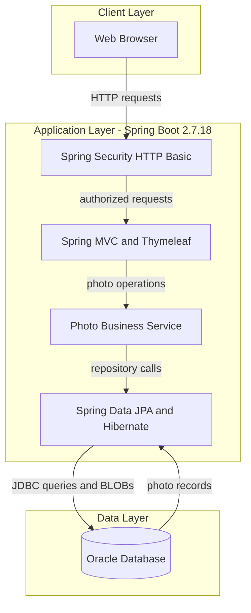
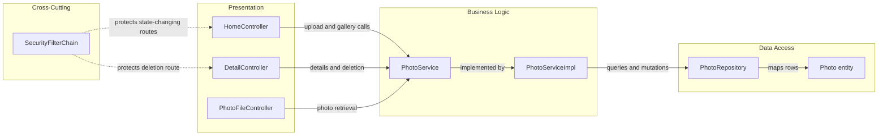

# Architecture Diagram

Photo Album is a single Spring Boot web application backed by an Oracle database. The application serves gallery pages and photo content directly, with no gateway or external service integrations identified.

## Application Architecture

### Technology Stack Summary

| Layer | Technology | Version | Purpose |
|---|---|---|---|
| Presentation | Spring MVC and Thymeleaf | Spring Boot 2.7.18; Thymeleaf 3.0.15.RELEASE | Server-rendered gallery and detail pages; upload and photo responses |
| Application | Java | 8 | Photo upload, retrieval, navigation, and deletion logic |
| Security | Spring Security | 5.7.11 | HTTP Basic authentication on state-changing requests |
| Persistence | Spring Data JPA and Hibernate | 2.7.18 / 5.6.15.Final | Repository and ORM access |
| Database | Oracle Database Free | `gvenzl/oracle-free:latest` in Compose | Photo metadata and binary image storage |
| Runtime packaging | Docker Compose | Not pinned | Runs the application and Oracle database containers |

### Data Storage & External Services

Photo records and image bytes are stored in Oracle as a relational entity with BLOB content. There is no cache, message broker, object-storage provider, or external API integration identified; the only separately deployed dependency is the Oracle database container.

### Key Architectural Decisions

- Uses a layered MVC → service → Spring Data repository pattern.
- Stores image bytes in the database rather than on a file system or object store.
- Uses Oracle-specific native SQL for photo navigation, reporting, and pagination.

## Component Relationships

### Component Inventory

| Component | Layer | Type | Responsibility |
|---|---|---|---|
| HomeController | Presentation | Spring MVC controller | Displays gallery and accepts multipart uploads |
| DetailController | Presentation | Spring MVC controller | Displays photo details, previous/next navigation, and handles deletion |
| PhotoFileController | Presentation | Spring MVC controller | Serves stored photo bytes |
| PhotoService / PhotoServiceImpl | Business Logic | Service interface and implementation | Validates uploads and coordinates photo retrieval, persistence, and deletion |
| PhotoRepository | Data Access | Spring Data JPA repository | Persists photos and runs Oracle-specific queries |
| Photo | Data Access | JPA entity | Represents image data and its display metadata |
| SecurityFilterChain | Cross-Cutting | Spring Security configuration | Requires HTTP Basic authentication for upload and deletion requests |
