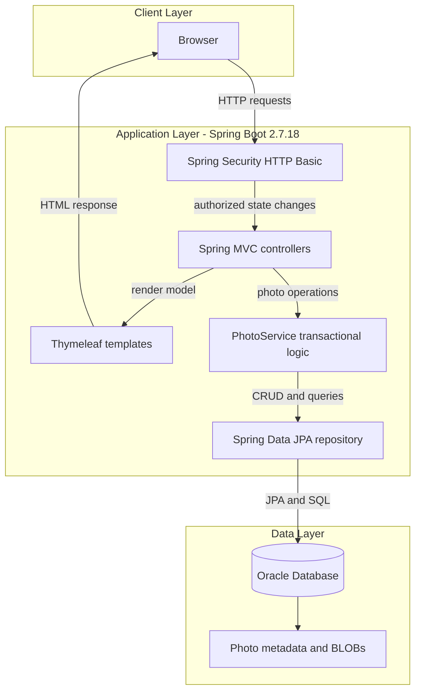
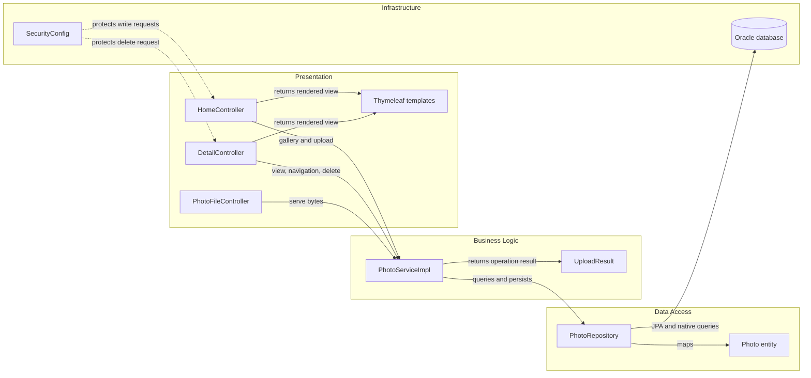

# Architecture Diagram

Photo Album is a single Spring MVC application that renders a server-side gallery and handles photo operations. Uploaded image data and metadata are persisted together in Oracle.

## Application Architecture

### Technology Stack Summary

| Layer | Technology | Version | Purpose |
|---|---|---|---|
| Presentation | Spring MVC and Thymeleaf | Spring Boot 2.7.18 | Server-rendered gallery and detail pages |
| Security | Spring Security, HTTP Basic | 5.7.11 | Protect upload and delete operations |
| Business Logic | Java | 8 | Photo upload, retrieval, navigation, deletion |
| Persistence | Spring Data JPA and Hibernate | 2.7.18 / 5.6.15.Final | Data access and transactions |
| Database | Oracle Database | Oracle Free container image | Photo metadata and binary storage |

### Data Storage & External Services

Oracle is the production/default database; each `Photo` record stores metadata and image bytes as a BLOB. H2 is used only by the test profile. No cache, message broker, or external API integration was identified.

### Key Architectural Decisions

- A single deployable Spring Boot application owns the presentation, business, and persistence layers.
- Photo payloads are stored in the relational database rather than on the application filesystem.
- Reads are public, while upload and delete operations use stateless HTTP Basic authentication.

## Component Relationships

### Component Inventory

| Component | Layer | Type | Responsibility |
|---|---|---|---|
| HomeController | Presentation | MVC controller | Displays gallery and accepts multipart uploads |
| DetailController | Presentation | MVC controller | Displays one photo, navigates adjacent photos, and deletes |
| PhotoFileController | Presentation | MVC controller | Returns stored photo bytes |
| PhotoServiceImpl | Business Logic | Spring service | Validates and coordinates photo operations |
| PhotoRepository | Data Access | Spring Data repository | Persists photos and runs ordered/navigation queries |
| Photo | Data Access | JPA entity | Represents photo metadata and content |
| SecurityConfig | Infrastructure | Security configuration | Configures HTTP Basic and authorization |
