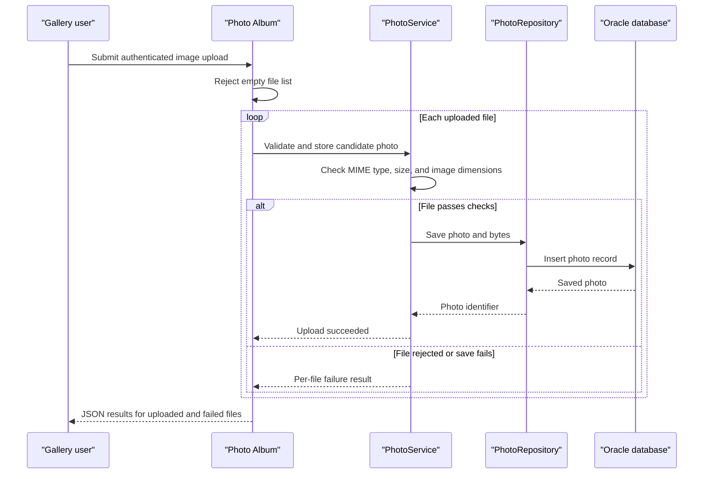

# Core Business Workflows

Photo Album lets a user browse a gallery, upload image files, view individual photos, navigate adjacent uploads, and delete photos. Photos and their metadata are managed as one business concept.

## Domain Entities

| Entity | Service / Bounded Context | Description | Key Relationships |
|---|---|---|---|
| Photo | photo-album / Photo Library | An uploaded image plus its display metadata and content | No other persistent entities; each photo is independently addressable |

## Service-to-Domain Mapping

| Service | Domain Context | Owned Entities | External Dependencies |
|---|---|---|---|
| photo-album | Photo Library | Photo | Oracle database |

## Primary Workflows

### Workflow 1: Upload photos

1. An authenticated user submits one or more multipart files to `/upload`.
2. `HomeController` rejects an empty list, then invokes `PhotoService.uploadPhoto` for each supplied part.
3. The service checks the submitted MIME type against its allowlist and checks non-empty content and per-file size. It reads image dimensions when an ImageIO reader recognizes the bytes and rejects images above the configured pixel ceiling.
4. The service generates an identifier/name, stores the original bytes and metadata on `Photo`, and saves through `PhotoRepository`.
5. The endpoint returns per-file successes and failures. A failed file does not prevent subsequent files in the list from being attempted.

### Workflow 2: Browse and view a photo

1. A visitor opens the gallery; the controller retrieves photos newest-first and renders the page.
2. Selecting a photo loads its details and asks the service for older/newer items for navigation.
3. The page requests the photo resource by identifier; the controller returns the database BLOB using the stored MIME type.

### Workflow 3: Delete a photo

1. An authenticated user submits a delete action for a photo identifier.
2. The service looks up the entity; if absent it reports no deletion.
3. If present, the service deletes it transactionally and the controller redirects to the gallery with a success or error message.

## Cross-Service Data Flows

No cross-service composition is implemented. The browser communicates with one application service, which reads and writes Oracle through the repository. Oracle health is a deployment prerequisite in Docker Compose; there is no application-level fallback store.

## Business Workflow Sequence

## Business Rules & Decision Logic

- Accepted MIME values are JPEG, PNG, GIF, and WebP; validation currently relies on the multipart request's declared content type.
- A photo must be non-empty and not exceed the configured 10 MiB per-file limit; multipart request size is configured to 50 MiB.
- Image dimensions are checked from headers when ImageIO identifies a reader; photos over 40 million pixels are rejected.
- The configuration specifies a maximum of 10 files per upload, but the inspected controller does not enforce that limit.
- Uploads report results per file; a failed item does not halt processing of later items.
- Upload and delete require HTTP Basic authentication; reading the gallery and photos is public.
- Photo service operations use transactional boundaries; no multi-service transaction, compensation, audit subsystem, or explicit state machine was identified.
