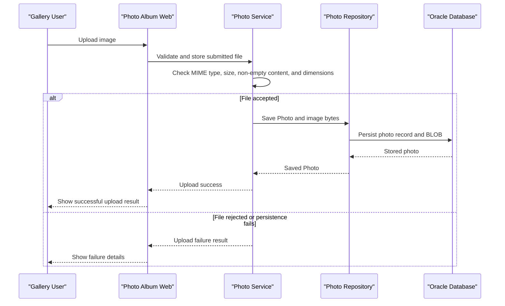

# Core Business Workflows

Photo Album lets users upload images, browse a shared gallery, inspect image metadata, navigate between photos, and delete records. The primary domain is a single photo collection rather than multiple user-owned albums or service-specific bounded contexts.

## Domain Entities

| Entity | Service / Bounded Context | Description | Key Relationships |
|---|---|---|---|
| Photo | Photo Album / Photo Gallery | An uploaded image and the metadata needed to display, retrieve, navigate, and remove it | Each photo is an independent gallery item; no other domain entity is modeled |
| UploadResult | Photo Album / Upload Processing | Result of an individual upload attempt, including success or failure information | Produced by the upload service and consumed by the upload controller; not persisted |

## Service-to-Domain Mapping

| Service | Domain Context | Owned Entities | External Dependencies |
|---|---|---|---|
| Photo Album | Photo Gallery and Upload Management | Photo records; transient UploadResult responses | Oracle database for persistent photo records and image bytes |

The application is a monolith with a shared Oracle schema. No cross-service domain exchange or separate source-of-truth boundary was found.

## Primary Workflows

### Workflow 1: Upload Photos

1. A client submits files through `POST /upload`.
2. `HomeController` delegates each file to `PhotoServiceImpl.uploadPhoto`.
3. The service checks the declared MIME type, configured per-file size limit, non-empty content, and image dimensions (up to 40 million pixels when a reader recognizes the image).
4. Accepted bytes and metadata are persisted as a `Photo` record in Oracle; rejected items are returned as failed upload results.
5. The controller collects successful and failed results into a JSON response. An empty file list receives HTTP 400; per-file validation failures are included in a normal upload response.

### Workflow 2: Browse and Navigate Photos

1. A client opens the gallery page at `GET /`; the controller retrieves photos ordered newest first and renders the gallery.
2. Selecting a photo opens `GET /detail/{id}`. The application loads the record and requests older/newer records for navigation.
3. Photo content is retrieved separately through `GET /photo/{id}`, which returns the database BLOB with the persisted MIME type.
4. Missing IDs or missing image bytes result in a redirect or not-found response, depending on the request.

### Workflow 3: Delete a Photo

1. An authenticated client submits `POST /detail/{id}/delete`.
2. The service finds the photo by ID and deletes the entity from Oracle.
3. The controller redirects to the gallery with a success or not-found message; unexpected errors are logged and surfaced as a generic failure message.

## Cross-Service Data Flows

There are no cross-service data composition or gateway aggregation flows. The Photo Album application is the only business service and reads/writes its photo data directly through the repository to Oracle. Compose waits for the database container's health check before starting the application, but there is no runtime service-to-service fallback behavior.

## Business Workflow Sequence

## Business Rules & Decision Logic

- The configured MIME allowlist is JPEG, PNG, GIF, and WebP; the service also checks the configured 10 MiB file limit and rejects empty files.
- If an image reader identifies dimensions, uploads exceeding 40 million pixels are rejected; unrecognized image content can proceed without dimensions.
- Each stored photo receives a generated UUID-based identifier and a generated storage filename; original filename and MIME type are retained as metadata.
- Gallery results are ordered by upload time. Detail navigation queries for photos before and after the current upload timestamp.
- Upload and deletion service methods operate transactionally. Spring Security requires HTTP Basic authentication for upload and deletion; gallery reads remain public.
- No multi-step compensation, event-driven workflow, audit trail, or explicit lifecycle state machine was identified.
