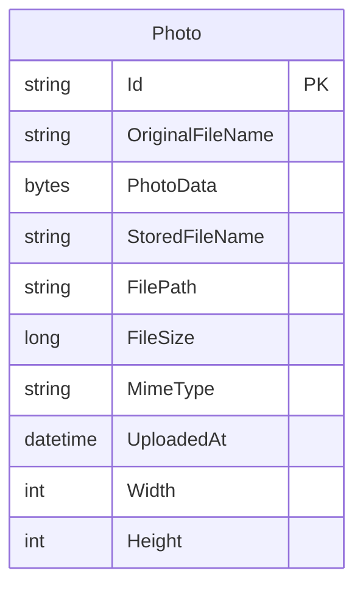

# Data Architecture & Persistence Layer

The data layer contains one JPA entity, `Photo`, backed by Oracle in normal and Docker execution and H2 in tests. Hibernate manages the entity model and the repository combines inherited CRUD operations with Oracle-specific native queries.

## Database Configuration

| Service/Module | DB Type | Profile | Driver | Connection | Migration Tool |
|---|---|---|---|---|---|
| photo-album | Oracle | default | Oracle JDBC | Oracle Free service; URL is externally overridable | None detected; schema generated at startup |
| photo-album | Oracle | docker | Oracle JDBC | `oracle-db:1521/FREEPDB1` via environment override | None detected; schema generated at startup |
| photo-album tests | H2 | test | H2 | In-memory `jdbc:h2:mem:testdb` | None; schema created and dropped for tests |

## Data Ownership per Service

| Service | Tables Owned | ORM Framework | Caching | Notes |
|---|---|---|---|---|
| photo-album | `photos` | Hibernate via Spring Data JPA | None detected | Stores image metadata and BLOB content in the same record |

## Entity Model

`Photo` is defined in `src/main/java/com/photoalbum/model/Photo.java`. No entity relationships or other persistent domain entities were identified. The service implementation uses transactional boundaries for mutations and read-only transactions for read operations.

## Key Repository Methods

| Service | Repository | Notable Methods | Purpose |
|---|---|---|---|
| photo-album | `PhotoRepository` (`src/main/java/com/photoalbum/repository/PhotoRepository.java`) | `findAllOrderByUploadedAtDesc()` | Retrieves all photos newest-first |
| photo-album | `PhotoRepository` | `findPhotosUploadedBefore(LocalDateTime)` | Finds older photos for previous-photo navigation |
| photo-album | `PhotoRepository` | `findPhotosUploadedAfter(LocalDateTime)` | Finds newer photos for next-photo navigation |
| photo-album | `PhotoRepository` | `findPhotosByUploadMonth(String, String)` | Filters by month using Oracle `TO_CHAR` |
| photo-album | `PhotoRepository` | `findPhotosWithPagination(int, int)` | Applies Oracle `ROWNUM` pagination |
| photo-album | `PhotoRepository` | `findPhotosWithStatistics()` | Returns Oracle analytic statistics |

## Caching Strategy

No application cache, cache provider, cache annotations, or Hibernate second-level cache configuration was identified.

## Data Ownership Boundaries

The application is a single service with one Oracle database; there are no separate service-owned stores or cross-service database access patterns. Reads and writes go through `PhotoService` and `PhotoRepository`; the service is the source of truth for photo metadata and bytes. There is no CQRS or cross-service aggregation.

### Data Classification & Sensitivity

| Entity | Sensitive Fields | Classification (PII/PHI/PCI/None) | Controls in Place |
|---|---|---|---|
| Photo | User-uploaded image content; original filename may include identifying information | Potential PII depending on uploaded content | No application-level encryption, masking, or field-level access controls identified; database-at-rest controls are not established by repository configuration |
