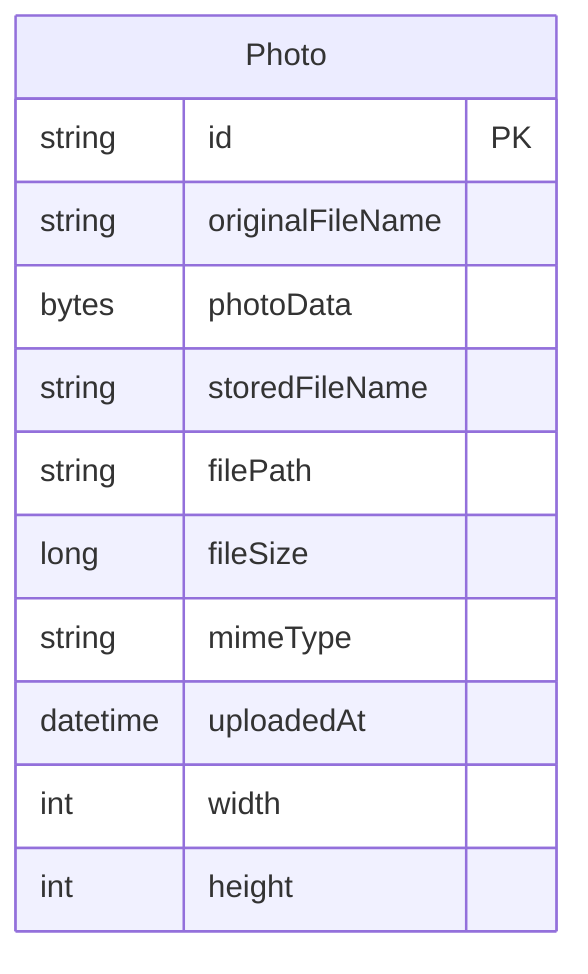

# Data Architecture & Persistence Layer

The persistence model contains one photo entity managed through Spring Data JPA/Hibernate. Oracle is the configured application database, with H2 used only by the test profile; image bytes are persisted as database BLOBs.

## Database Configuration

| Service / Module | DB Type | Profile | Driver | Connection | Migration Tool |
|---|---|---|---|---|---|
| Photo Album | Oracle | Default | Oracle JDBC `ojdbc8` 21.5.0.0 | JDBC URL can be overridden with `SPRING_DATASOURCE_URL`; default points at the Compose Oracle service | None detected; Hibernate creates the schema on startup |
| Photo Album | Oracle | `docker` | Oracle JDBC `ojdbc8` 21.5.0.0 | Compose service `oracle-db` on port 1521; credentials supplied through environment variables | None detected; Hibernate creates the schema on startup |
| Photo Album tests | H2 in-memory | `test` | H2 2.1.214 | In-memory `testdb` | None detected; Hibernate creates and drops the schema for tests |

## Data Ownership per Service

| Service | Tables Owned | ORM Framework | Caching | Notes |
|---|---|---|---|---|
| Photo Album | `photos` (Photo) | Hibernate via Spring Data JPA | None detected | Photo bytes and metadata share the same entity/database; Oracle is the configured runtime database |

## Entity Model

`Photo` is the only JPA entity found; it has a UUID string primary key and no entity relationships or foreign keys. Upload and deletion service operations are transactional. Image data is stored in the `photo_data` BLOB column; original filename and MIME type are also persisted as metadata. Source: `src/main/java/com/photoalbum/model/Photo.java`.

## Key Repository Methods

| Service | Repository | Notable Methods | Purpose |
|---|---|---|---|
| Photo Album | `PhotoRepository` (`Photo`) | `findAllOrderByUploadedAtDesc()` | Returns photos ordered newest first |
| Photo Album | `PhotoRepository` (`Photo`) | `findPhotosUploadedBefore(LocalDateTime)` | Retrieves up to ten older photo records for navigation |
| Photo Album | `PhotoRepository` (`Photo`) | `findPhotosUploadedAfter(LocalDateTime)` | Retrieves newer photo records for navigation |
| Photo Album | `PhotoRepository` (`Photo`) | `findPhotosByUploadMonth(String, String)` | Filters photos by upload year and month using Oracle `TO_CHAR` |
| Photo Album | `PhotoRepository` (`Photo`) | `findPhotosWithPagination(int, int)` | Applies Oracle `ROWNUM`-based pagination |
| Photo Album | `PhotoRepository` (`Photo`) | `findPhotosWithStatistics()` | Returns photo records with rank and running file-size calculations |

The repository extends `JpaRepository<Photo,String>` and includes native, parameterized Oracle queries. Source: `src/main/java/com/photoalbum/repository/PhotoRepository.java`.

## Caching Strategy

No application cache provider, cache annotations, cache regions, or second-level Hibernate cache configuration was detected. Photo reads are served from repository/database operations; the gallery adds a timestamp for browser cache busting, not server-side data caching.

## Data Ownership Boundaries

The single application owns all photo records in one Oracle schema. There are no service-isolated stores, cross-service queries, CQRS projections, or cross-service aggregation flows. The test profile substitutes an in-memory H2 database and does not provide production Oracle behavior parity for Oracle-specific native SQL.

### Data Classification & Sensitivity

| Entity | Sensitive Fields | Classification | Controls in Place |
|---|---|---|---|
| Photo | `photoData` may contain identifiable images; `originalFileName` may contain personal information | Potential personal data / image content | No field-level encryption or masking is evident in the application configuration; database storage is used for BLOBs |

No explicit user profile, health, payment-card, or credential entity was found. The contents of user-uploaded images and filenames are user-controlled and may contain personal information.
