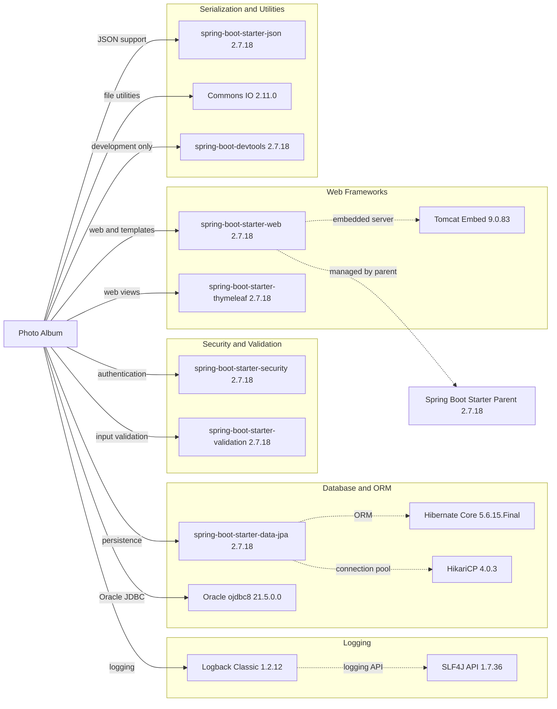

# Dependency Map

Photo Album declares 11 direct Maven dependencies and resolves 101 dependency coordinates across compile, runtime, and test scopes. The diagram highlights direct application dependencies and notable transitive libraries; most Spring versions are managed by the Spring Boot parent POM.

## Dependencies

### Dependency Summary

| Category | Count | Key Libraries | Notes |
|---|---:|---|---|
| Web Frameworks | 2 direct | Spring Boot Web, Thymeleaf | Embedded Tomcat is transitive |
| Database / ORM | 2 direct | Spring Data JPA, Oracle JDBC | Hibernate and HikariCP are transitive |
| Security | 1 direct | Spring Boot Security | Spring Security 5.7.11 is resolved transitively |
| Validation | 1 direct | Spring Boot Validation | Hibernate Validator 6.2.5.Final is transitive |
| Serialization | 1 direct | Spring Boot JSON | Jackson 2.13.5 is transitive |
| Logging | Transitive | Logback, SLF4J, Log4j API | Supplied by Spring Boot starters |
| Utilities | 2 direct | Commons IO, Spring Boot DevTools | DevTools is optional; Commons IO is explicitly versioned |

### Version & Compatibility Risks

The project uses Spring Boot 2.7.18 and Java 8, both older platform baselines. Dependency advisory analysis identified vulnerabilities in resolved dependencies; detailed medium-and-higher findings are recorded in the security assessment. Commons IO is explicitly pinned to 2.11.0 while most Spring versions are parent-managed.

### Notable Observations

- The Spring Boot parent manages most direct and transitive versions; the parent is not separately counted among the 11 declared dependencies.
- Oracle JDBC is runtime-scoped; H2 is test-scoped, so the test database differs from production.
- The resolved dependency tree contains 73 compile, 2 runtime, and 26 test-scope coordinates (101 total).

## Test Dependencies

| Framework / Library | Version | Notes |
|---|---|---|
| Spring Boot Starter Test | 2.7.18 | Direct test dependency; brings JUnit, Mockito, AssertJ, Hamcrest, and Spring Test |
| JUnit Jupiter | 5.8.2 | Unit/integration test framework |
| Mockito | 4.5.1 | Mocking library |
| AssertJ | 3.22.0 | Fluent assertions |
| Hamcrest | 2.2 | Matchers |
| H2 | 2.1.214 | In-memory test database; direct test dependency |
| JSONPath / JSONAssert | 2.7.0 / 1.5.1 | Included through the Spring test starter |

Total test-scope dependencies: 26 resolved coordinates, including 2 direct test dependencies. The checked-in test suite currently contains a Spring context-load test; no dedicated repository integration, API contract, or container-test framework was identified.
