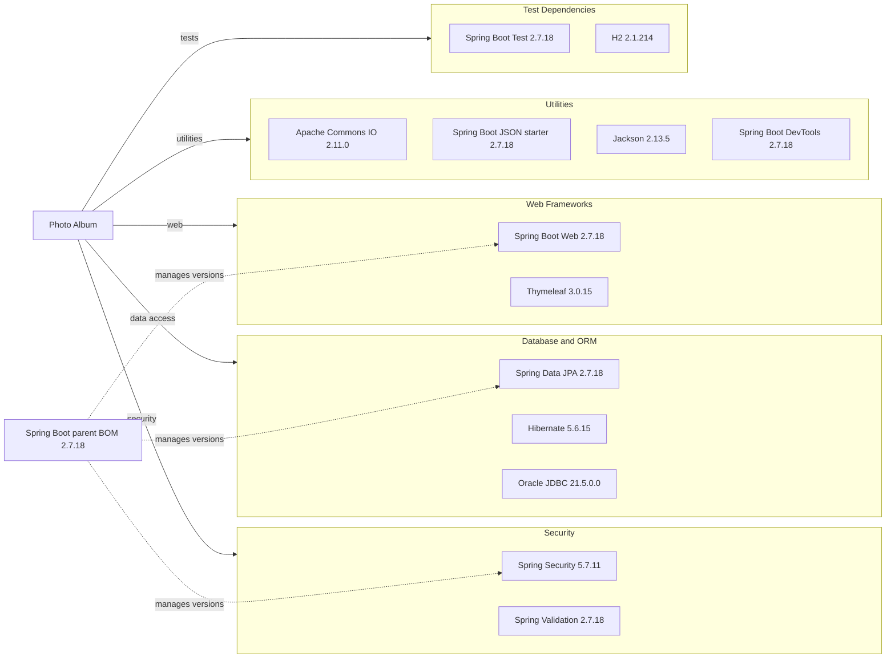

# Dependency Map

Photo Album declares 11 direct Maven dependencies. The Spring Boot 2.7.18 parent manages most transitive versions.

## Dependencies

### Dependency Summary

| Category | Count | Key Libraries | Notes |
|---|---:|---|---|
| Web Frameworks | 2 | Spring Boot Web, Thymeleaf | Server-side MVC and templates |
| Database / ORM | 3 | Spring Data JPA, Hibernate, Oracle JDBC | Oracle-specific SQL is used in repository queries |
| Security | 2 | Spring Security, Spring Validation | State-changing routes require Basic authentication |
| Utilities | 4 | Commons IO, Spring Boot JSON, Jackson, Spring Boot DevTools | DevTools is optional; Jackson is pulled by the JSON starter |
| Test | 2 | Spring Boot Test, H2 | Excluded from the production dependency diagram |

### Version & Compatibility Risks

Spring Boot 2.7.18 and its Spring Framework 5.3/Spring Security 5.7 dependency family are older than current supported release lines. Java 8 compatibility constrains upgrades, and Oracle-specific native queries and the JDBC driver should be included in any runtime/framework modernization review.

### Notable Observations

- Most Spring, Hibernate, Jackson, and test-library versions are inherited from the Spring Boot parent BOM.
- The Oracle JDBC driver has runtime scope; H2 is test-scoped.
- Native repository queries include Oracle-specific functions and pagination constructs.

## Test Dependencies

| Framework | Version | Notes |
|---|---|---|
| Spring Boot Test | 2.7.18 | JUnit 5, Mockito, AssertJ, and Spring test support are included transitively |
| H2 | 2.1.214 | In-memory test database |

Total test-scope dependencies: 2 direct dependencies. The Maven test starter provides the test framework; the observed test suite contains a context-load test.
