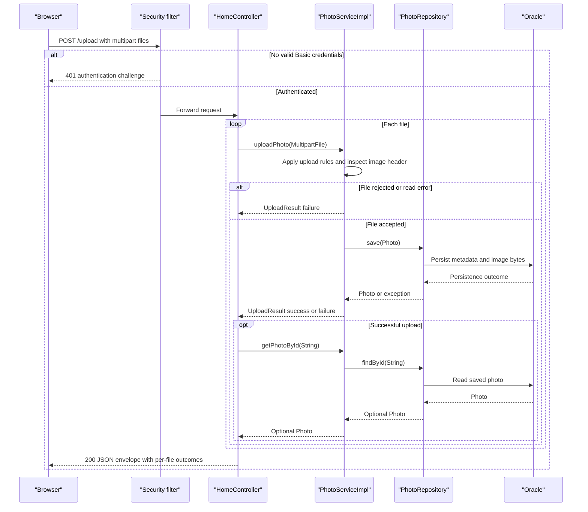

# API & Service Communication Contracts

Five explicit controller mappings expose HTML browsing, JSON multi-file upload feedback, binary photo delivery, and deletion by redirect. All application and database interactions are synchronous; no versioned API or inter-service gateway is defined.

## Service Catalog

| Service | Port | Category | Purpose |
|---|---|---|---|
| `photo-album` / Compose `photoalbum-java-app` | 8080 | Business | One source-built module; Spring MVC/Thymeleaf, Spring Security, Spring Data JPA |
| Compose `oracle-db` | 1521 | Infrastructure | Third-party Oracle Free container; not a source-built application module |

The Azure resource provisioning script is not evidence of a deployed application service or an additional runtime API.

## API Endpoints Inventory

| Service | Method | Path | Request Type | Response Type |
|---|---|---|---|---|
| Photo Album / `HomeController` | GET | `/` | No typed request | 200 HTML `index` model; database failures produce an empty-gallery model |
| Photo Album / `HomeController` | POST | `/upload` | `multipart/form-data`, repeated required `files` parts bound to `List<MultipartFile>` | 200 JSON `Map<String,Object>` with `success`, `uploadedPhotos`, `failedUploads`; empty supplied collection returns 400 with `success=false` and `error`; missing required binding normally yields framework 400 |
| Photo Album / `DetailController` | GET | `/detail/{id}` | String path ID | 200 HTML `detail`; absent/invalid ID or load failure redirects to `/` (normally 302) |
| Photo Album / `DetailController` | POST | `/detail/{id}/delete` | String path ID; no body model | Redirect to `/` (normally 302) with success/error flash attribute |
| Photo Album / `PhotoFileController` | GET | `/photo/{id}` | String path ID; browser may append an ignored cache-busting query | 200 `ResponseEntity<Resource>` using stored MIME type; 404 for absent record or empty bytes; 500 for caught serving errors |

Upload results can mix successes and failures in one 200 response. Even when every file fails business checks, the normal controller result is 200 with `success=false`, not a per-file HTTP error. Multipart transport limits are framework-level constraints; no custom exception-to-status mapping is defined. Both POST mappings require authentication; unauthenticated requests receive the Basic authentication challenge/401.

## Management & Observability Endpoints

| Service | Endpoint | Custom Metrics (if any) |
|---|---|---|
| Photo Album | No explicit management, health, OpenAPI, or Swagger endpoint found | No custom metrics or metrics exporter found |
| Oracle container | No HTTP management endpoint defined in application source | Container command health check, not an application HTTP contract |

No Actuator dependency is declared. Framework fallback error handling is not an explicitly authored business endpoint.

## DTOs & Contracts

- `Photo` is a mutable service-owned entity used in HTML models and selected upload response projections, not an exposed entity-wide JSON resource.
- `UploadResult` is a mutable per-file service outcome POJO. The controller converts it into success/failure maps; it is not returned directly.
- The upload envelope is an untyped map containing success and failure collections. There is no immutable DTO, gateway aggregation DTO, or explicit schema contract. Persistence fields are documented in `data-architecture.md`.
- MVC supplies normal Jackson JSON serialization through the JSON/web starters; there is no custom serializer or explicit date-format configuration. The browser converts the returned upload timestamp using `new Date(...)`.
- Binary delivery uses the recorded MIME type and includes `X-Photo-ID`, `X-Photo-Name`, and `X-Photo-Size` headers plus cache-prevention headers.
- No OpenAPI document, protobuf, GraphQL schema, API version qualifier, or versioning header was found in the analyzed application files.

## Communication Patterns

Browser-to-server HTTP, constructor-injected controller-to-service calls, and service-to-repository/JDBC calls are synchronous. Upload processing is sequential over files; it is not background or message-driven processing. No outbound REST client, broker, discovery client, gateway, aggregation across services, client-side load balancer, retry, circuit breaker, bulkhead, fallback service, or explicit network/request timeout is defined in application configuration.

Error degradation is local: gallery database errors render an empty gallery; detail lookup/errors redirect; image errors return 404/500; upload business failures appear in per-file results. There is no automatic replay or downstream retry. Database readiness gates local application startup; see `configuration-inventory.md` for the exact mechanism.

`SecurityConfig` configures stateless HTTP Basic with a BCrypt-encoded in-memory administrator. Upload and delete require an authenticated caller; the configured account has an ADMIN role, but endpoint rules use authentication rather than role/ownership checks. Reads and other unmatched requests are permitted. CSRF is disabled. No application-side TLS listener is configured; local Compose exposes HTTP. External TLS termination and deployed identity policies cannot be inferred from these files.

## Service Technology Matrix

| Service | Web | Data Access | Discovery | Gateway | Actuator | Cache | Metrics |
|---|---|---|---|---|---|---|---|
| Photo Album | MVC + Thymeleaf | JPA/Hibernate and Oracle-native SQL | None | None | None declared | No application cache | Logs only; no exporter found |
| Oracle container | Not an application web service | Oracle SQL | Compose service-name DNS | None | Not applicable | Not assessed inside third-party image | No exporter configured |

## Service Communication Sequence

The sequence summarizes service outcomes; a transaction completion failure or an uncaught post-save lookup error can still escape normal per-file handling. No circuit-breaker fallback exists to illustrate.

Evidence: `/home/runner/work/PhotoAlbum-Java/PhotoAlbum-Java/src/main/java/com/photoalbum/controller/`; `/home/runner/work/PhotoAlbum-Java/PhotoAlbum-Java/src/main/java/com/photoalbum/config/SecurityConfig.java`; `/home/runner/work/PhotoAlbum-Java/PhotoAlbum-Java/src/main/java/com/photoalbum/service/impl/PhotoServiceImpl.java`; `/home/runner/work/PhotoAlbum-Java/PhotoAlbum-Java/src/main/resources/static/js/upload.js`; `/home/runner/work/PhotoAlbum-Java/PhotoAlbum-Java/pom.xml`; `/home/runner/work/PhotoAlbum-Java/PhotoAlbum-Java/docker-compose.yml`.
