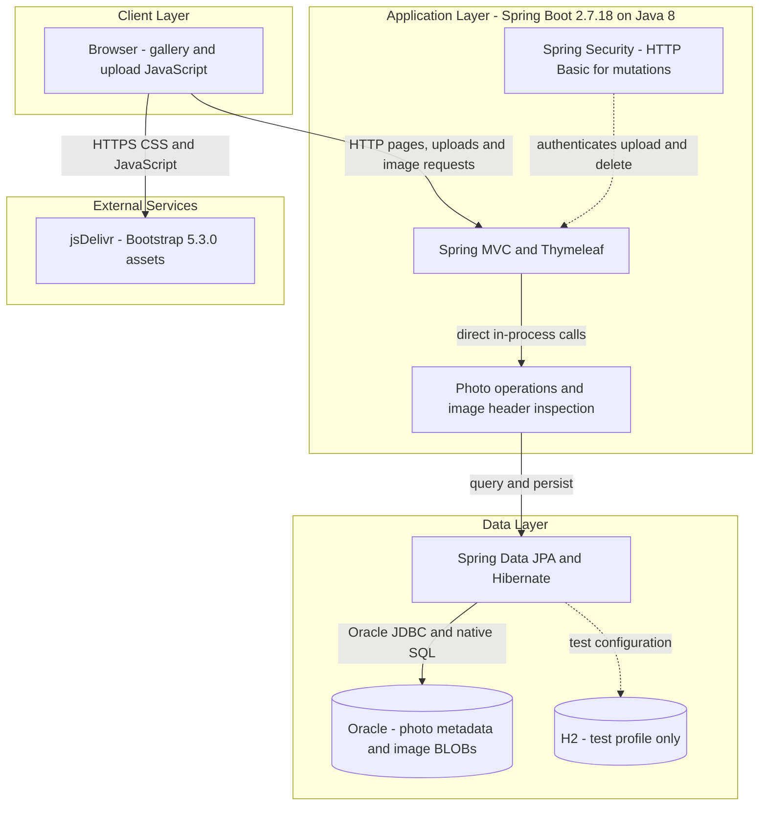
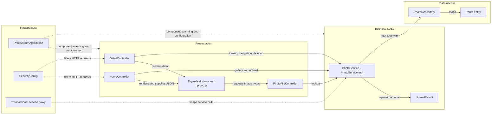

# Architecture Diagram

Photo Album is one deployable application with server-rendered pages, a multipart upload contract, and database-backed image delivery. These diagrams describe checked-in implementation and configuration, not verified running infrastructure.

## Application Architecture

### Technology Stack Summary

| Layer | Technology | Version | Purpose |
|---|---|---|---|
| Runtime | Java | 8 / POM `1.8` | Compile target and container runtime |
| Application | Spring Boot | 2.7.18 | Auto-configuration and executable JAR |
| Presentation | Spring MVC, Thymeleaf | Parent-managed; not pinned individually | HTML views, JSON upload result, binary image responses |
| Presentation | Bootstrap | 5.3.0 | Browser-loaded CDN assets |
| Security | Spring Security, BCrypt | Parent-managed | Stateless Basic authentication; in-memory administrator |
| Business | Java ImageIO | Java 8 API | Image header dimensions and pixel-count check |
| Persistence | Spring Data JPA, Hibernate | Parent-managed | Entity persistence and native queries |
| Database | Oracle JDBC `ojdbc8` | Parent-managed; exact resolved version not inspected | Runtime Oracle connectivity |
| Database | Oracle Free container | `latest` tag; exact version unpinned | Local database and persistent volume |
| Test persistence | H2 | Parent-managed; test scope | In-memory test database |
| Packaging | Maven / Temurin | Docker builder 3.9.6 / Java 8 | Multi-stage application image |

### Data Storage & External Services

Oracle holds both photo metadata and image bytes in one table; uploads do not write image files to disk. Legacy filename/path fields and one bundled static image remain for compatibility. Local Compose provides a persistent database volume, while the test profile selects H2. No application cache, message broker, or outbound business API client was found. Browser assets depend on jsDelivr. The separate Azure setup script provisions AKS, ACR, and PostgreSQL 15, but there is no corresponding PostgreSQL driver or runtime profile in the application; those resources are not represented as active application dependencies.

### Key Architectural Decisions

- Constructor injection connects controllers to a shared transactional service and one repository; there are no independently deployable domain microservices.
- The same database record owns metadata and BLOB content; the gallery query also selects BLOBs. Native Oracle queries create a database-specific persistence boundary.
- Reads are public; upload/delete require authentication. No application-side HTTPS listener is configured, and TLS termination outside the repository cannot be established.

## Component Relationships

### Component Inventory

| Component | Layer | Type | Responsibility |
|---|---|---|---|
| `HomeController` | Presentation | MVC controller | Gallery model and multi-file JSON upload outcome |
| `DetailController` | Presentation | MVC controller | Detail display, adjacent-photo lookup, delete redirect and flash feedback |
| `PhotoFileController` | Presentation | MVC controller | BLOB-to-resource response with no-store headers |
| `index.html`, `detail.html`, `layout.html`, `upload.js` | Presentation | Templates and browser client | Render gallery, navigate, submit uploads and display feedback |
| `PhotoService` / `PhotoServiceImpl` | Business | Interface and transactional service | Upload checks, image headers, photo CRUD and navigation |
| `UploadResult` | Business | Mutable result POJO | Per-file success/failure communication |
| `PhotoRepository` | Data access | Spring Data repository | CRUD and Oracle-native ordering/navigation/reporting queries |
| `Photo` | Data access | JPA entity | Photo metadata and binary content |
| `SecurityConfig` | Infrastructure | Configuration and filter chain | BCrypt administrator and stateless Basic authentication |
| `PhotoAlbumApplication` | Infrastructure | Bootstrap class | Start Spring application context |
| Transaction proxy | Infrastructure | Framework cross-cutting concern | Write transactions and explicit read-only query methods |
| `MathUtil` | Utility | Static helper | GCD function; no caller found in analyzed application sources |

Evidence: `/home/runner/work/PhotoAlbum-Java/PhotoAlbum-Java/pom.xml`; `/home/runner/work/PhotoAlbum-Java/PhotoAlbum-Java/Dockerfile`; `/home/runner/work/PhotoAlbum-Java/PhotoAlbum-Java/docker-compose.yml`; `/home/runner/work/PhotoAlbum-Java/PhotoAlbum-Java/src/main/java/com/photoalbum/`; `/home/runner/work/PhotoAlbum-Java/PhotoAlbum-Java/src/main/resources/templates/`; `/home/runner/work/PhotoAlbum-Java/PhotoAlbum-Java/azure-setup.ps1`.
