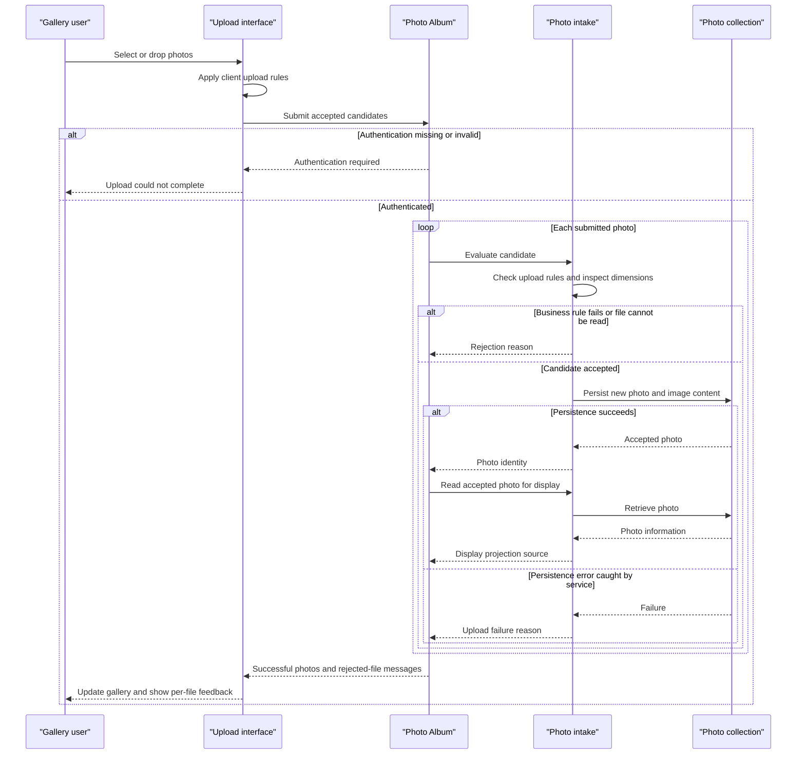

# Core Business Workflows

Users browse a shared photo gallery, open individual images, and move between older/newer uploads. Authenticated administrators can upload multiple files and delete photos; there are no user-owned albums, sharing invitations, or approval workflows.

## Domain Entities

| Entity | Service / Bounded Context | Description | Key Relationships |
|---|---|---|---|
| `Photo` | Photo Album / photo collection | An uploaded image and the information needed to display and navigate it | Standalone aggregate; no album, owner, or user entity |
| `UploadResult` | Photo Album / upload handling | Transient success/failure outcome for one submitted file | Refers to a newly accepted photo or identifies the rejected file; not persisted |

## Service-to-Domain Mapping

| Service | Domain Context | Owned Entities | External Dependencies |
|---|---|---|---|
| `PhotoServiceImpl` in the single Photo Album deployment | Photo intake, gallery reading, navigation and removal | `Photo`; constructs `UploadResult` | Repository/database and local image-header reader |
| Browser gallery/upload client | User interaction; not an independently deployed backend | No authoritative domain state | Photo Album HTTP contracts and CDN presentation assets |

This is one bounded context, not a multi-service domain. The service/repository is authoritative; newly rendered browser cards are only a projection of accepted photos.

## Primary Workflows

### Workflow 1: Submit Multiple Photos

1. A visitor selects/drops files. The browser applies the **Client upload allowlist and size** rules and shows local failures; accepted candidates proceed together.
2. Submission enters `POST /upload`. The security filter requires authentication before controller processing.
3. The controller checks for a provided file collection, then calls the service sequentially for each file.
4. The service applies **Server MIME allowlist**, **Nonempty bounded upload**, and **Image pixel budget** rules. It generates compatibility naming and attempts to inspect dimensions without fully decoding the image.
5. Accepted files become new photos with generated identities and upload times. Each service call persists metadata and content within its own transaction.
6. The controller reads each successful photo back to construct the response projection and collects failures separately.
7. The browser prepends successful photos to the gallery and displays rejected-file messages. Mixed outcomes are retained; successful uploads are not compensated because a different file failed.

There is no request-wide atomic batch, queue, deferred image processing, automatic retry, or deduplication stage.

### Workflow 2: Browse the Gallery and Navigate Photos

1. A public gallery visit loads all photos in newest-first order and renders their information.
2. Database errors are logged and degraded to an empty gallery, which can look like an empty collection rather than an outage.
3. Opening `GET /detail/{id}` loads the photo and queries both older and newer candidates. The service chooses the first result in each direction.
4. Missing photos or detail-loading failures redirect to the gallery. At collection boundaries, unavailable navigation links are omitted.
5. The browser separately requests the image bytes. Missing/empty content produces not-found; other caught serving errors produce a server-error response. No placeholder image fallback is implemented in the controller.

### Workflow 3: Delete a Photo

1. The detail page asks the user for a browser confirmation, then submits `POST /detail/{id}/delete`; authentication is required.
2. The service looks up the photo. If absent, it reports false; otherwise it deletes the database record including its content.
3. The controller redirects to the gallery with a success, not-found, or failure flash message.
4. Deletion is permanent at the application level: no recycle bin, soft delete, retention timer, or compensating restore is implemented.

## Cross-Service Data Flows

There is no gateway composition, distributed saga, domain event exchange, or separate photo-storage service. Browser requests, controller/service delegation, and database operations form one synchronous path. Upload responses combine per-file outcomes within one application, not responses from downstream business services.

The application joins nothing across services: image content and display information belong to the same photo record. When database access fails, local error behavior varies by entry point as described above; there is no circuit-breaker or alternate service fallback.

## Business Workflow Sequence

This depicts ordinary handled outcomes, not a guarantee that commit-time failures or the post-save lookup are converted into per-file feedback.

## Business Rules & Decision Logic

| Rule | Implemented decision |
|---|---|
| Client upload allowlist and size | Browser accepts declared MIME `image/jpeg`, `image/png`, `image/gif`, `image/webp`, with an independent hard-coded maximum of 10 MiB per file |
| Server MIME allowlist | Service compares lowercased submitted content type to configured values; unsupported types fail. This is a declared-MIME check, not guaranteed signature validation |
| Nonempty bounded upload | Service rejects files larger than configured 10 MiB or of zero/nonpositive length; multipart transport separately limits individual/request payloads |
| Image pixel budget | When ImageIO finds a reader, header width times height must not exceed 40,000,000 pixels; rejection occurs before full image decode |
| Optional dimensions | No matching reader permits storage without dimensions. I/O failures cause upload failure; other caught dimension-extraction exceptions can permit continuation without dimensions |
| Collection required | Empty supplied file collection is rejected; missing required multipart binding is handled by the web framework |
| Maximum files setting | A value of 10 is declared, but no controller/service/browser count-enforcement logic was found |
| Entity validation | Original/stored filenames: nonblank, maximum 255; compatibility path maximum 500; file size non-null and positive; MIME nonblank, maximum 50; upload time non-null |
| Identity and naming | Entity identity is a UUID; stored filename is another UUID plus original extension. Names are not deduplicated, and no uniqueness rule is enforced for original filenames |
| Temporal navigation | Older/newer use strict timestamp comparisons; equal-timestamp records are not adjacent candidates under these rules |
| Request success | Overall upload `success` means at least one successful photo was added to the response list, not that every input succeeded |
| Lifecycle | Accepted photo becomes available for gallery reading; deletion removes it. There is no explicit domain status/state machine |

Entity validation is declared with Bean Validation annotations; no controller `@Valid` binding is used for these programmatically created photos. JPA validation can occur during persistence, so annotated entity validation and explicit service checks are different stages.

**Transactions:** the service's default transaction covers each write operation; read methods are marked read-only. The controller is not transactional across the batch. Persistence exceptions caught inside the service do not guarantee recovery from a rollback-only or commit-time error.

**Error handling:** service upload failures carry user-oriented messages; gallery read errors render empty results; detail errors redirect; image delivery returns status errors; deletion sets flash feedback. No custom domain exception hierarchy, dead-letter queue, compensation, or retry policy was found.

**Audit/logging:** upload and deletion successes, file identities, and failures are logged; image delivery additionally logs metadata and a byte prefix. There is no durable business audit entity, actor-linked change history, or event stream.

**Authorization:** reads are public and state changes require authentication. Although the in-memory account is assigned an ADMIN role, there is no explicit role predicate, per-photo ownership, tenant boundary, or authorization inside domain service methods.

Evidence: `/home/runner/work/PhotoAlbum-Java/PhotoAlbum-Java/src/main/resources/static/js/upload.js`; `/home/runner/work/PhotoAlbum-Java/PhotoAlbum-Java/src/main/resources/templates/index.html`; `/home/runner/work/PhotoAlbum-Java/PhotoAlbum-Java/src/main/resources/templates/detail.html`; `/home/runner/work/PhotoAlbum-Java/PhotoAlbum-Java/src/main/java/com/photoalbum/controller/`; `/home/runner/work/PhotoAlbum-Java/PhotoAlbum-Java/src/main/java/com/photoalbum/service/impl/PhotoServiceImpl.java`; `/home/runner/work/PhotoAlbum-Java/PhotoAlbum-Java/src/main/java/com/photoalbum/model/Photo.java`; `/home/runner/work/PhotoAlbum-Java/PhotoAlbum-Java/src/main/java/com/photoalbum/repository/PhotoRepository.java`; `/home/runner/work/PhotoAlbum-Java/PhotoAlbum-Java/src/main/java/com/photoalbum/config/SecurityConfig.java`.
