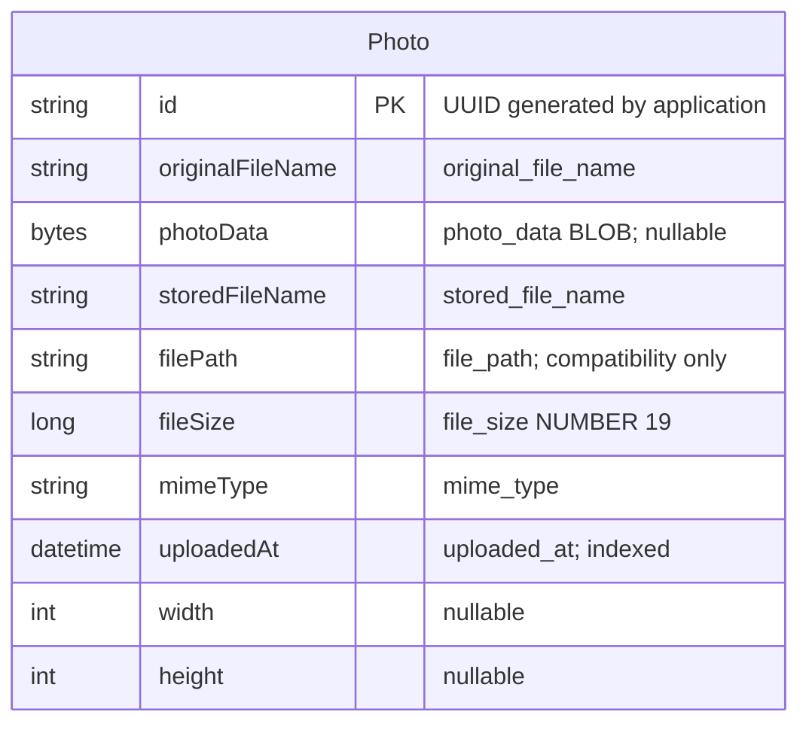

# Data Architecture & Persistence Layer

One JPA entity stores photo metadata and binary image content in Oracle; H2 is selected for the test profile. A single repository combines standard CRUD with six Oracle-native queries.

## Database Configuration

| Service/Module | DB Type | Profile | Driver | Connection | Migration Tool |
|---|---|---|---|---|---|
| `photo-album` | Oracle | Default | `oracle.jdbc.OracleDriver`, runtime `ojdbc8` | Environment-overridable JDBC endpoint; fallback uses Compose Oracle service and FREEPDB1; schema username/password injected | No Flyway/Liquibase; Hibernate recreates schema on startup |
| `photo-album` | Oracle | `docker` | Same Oracle driver | Same endpoint and credential sources as default | Same destructive schema recreation |
| `photo-album` | H2 | `test` | `org.h2.Driver`, test-scoped H2 | In-memory `testdb`; test-local credentials not reproduced | Hibernate creates and drops schema |
| Provisioning script only; not an application database profile | PostgreSQL 15 | None implemented | No PostgreSQL driver declared | Script constructs an Azure PostgreSQL JDBC URL, but application binding is not supplied | Script provisions database/user; not an application schema migration system |

No connection pool size or pool timeout is explicitly configured. The JPA starter normally supplies framework-managed pooling, but no resolved pool version was inspected. Oracle initialization scripts grant schema privileges and verify the user; they do not provide a versioned photo-table migration or domain seed data. The bundled static image is not a database seed routine. Recreating schema can discard existing photos despite persistence of the underlying Oracle volume. Property keys and deployment details belong to `configuration-inventory.md`.

## Data Ownership per Service

| Service | Tables Owned | ORM Framework | Caching | Notes |
|---|---|---|---|---|
| Photo Album | `photos` | JPA / Hibernate | No explicit application or second-level cache | One aggregate, no entity relationships or join tables; image bytes share the metadata record |

## Entity Model

Source: `/home/runner/work/PhotoAlbum-Java/PhotoAlbum-Java/src/main/java/com/photoalbum/model/Photo.java`.

| Java field/type | Persistence mapping |
|---|---|
| `id: String` | Assigned UUID string, primary key, length 36 |
| `originalFileName: String` | `original_file_name`, non-null, length 255 |
| `photoData: byte[]` | `photo_data`, `@Lob`, nullable; no explicit lazy-fetch annotation |
| `storedFileName: String` | `stored_file_name`, non-null, length 255; no unique constraint |
| `filePath: String` | `file_path`, nullable, length 500; compatibility metadata |
| `fileSize: Long` | `file_size`, non-null, Oracle-specific `NUMBER(19,0)` |
| `mimeType: String` | `mime_type`, non-null, length 50 |
| `uploadedAt: LocalDateTime` | `uploaded_at`, non-null, Oracle-specific `TIMESTAMP DEFAULT SYSTIMESTAMP`; constructor also sets local current time; nonunique `idx_photos_uploaded_at` |
| `width`, `height: Integer` | Nullable numeric columns |

There are no foreign keys, bidirectional mappings, cascades, owner/user relationships, optimistic-lock version fields, soft-delete fields, or explicit timezone policy. Validation constraints are inventoried once in `business-workflows.md`.

`PhotoServiceImpl` has class-level `@Transactional`; its four retrieval/navigation methods explicitly use `readOnly=true`. Upload/delete receive separate service-call transactions. A multi-file controller request does not have one transaction spanning every photo; post-upload lookup is another read-only service call.

## Key Repository Methods

Repository: `PhotoRepository extends JpaRepository<Photo,String>`, source `/home/runner/work/PhotoAlbum-Java/PhotoAlbum-Java/src/main/java/com/photoalbum/repository/PhotoRepository.java`. Standard `findById`, `save`, and `delete` are inherited and used by the service.

| Service | Repository | Notable Methods | Purpose |
|---|---|---|---|
| Photo Album | `PhotoRepository` | `List<Photo> findAllOrderByUploadedAtDesc()` | Gallery: explicit metadata and BLOB selection ordered newest first; unpaginated |
| Photo Album | `PhotoRepository` | `List<Photo> findPhotosUploadedBefore(LocalDateTime uploadedAt)` | Older-photo candidates, descending timestamp, Oracle `ROWNUM` cap of 10; service selects first |
| Photo Album | `PhotoRepository` | `List<Photo> findPhotosUploadedAfter(LocalDateTime uploadedAt)` | Newer-photo candidates ascending timestamp; `NVL` supplies a compatibility path; service selects first |
| Photo Album | `PhotoRepository` | `List<Photo> findPhotosByUploadMonth(String year, String month)` | Oracle `TO_CHAR` filters; no service caller found |
| Photo Album | `PhotoRepository` | `List<Photo> findPhotosWithPagination(int startRow, int endRow)` | Nested Oracle `ROWNUM` range selection; no service caller found |
| Photo Album | `PhotoRepository` | `List<Object[]> findPhotosWithStatistics()` | Native `RANK` and running `SUM` with metadata/BLOB columns; no service caller found |

All six custom methods use parameterized native SQL. Oracle-specific functions, row numbering, and column definitions limit portability to H2 or PostgreSQL; the H2 profile does not establish production-query compatibility.

## Caching Strategy

No Spring Cache annotations, Redis/EhCache/Caffeine/JCache dependency or configuration, explicit cache regions/TTL, or configured Hibernate second-level/query cache was found. Hibernate's normal transaction persistence context is not a shared application cache.

Binary responses deliberately prohibit browser/proxy storage with no-cache/no-store/private headers; browser JavaScript also adds cache-busting timestamps. Gallery rendering still queries complete records, including BLOBs; there is no separate thumbnail or metadata projection cache.

## Data Ownership Boundaries

One application owns one Oracle schema/table; there is no database-per-microservice topology, shared domain database access by other source-built services, cross-service join, or gateway aggregation. Reads and writes use the same entity/repository, not CQRS. Multiple app instances, if introduced, would share database records rather than a filesystem upload directory.

Photo metadata and content are persisted together. No object-store integration, audit history, retention/expiry policy, or soft-delete workflow is defined. The infrastructure script's PostgreSQL resources are a separate, unwired configuration path, not proof of replicated or migrated photo data.

### Data Classification & Sensitivity

| Entity | Sensitive Fields | Classification (PII/PHI/PCI/None) | Controls in Place |
|---|---|---|---|
| `Photo` | `photoData`, `originalFileName`, potentially image-embedded metadata; timestamp and dimensions can aid correlation | Potential PII in user-supplied images/names; no explicit PHI or PCI business fields | No application-level encryption-at-rest, masking, field-level authorization, or metadata stripping found; read access is public, mutations authenticated, responses no-store |
| `UploadResult` (nonpersisted) | Original filename and per-file error text | Potential PII in filename | No field masking; returned to uploading client |

Sensitive image content cannot be classified from schema alone; no inspection of image contents was performed. Oracle/container or cloud at-rest encryption settings cannot be established from application configuration. User credentials are configured separately, not persisted as photo entities.

Evidence also includes `/home/runner/work/PhotoAlbum-Java/PhotoAlbum-Java/src/main/java/com/photoalbum/service/impl/PhotoServiceImpl.java`; `/home/runner/work/PhotoAlbum-Java/PhotoAlbum-Java/src/main/java/com/photoalbum/controller/PhotoFileController.java`; `/home/runner/work/PhotoAlbum-Java/PhotoAlbum-Java/src/main/resources/application.properties`; `/home/runner/work/PhotoAlbum-Java/PhotoAlbum-Java/src/main/resources/application-docker.properties`; `/home/runner/work/PhotoAlbum-Java/PhotoAlbum-Java/src/test/resources/application-test.properties`; `/home/runner/work/PhotoAlbum-Java/PhotoAlbum-Java/oracle-init/`; `/home/runner/work/PhotoAlbum-Java/PhotoAlbum-Java/azure-setup.ps1`.
