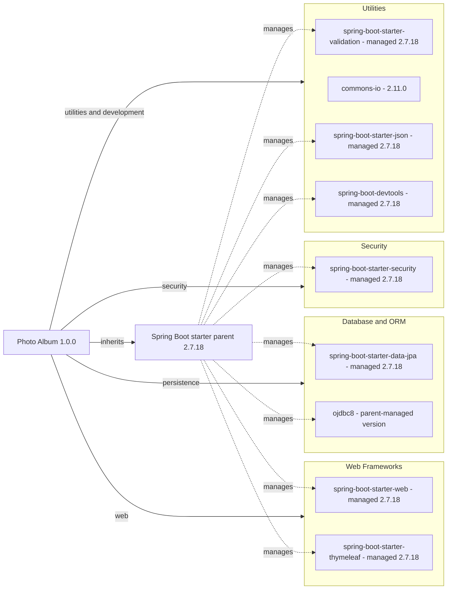

# Dependency Map

Photo Album declares 11 direct Maven dependencies: nine non-test and two test dependencies. This inventory uses the POM only; inherited versions are identified as managed rather than guessed, and no dependency resolution or build was performed.

## Dependencies

### Dependency Summary

| Category | Count | Key Libraries | Notes |
|---|---|---|---|
| Web Frameworks | 2 | `org.springframework.boot:spring-boot-starter-web`, `org.springframework.boot:spring-boot-starter-thymeleaf` | Compile scope by default; managed by parent 2.7.18 |
| Database / ORM | 2 | `org.springframework.boot:spring-boot-starter-data-jpa`, `com.oracle.database.jdbc:ojdbc8` | JPA compile scope; Oracle driver runtime scope; driver version inherited, not present in local POM |
| Security | 1 | `org.springframework.boot:spring-boot-starter-security` | Compile scope; managed by parent 2.7.18 |
| Utilities | 4 | `org.springframework.boot:spring-boot-starter-validation`, `commons-io:commons-io:2.11.0`, `org.springframework.boot:spring-boot-starter-json`, `org.springframework.boot:spring-boot-devtools` | Compile scope; DevTools is optional; all except Commons IO parent-managed |
| Messaging / Caching / Observability | 0 | None directly declared | No dedicated starter/client in these categories |

### Version & Compatibility Risks

The Spring Boot 2.7.18 and Java 8 baseline predates current major Spring generations; an upgrade crosses the Java baseline and Java EE-to-Jakarta compatibility boundary. Oracle `ojdbc8` is explicitly the runtime driver artifact, so changing databases requires more than a connection URL. Commons IO is explicitly pinned to 2.11.0 rather than left to central management. This is a compatibility inventory, not an advisory scan or a claim about specific CVEs; commercial support entitlements and resolved transitive versions were not assessed.

### Notable Observations

- `org.springframework.boot:spring-boot-starter-parent:2.7.18` is the sole declared parent. There are no explicit BOM imports, Maven modules, profiles, or lockfiles in this build.
- `org.springframework.boot:spring-boot-maven-plugin` is the only explicitly declared build plugin; its version is inherited. Target/source Java 8 and UTF-8 encoding are explicit.
- JSON is separately declared despite overlap with the web starter's usual dependency tree. The POM comment calls it image processing, but the declared artifact is the JSON starter, not a dedicated image-processing package.
- No resolved transitive graph is checked in. Framework-provided logging, pooling, ORM, serialization, and test libraries must not be counted as separately declared dependencies.

## Test Dependencies

| Framework | Version | Notes |
|---|---|---|
| `org.springframework.boot:spring-boot-starter-test` | Parent-managed 2.7.18 | Test scope; test framework/support bundle, not individually pinned child libraries |
| `com.h2database:h2` | Parent-managed; exact version not declared locally | Test scope; in-memory database support |

Total test-scope dependencies: 2

No Testcontainers, dedicated contract-testing dependency, or Oracle integration-test driver in test scope is separately declared. The starter bundles testing tools transitively, but their exact resolved versions are outside this static POM inventory.

Evidence: `/home/runner/work/PhotoAlbum-Java/PhotoAlbum-Java/pom.xml:8-110`.
