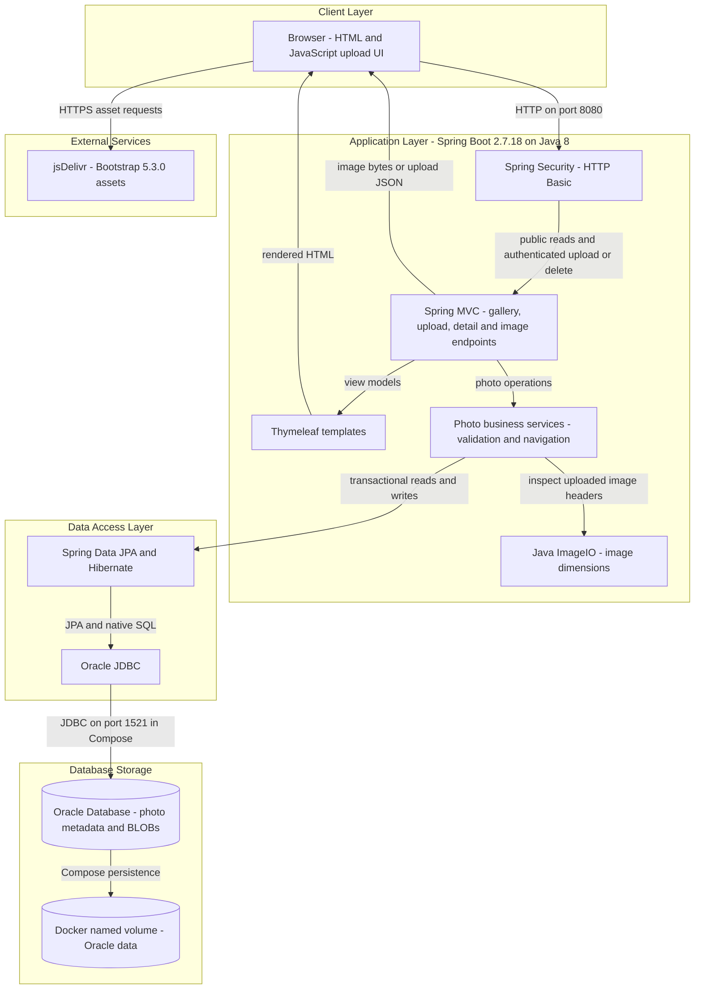
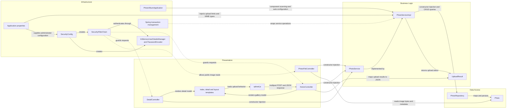

# Architecture Diagram

Photo Album is a single-module Java web application for uploading, browsing, viewing, and deleting images. This source-based assessment describes the implemented architecture and optional Docker Compose topology; it does not verify a running deployment.

## Application Architecture

### Technology Stack Summary

| Layer | Technology | Version | Purpose |
| --- | --- | --- | --- |
| Runtime | Java / Eclipse Temurin | Java 8 | Application runtime; Docker uses a Java 8 JRE |
| Build | Maven | 3.9.6 in Docker build stage | Builds the executable JAR |
| Application | Spring Boot | 2.7.18 | Auto-configuration and application startup |
| Presentation | Spring MVC, Thymeleaf | Managed by Spring Boot 2.7.18 | Server-rendered gallery and detail pages, multipart upload, binary image responses |
| Browser UI | JavaScript, Bootstrap | Bootstrap 5.3.0; JavaScript version unspecified | Drag-and-drop upload, dynamic gallery updates, styling |
| Security | Spring Security, BCrypt | Managed by Spring Boot 2.7.18 | Stateless HTTP Basic and in-memory administrator authentication |
| Business logic | Spring services, Java ImageIO | Boot-managed Spring; Java 8 ImageIO | Upload validation, image dimensions, photo navigation and deletion |
| Persistence | Spring Data JPA, Hibernate, Oracle JDBC ojdbc8 | Managed by Spring Boot 2.7.18 | Repository access, entity mapping, Oracle SQL execution |
| Database | Oracle Database | Compose uses Oracle Free image with mutable `latest` tag; exact version unspecified | Metadata and binary image storage |
| Packaging | Docker, Docker Compose | Runtime tool versions unspecified | Multi-stage JAR image and app/database service topology |

### Data Storage & External Services

The `photos` table stores UUID identifiers, filenames, size, MIME type, upload timestamp, dimensions, and image bytes in a BLOB. Uploads persist bytes in Oracle, and image requests read those bytes through the application; stored file paths are compatibility metadata, not the active upload storage mechanism. Compose defines separate application and Oracle containers on a bridge network, with a named Oracle data volume and mounted initialization scripts. Both application profiles configure Hibernate schema creation (`ddl-auto=create`), so a database volume alone does not guarantee preservation of application tables on restart. Browser pages load Bootstrap assets from jsDelivr. No cache, message broker, object-storage integration, or backend remote API client was identified in the inspected application source.

### Key Architectural Decisions

- A layered monolith uses constructor-injected controllers, a `PhotoService` interface and implementation, and a Spring Data repository; service-level transactions cover persistence operations.
- Images and metadata share the relational database. Native repository queries use Oracle-specific constructs, including `ROWNUM`, `NVL`, and `TO_CHAR`.
- Gallery and image reads are public; upload and delete POST routes require authentication. Security uses an in-memory administrator with BCrypt, stateless HTTP Basic, and disabled CSRF; configuration values and credentials are intentionally omitted.

## Component Relationships

### Component Inventory

| Component | Layer | Type | Responsibility |
| --- | --- | --- | --- |
| `PhotoAlbumApplication` | Infrastructure | Spring Boot entry point | Starts the application and enables component scanning and auto-configuration |
| `HomeController` | Presentation | MVC controller | Renders the gallery at `/` and handles multipart uploads at `/upload` with JSON results |
| `DetailController` | Presentation | MVC controller | Renders `/detail/{id}`, resolves adjacent photos, and handles deletion POST requests |
| `PhotoFileController` | Presentation | Binary-response controller | Serves `/photo/{id}` from stored bytes with MIME type and no-cache headers |
| `index.html`, `detail.html`, `layout.html` | Presentation | Thymeleaf templates | Gallery, photo detail, navigation, deletion forms, and layout markup |
| `upload.js`, `site.css` | Presentation | Browser assets | Drag-and-drop selection, client-side validation, asynchronous upload, gallery updates, and styling |
| `PhotoService` | Business Logic | Service interface | Defines upload, listing, lookup, deletion, and previous/next navigation operations |
| `PhotoServiceImpl` | Business Logic | Transactional Spring service | Validates MIME type and size, inspects dimensions with ImageIO, assigns stored filenames, and delegates persistence |
| `UploadResult` | Business Logic | Result model | Carries upload success, photo identifier, filename, and error details |
| `PhotoRepository` | Data Access | Spring Data JPA repository | Provides CRUD plus native Oracle queries for ordering, navigation, month filtering, pagination, and statistics |
| `Photo` | Data Access | JPA entity | Maps photo metadata and binary data to `photos`, including an upload-time index |
| `SecurityConfig` | Infrastructure | Spring configuration | Defines authorization policy, stateless HTTP Basic, and authentication beans |
| `SecurityFilterChain` | Infrastructure | Request filter chain | Intercepts HTTP requests and enforces authentication on mutation routes |
| `InMemoryUserDetailsManager`, `PasswordEncoder` | Infrastructure | Authentication beans | Hold the configured administrator in memory and encode its password with BCrypt |
| Application properties | Infrastructure | Externalized configuration | Configure datasource, JPA, multipart limits, logging, and profile-specific settings |
| Spring transaction management | Infrastructure | Cross-cutting transaction support | Applies service transactions and read-only semantics to retrieval operations |

Evidence: `/home/runner/work/PhotoAlbum-Java/PhotoAlbum-Java/pom.xml`; `/home/runner/work/PhotoAlbum-Java/PhotoAlbum-Java/Dockerfile`; `/home/runner/work/PhotoAlbum-Java/PhotoAlbum-Java/docker-compose.yml`; `/home/runner/work/PhotoAlbum-Java/PhotoAlbum-Java/src/main/resources/application.properties`; `/home/runner/work/PhotoAlbum-Java/PhotoAlbum-Java/src/main/resources/application-docker.properties`; Java components under `/home/runner/work/PhotoAlbum-Java/PhotoAlbum-Java/src/main/java/com/photoalbum`; templates under `/home/runner/work/PhotoAlbum-Java/PhotoAlbum-Java/src/main/resources/templates`; `/home/runner/work/PhotoAlbum-Java/PhotoAlbum-Java/src/main/resources/static/js/upload.js`.
