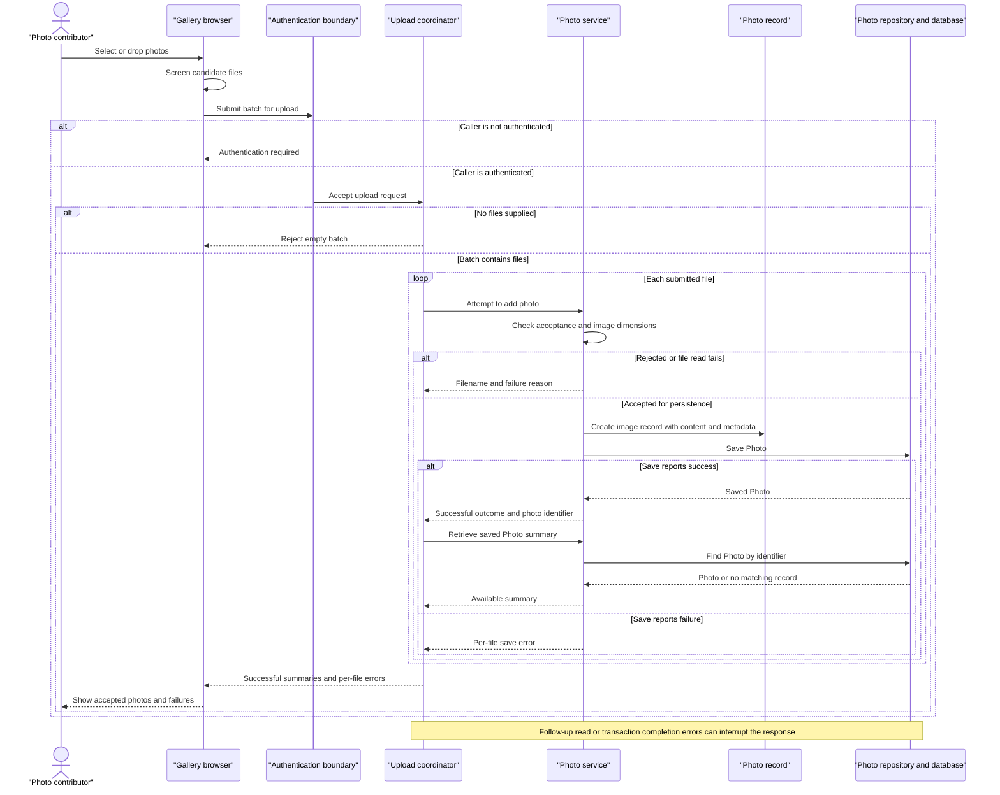

# Core Business Workflows

Photo Album lets visitors browse a shared photo collection, inspect individual images, and navigate by upload chronology. Authenticated users can add photos in batches and permanently remove photos.

## Domain Entities

| Entity | Service / Bounded Context | Description | Key Relationships |
|---|---|---|---|
| Photo | PhotoService / Photo Collection | An uploaded image and its descriptive information, managed as one business record. This is the sole persistent domain entity found. | Displayed in the shared gallery; related to older and newer photos through upload chronology, not explicit entity associations. |
| UploadResult | PhotoService / Upload Processing | A transient outcome for one attempted upload, not a persistent entity or aggregate. | Identifies the saved Photo on success, or associates the attempted filename with an error on failure. |

No separate Album, photo owner, tagging, or user-profile domain entities were found. The gallery is a collection view, not a stored album aggregate.

## Service-to-Domain Mapping

The application is a single deployable service. The following are internal responsibilities, not independently deployed microservices.

| Service | Domain Context | Owned Entities | External Dependencies |
|---|---|---|---|
| PhotoService / PhotoServiceImpl | Photo collection, upload acceptance, chronological navigation, removal | Photo; transient UploadResult | PhotoRepository and the database containing photo content and metadata |
| HomeController | Gallery presentation and batch-upload orchestration | None; composes Photo summaries and upload outcomes | Internal PhotoService; browser upload interface |
| DetailController | Individual-photo viewing and deletion feedback | None; composes current Photo and neighboring photo identifiers | Internal PhotoService |
| PhotoFileController | Delivery of stored image content | None; reads Photo content | Internal PhotoService |

PhotoService is the business entry to the repository; the database is the source of truth for both content and metadata. There is no separately owned media-storage service or cross-context identifier exchange.

## Primary Workflows

### Workflow 1: Upload a batch and publish accepted photos

1. A visitor selects or drops files in the gallery. The browser applies **Client upload screening**, then sends accepted candidates to `POST /upload`.
2. The security boundary requires authentication under **Mutation authorization**. The controller applies **Nonempty batch**.
3. The controller processes files sequentially through PhotoService. Each file follows **Server upload acceptance** and **Image dimension handling**.
4. For an accepted file, the service generates a compatibility filename and path, reads image content, optionally extracts dimensions, constructs a Photo, and saves its content and metadata together. The compatibility path is not a file-system write or the image-delivery source.
5. The service returns an UploadResult. For each successful result, the controller reads the Photo back and adds a summary to the batch response. Failed results become filename-associated errors.
6. **Batch outcome aggregation** permits partial success; accepted files are not intentionally undone because another file is rejected. The browser prepends returned photos to the gallery and shows per-file errors. Image content is fetched separately from `GET /photo/{id}`.

An upload can be stored without a returned summary if its follow-up lookup returns empty. A thrown follow-up lookup error is not caught by the upload controller, so response completion is not guaranteed even after earlier files have been saved.

### Workflow 2: Browse the gallery and navigate photo details

1. A visitor opens `GET /`. HomeController loads all photos through PhotoService and renders the gallery under **Gallery ordering**.
2. The browser requests image content separately for each displayed Photo identifier.
3. Selecting a photo opens `GET /detail/{id}`. DetailController loads the selected Photo, obtains older and newer neighbors under **Chronological navigation**, and renders metadata and available navigation links.
4. The detail image is delivered through `GET /photo/{id}` using the same stored Photo record.
5. Under **Read degradation**, gallery retrieval failure produces an empty gallery; a missing detail record or detail-loading exception redirects to the gallery. Missing image content produces a not-found response rather than a replacement image.

### Workflow 3: Permanently remove a photo

1. The detail page asks for browser confirmation before submitting `POST /detail/{id}/delete`; cancellation prevents that browser submission.
2. **Mutation authorization** is checked before the controller runs.
3. PhotoService looks up the Photo. A missing record returns a negative outcome; an existing record is deleted, including its stored image content.
4. DetailController sets success, not-found, or failure feedback and redirects to the gallery.

There is no soft-delete, trash, restore, approval, or separate media-cleanup workflow in the inspected implementation. Browser confirmation is not a server-side business precondition.

No scheduled jobs, message-driven business handlers, batch commands, or startup routines that initialize business records were found in the application sources. Repository methods for month filtering, pagination, and statistics have no traced controller/service workflow and are not treated as exposed business processes.

## Cross-Service Data Flows

There are no backend-to-backend business service calls, event exchanges, gateway aggregations, or circuit breakers in the inspected sources.

- **Batch composition:** HomeController combines per-file UploadResult outcomes with follow-up Photo reads into successful summaries and failed-upload messages. Summaries are associated by the saved Photo identifier.
- **Detail composition:** DetailController combines a current Photo with older and newer Photo identifiers from repository queries. This is in-process composition within one collection context.
- **Content delivery:** Gallery and detail pages refer to images by Photo identifier. Separate browser requests retrieve bytes from the same source-of-truth record; compatibility upload paths are not used for this delivery.
- **Availability outcomes:** Database read failures can appear as an empty gallery or a redirect rather than explicit unavailability. Image-serving exceptions return a server error; upload read/save failures generally become per-file errors. There is no alternative storage provider, queue, retry, or compensating operation.

## Business Workflow Sequence

## Business Rules & Decision Logic

### Validation and acceptance

- **Client upload screening:** The browser permits JPEG, PNG, GIF, and WebP MIME types and files up to 10 MiB. It does not reject zero-byte files or enforce a file-count limit.
- **Nonempty batch:** A null or empty file list is rejected with a bad-request response. Files missing at request binding may be rejected before controller execution.
- **Server upload acceptance:** A file's declared content type, lowercased, must match the configured allowed MIME types. Its size must be positive and no greater than the configured byte limit. Checked-in settings allow the same four image types and 10 MiB per file. A missing content type falls into the generic upload-error path.
- **Request envelope:** Checked-in multipart settings limit each file to 10 MB and the entire request to 50 MB; these limits can reject a request before per-file processing. A configured maximum of ten files is not consumed by the inspected upload controller, service, or browser script, so it is not an implemented file-count rule.
- **Image dimension handling:** Where an image reader recognizes the content, width multiplied by height must not exceed 40,000,000 pixels. Dimensions are read from the header. An I/O failure rejects the file; no reader or a non-I/O extraction exception permits continuation without dimensions. Declared MIME acceptance therefore does not guarantee recognized or fully decoded image content.
- **Photo metadata constraints:** Entity declarations require nonblank original and generated filenames, each at most 255 characters; a nonblank MIME type at most 50 characters; positive, nonnull file size; nonnull upload time; and a compatibility path at most 500 characters. Image dimensions are optional. These persistence constraints are distinct from explicit upload checks; image content is nullable in the entity and the delivery workflow handles absent content.

### Decisions and lifecycle

- **Batch outcome aggregation:** Each service upload is a separate transaction, not one batch-wide transaction. The controller marks overall success only when at least one saved Photo summary is included. Individual rejected uploads normally still produce an HTTP-success batch response containing failure details.
- **Gallery ordering:** All photos are retrieved newest first. Browser-inserted upload results are prepended; a full reload restores database timestamp ordering.
- **Chronological navigation:** Previous means the nearest strictly older upload; next means the nearest strictly newer upload. The service takes the first query result. Photos with equal upload timestamps are not neighbors through these strict comparisons, and no identifier tie-breaker is specified. Navigation ends when the relevant result list is empty.
- **Identity and uniqueness:** New Photos receive generated identifiers and upload timestamps; generated storage names retain the original extension. No content deduplication or original-filename uniqueness rule is implemented.
- **Lifecycle:** A candidate is rejected or becomes a persisted Photo; a persisted Photo can be viewed and permanently deleted. These are workflow outcomes, not a stored status state machine. There are no approval or archival states and no bidirectional entity relationships to maintain.
- **Presentation calculations:** File sizes are displayed in human-readable units and dimensions only when available; no pricing, quotas per user, or other calculated business totals are implemented.

### Cross-cutting behavior

- **Mutation authorization:** Upload and delete require an authenticated caller via HTTP Basic. The configured account is assigned an administrator role, but endpoint checks require authentication rather than explicitly testing that role. Read requests are public. No per-photo ownership restrictions exist in the inspected domain.
- **Transactions:** PhotoServiceImpl is transactional; lookup/list/navigation methods are read-only transactions. Photo content and metadata are saved or deleted through the same record. Some persistence errors can surface during transaction completion after the method's local save handling, so a caught save error is not a guarantee of a complete batch response.
- **Read degradation:** Gallery errors are logged and rendered as an empty collection, which can resemble a genuinely empty album. Detail errors or missing records redirect to the gallery. Image requests with blank identifiers, missing records, or absent bytes return not found; other serving failures return a server error. Image responses discourage caching, favoring current content over reuse.
- **Deletion errors:** Missing records yield not-found feedback; exceptions yield generic retry feedback. No explicit retry or compensation is implemented.
- **Audit and logging:** Upload acceptance/rejection, deletion, retrieval failures, and image serving are logged. Image-serving diagnostics also log a small content prefix. No persistent business audit entity, uploader attribution, or durable change history was found.

### Source evidence

All paths below are absolute; line ranges refer to the inspected implementation.

| Evidence | Source |
|---|---|
| Gallery loading, empty fallback, sequential upload aggregation and read-back | `/home/runner/work/PhotoAlbum-Java/PhotoAlbum-Java/src/main/java/com/photoalbum/controller/HomeController.java:37-98` |
| Upload checks, dimension handling, persistence, transactions and deletion | `/home/runner/work/PhotoAlbum-Java/PhotoAlbum-Java/src/main/java/com/photoalbum/service/impl/PhotoServiceImpl.java:28-237` |
| Photo business record, constraints and creation defaults | `/home/runner/work/PhotoAlbum-Java/PhotoAlbum-Java/src/main/java/com/photoalbum/model/Photo.java:15-108` |
| Transient upload outcome | `/home/runner/work/PhotoAlbum-Java/PhotoAlbum-Java/src/main/java/com/photoalbum/model/UploadResult.java:6-30` |
| Ordering and neighboring-photo queries; additional unexposed queries | `/home/runner/work/PhotoAlbum-Java/PhotoAlbum-Java/src/main/java/com/photoalbum/repository/PhotoRepository.java:16-100` |
| Detail composition, redirects and deletion feedback | `/home/runner/work/PhotoAlbum-Java/PhotoAlbum-Java/src/main/java/com/photoalbum/controller/DetailController.java:32-78` |
| Content lookup, missing bytes, error handling and diagnostic logging | `/home/runner/work/PhotoAlbum-Java/PhotoAlbum-Java/src/main/java/com/photoalbum/controller/PhotoFileController.java:37-87` |
| Authentication requirements and public reading | `/home/runner/work/PhotoAlbum-Java/PhotoAlbum-Java/src/main/java/com/photoalbum/config/SecurityConfig.java:38-61` |
| Browser screening, upload request, outcome presentation and gallery insertion | `/home/runner/work/PhotoAlbum-Java/PhotoAlbum-Java/src/main/resources/static/js/upload.js:60-202` |
| Gallery composition and image requests | `/home/runner/work/PhotoAlbum-Java/PhotoAlbum-Java/src/main/resources/templates/index.html:48-113` |
| Browser delete confirmation, image delivery, chronology links and metadata presentation | `/home/runner/work/PhotoAlbum-Java/PhotoAlbum-Java/src/main/resources/templates/detail.html:50-131` |
| Acceptance and multipart settings, inspected only for upload-related keys | `/home/runner/work/PhotoAlbum-Java/PhotoAlbum-Java/src/main/resources/application.properties`; `/home/runner/work/PhotoAlbum-Java/PhotoAlbum-Java/src/main/resources/application-docker.properties` |
| Startup entry without business-record initialization | `/home/runner/work/PhotoAlbum-Java/PhotoAlbum-Java/src/main/java/com/photoalbum/PhotoAlbumApplication.java:9-14` |
