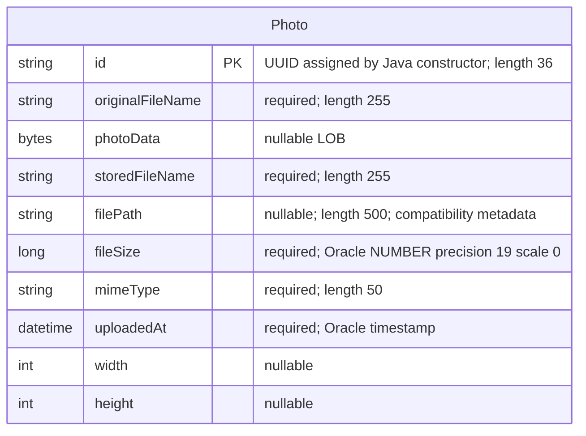

# Data Architecture & Persistence Layer

The data layer contains one JPA entity, `Photo`, persisted through Spring Data JPA and Hibernate to Oracle, with image bytes and metadata stored together. An H2 in-memory database is configured for the test profile.

## Database Configuration

| Service/Module | DB Type | Profile | Driver | Connection | Migration Tool |
|---|---|---|---|---|---|
| Photo Album | Oracle; local configuration identifies Oracle Database Free 23ai, but the image tag is floating | Default | `com.oracle.database.jdbc:ojdbc8`; `oracle.jdbc.OracleDriver` | Environment-overridable JDBC Thin connection to an Oracle pluggable database; authentication supplied externally; no explicit pool tuning found | No Flyway or Liquibase; Hibernate recreates the mapped schema at startup |
| Photo Album | Oracle | `docker` | Same Oracle runtime driver | Environment-overridable JDBC Thin connection; external credentials; no explicit pool tuning found | Hibernate recreates the mapped schema at startup |
| Photo Album tests | H2 in-memory | `test` | `com.h2database:h2` (test scope); `org.h2.Driver` | Process-local, in-memory JDBC database; H2 dialect | Hibernate creates the schema and drops it when the persistence factory closes |

- **Schema authority:** entity mappings, not versioned SQL migrations. Runtime profiles request schema recreation, so existing photo data can be lost across application restarts even if database storage survives.
- **Initialization:** Oracle initialization SQL grants schema privileges and checks account/database availability; it does not define `photos` or seed photo records. No photo seed SQL or programmatic data initializer was found in the inspected source.
- **Pooling:** the JPA starter normally supplies HikariCP through its JDBC dependencies; no application-defined datasource, pool sizes, or timeout overrides were found. This is dependency-based inference, not a runtime observation.
- **Portability:** repository queries use Oracle-specific SQL, and the entity includes Oracle-specific numeric and timestamp DDL. The H2 profile alone does not establish that these mappings or queries are compatible with H2.
- Full configuration-property inventory belongs in `configuration-inventory.md`; connection strings, credential values, and raw property assignments are intentionally omitted here.

Evidence:
- `/home/runner/work/PhotoAlbum-Java/PhotoAlbum-Java/pom.xml:43-54,88-93`
- `/home/runner/work/PhotoAlbum-Java/PhotoAlbum-Java/src/main/resources/application.properties:9-21`
- `/home/runner/work/PhotoAlbum-Java/PhotoAlbum-Java/src/main/resources/application-docker.properties:1-17`
- `/home/runner/work/PhotoAlbum-Java/PhotoAlbum-Java/src/test/resources/application-test.properties:1-10`
- `/home/runner/work/PhotoAlbum-Java/PhotoAlbum-Java/docker-compose.yml:2-14`
- `/home/runner/work/PhotoAlbum-Java/PhotoAlbum-Java/oracle-init/01-create-user.sql:7-30`
- `/home/runner/work/PhotoAlbum-Java/PhotoAlbum-Java/oracle-init/02-verify-user.sql:1-14`
- `/home/runner/work/PhotoAlbum-Java/PhotoAlbum-Java/oracle-init/healthcheck.sql:1-3`

## Data Ownership per Service

| Service | Tables Owned | ORM Framework | Caching | Notes |
|---|---|---|---|---|
| Photo Album (`PhotoServiceImpl`) | `photos` | JPA (`javax.persistence`), Hibernate, Spring Data JPA | No explicit application or distributed data cache | One entity/repository pair; binary image content is a LOB in the same row as its metadata; no outbox or auxiliary domain tables found |

Evidence: `/home/runner/work/PhotoAlbum-Java/PhotoAlbum-Java/src/main/java/com/photoalbum/model/Photo.java:15-91`, `/home/runner/work/PhotoAlbum-Java/PhotoAlbum-Java/src/main/java/com/photoalbum/repository/PhotoRepository.java:15-16`, `/home/runner/work/PhotoAlbum-Java/PhotoAlbum-Java/src/main/java/com/photoalbum/service/impl/PhotoServiceImpl.java:28-47`.

## Entity Model

`Photo` maps to `photos`; Java field names are shown in the diagram. There are **no mapped relationships or foreign keys**, so no cardinality edges, join tables, cascade rules, or bidirectional associations apply.

| Mapping concern | Persistence implications |
|---|---|
| Identifier | String primary key initialized with a random UUID in the constructor; no database-generated identifier or sequence mapping |
| Upload timestamp | Initialized with `LocalDateTime.now()` in Java; column DDL also declares an Oracle server-time default; no timezone-bearing type |
| Index | Non-unique `idx_photos_uploaded_at` index on `uploaded_at` supports timestamp-oriented reads |
| Binary content | Nullable `byte[]` LOB; no explicit lazy basic-field loading. Custom entity queries select the image column together with metadata, rather than using metadata-only projections |
| Compatibility fields | Stored filename and relative path remain metadata; the active service stores image bytes in the database rather than writing image files to disk |
| Concurrency | No `@Version` optimistic-lock field or explicit pessimistic-lock annotation found |
| Transactions | Service-wide `@Transactional`; photo listing, lookup, and adjacent-photo reads override this with read-only transactions; uploads and deletions use the default write transaction |

`UploadResult` is a nonpersistent result object, not an entity or table. Bean-validation/business rules are outside this document's scope.

Evidence:
- `/home/runner/work/PhotoAlbum-Java/PhotoAlbum-Java/src/main/java/com/photoalbum/model/Photo.java:15-118`
- `/home/runner/work/PhotoAlbum-Java/PhotoAlbum-Java/src/main/java/com/photoalbum/model/UploadResult.java:3-10`
- `/home/runner/work/PhotoAlbum-Java/PhotoAlbum-Java/src/main/java/com/photoalbum/service/impl/PhotoServiceImpl.java:28-30,53-75,112-125,160-174,195-237`

## Key Repository Methods

All custom methods belong to `PhotoRepository extends JpaRepository<Photo, String>` and use parameterized native SQL. Standard inherited CRUD operations are not enumerated below; the service uses the same repository for reads and writes.

| Service | Repository | Notable Methods | Purpose |
|---|---|---|---|
| Photo Album | `PhotoRepository` | `List<Photo> findAllOrderByUploadedAtDesc()` | Returns all photo rows, including image bytes, ordered newest first; no result limit |
| Photo Album | `PhotoRepository` | `List<Photo> findPhotosUploadedBefore(LocalDateTime uploadedAt)` | Strictly earlier timestamps ordered descending; Oracle `ROWNUM` limits the outer result to ten rows |
| Photo Album | `PhotoRepository` | `List<Photo> findPhotosUploadedAfter(LocalDateTime uploadedAt)` | Strictly later timestamps ordered ascending; uses Oracle `NVL` for nullable path metadata; no SQL result limit |
| Photo Album | `PhotoRepository` | `List<Photo> findPhotosByUploadMonth(String year, String month)` | Uses Oracle `TO_CHAR` to filter timestamp year/month, with newest-first ordering |
| Photo Album | `PhotoRepository` | `List<Photo> findPhotosWithPagination(int startRow, int endRow)` | Inclusive one-based row range using nested Oracle `ROWNUM` pagination |
| Photo Album | `PhotoRepository` | `List<Object[]> findPhotosWithStatistics()` | Raw rows containing photo columns, size ranking, and running cumulative file size from analytic SQL functions |

Source: `/home/runner/work/PhotoAlbum-Java/PhotoAlbum-Java/src/main/java/com/photoalbum/repository/PhotoRepository.java:15-100`.

The service invokes the all-photos and before/after methods; month filtering, row-range pagination, and statistics are declared but not invoked by the inspected service. No stored-procedure calls, cross-service bulk-aggregation methods, custom JDBC DAO, or separate read-model repository were found.

## Caching Strategy

| Layer | Observed strategy |
|---|---|
| Application/distributed caching | No Spring cache annotations or explicit cache manager, Redis, Caffeine, Ehcache, or JCache dependency/configuration found in application source and build declarations |
| ORM | Normal transaction-scoped JPA persistence-context identity management; no explicit Hibernate second-level/query cache provider, regions, TTL, or eviction policy configured |
| Photo HTTP responses | Explicitly discourage browser/intermediary storage with no-cache/no-store/private response directives and immediate expiration |
| Sessions | Security configuration is stateless; no application session cache configured |

No cache-aside, read-through, write-through, or write-behind data-cache implementation was found. Native list queries include the LOB, so there is no configured cache or metadata-only projection to avoid retrieving image bytes during listing. The response-header comments explicitly indicate an intent to prevent stale photo caching; no broader data-cache rationale is documented in the inspected code.

Evidence:
- `/home/runner/work/PhotoAlbum-Java/PhotoAlbum-Java/pom.xml:30-101`
- `/home/runner/work/PhotoAlbum-Java/PhotoAlbum-Java/src/main/java/com/photoalbum/controller/PhotoFileController.java:74-83`
- `/home/runner/work/PhotoAlbum-Java/PhotoAlbum-Java/src/main/java/com/photoalbum/config/SecurityConfig.java:45-60`
- `/home/runner/work/PhotoAlbum-Java/PhotoAlbum-Java/src/main/java/com/photoalbum/repository/PhotoRepository.java:22-26`

## Data Ownership Boundaries

One application service owns one logical application schema containing `photos`. Image bytes and descriptive metadata share the same database and transactional boundary; no separate object store or active filesystem image store is used by the inspected persistence implementation.

There is no separate service-owned database, shared-database integration with another application, direct cross-service database access, or remote data-aggregation client in the inspected data layer. The H2 test profile substitutes an ephemeral database rather than adding a second production data owner. Reads and writes use the same entity and repository: read-only transaction annotations are optimizations, not CQRS separation.

There is no user/tenant identifier or ownership relationship on `Photo`. Authentication for photo mutations is application-wide rather than row-level or per-owner; gallery/photo reads are public in the inspected security configuration. The configured Oracle account has schema-object creation privileges for Hibernate, not an application-enforced per-record boundary.

Evidence: `/home/runner/work/PhotoAlbum-Java/PhotoAlbum-Java/src/main/java/com/photoalbum/model/Photo.java:15-91`, `/home/runner/work/PhotoAlbum-Java/PhotoAlbum-Java/src/main/java/com/photoalbum/service/impl/PhotoServiceImpl.java:112-174,195-237`, `/home/runner/work/PhotoAlbum-Java/PhotoAlbum-Java/src/main/java/com/photoalbum/config/SecurityConfig.java:33-60`, `/home/runner/work/PhotoAlbum-Java/PhotoAlbum-Java/oracle-init/01-create-user.sql:7-30`.

### Data Classification & Sensitivity

| Entity | Sensitive Fields | Classification (PII/PHI/PCI/None) | Controls in Place |
|---|---|---|---|
| `Photo` | `photoData` | Potential PII: uploaded images can identify people or retain embedded metadata; actual content was not inspected | No field encryption, masking, metadata stripping, or per-photo read authorization found; reads are public and mutations require authentication. No repository configuration establishes database encryption at rest |
| `Photo` | `originalFileName` | Potential PII if an uploaded name contains personal information | No masking or field-level access control found; original filenames are included in application logs and photo response metadata |
| `Photo` | `id`, `storedFileName`, `filePath`, `fileSize`, `mimeType`, `uploadedAt`, `width`, `height` | No explicit PII/PHI/PCI category modeled; timestamps and identifiers can become identifying when correlated with external information | UUID identifiers are not authorization controls; no field-specific encryption or masking found |

No explicit PHI or payment-card fields, personal-profile entities, or persistent application-user tables were found. User-provided image content could contain sensitive material, but the schema does not establish that PHI or PCI is actually stored. Database/platform encryption at rest and transport encryption cannot be verified from these source files; neither should be assumed. In-memory administrator password hashing does not encrypt photo data. The photo-serving code also logs a short prefix of binary image data, so logs may contain fragments of stored content.

Evidence:
- `/home/runner/work/PhotoAlbum-Java/PhotoAlbum-Java/src/main/java/com/photoalbum/model/Photo.java:21-91`
- `/home/runner/work/PhotoAlbum-Java/PhotoAlbum-Java/src/main/java/com/photoalbum/config/SecurityConfig.java:28-60`
- `/home/runner/work/PhotoAlbum-Java/PhotoAlbum-Java/src/main/java/com/photoalbum/controller/PhotoFileController.java:53-81`
- `/home/runner/work/PhotoAlbum-Java/PhotoAlbum-Java/src/main/java/com/photoalbum/service/impl/PhotoServiceImpl.java:123-149,179-184`

Assessment is static source/configuration inspection only; no tests, application startup, database queries, or runtime verification were performed.
