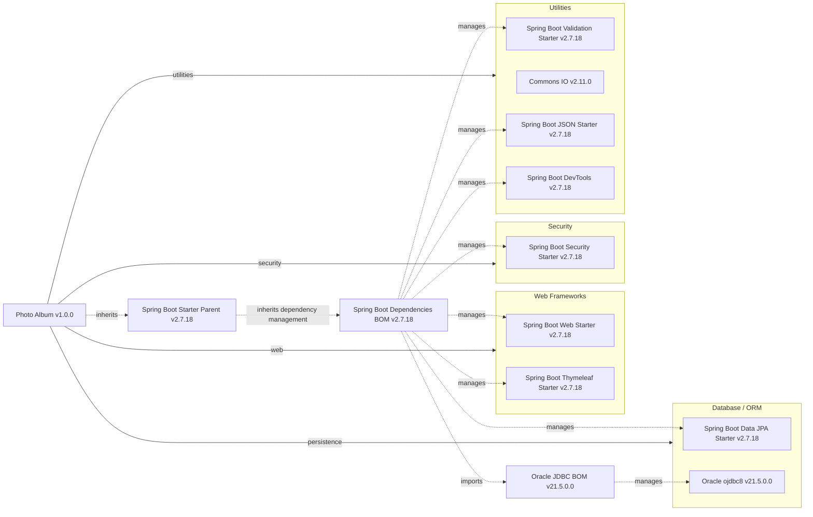

# Dependency Map

Photo Album (`com.photoalbum:photo-album:1.0.0`) declares **11 external dependencies: 9 non-test and 2 test-scoped** in `/home/runner/work/PhotoAlbum-Java/PhotoAlbum-Java/pom.xml`. Counts exclude parent POMs, imported BOMs, build plugins, and transitive libraries.

## Dependencies

### Dependency Summary

| Category | Count | Key Libraries | Notes |
|---|---:|---|---|
| Web Frameworks | 2 | Spring Boot Web and Thymeleaf starters 2.7.18 | Compile scope; servlet web framework and server-rendered templates |
| Database / ORM | 2 | Spring Boot Data JPA starter 2.7.18; Oracle ojdbc8 21.5.0.0 | JPA starter is compile scope; JDBC driver is runtime scope |
| Security | 1 | Spring Boot Security starter 2.7.18 | Compile scope; framework security support |
| Utilities | 4 | Spring Boot Validation, JSON, and DevTools 2.7.18; Commons IO 2.11.0 | Compile scope; DevTools is optional |
| **Total non-test** | **9** | | Test dependencies excluded |

Declared coordinates and version provenance:

| Dependency | Declared version | Managed version | Scope |
|---|---|---|---|
| `org.springframework.boot:spring-boot-starter-web` | Omitted | 2.7.18 | compile (default) |
| `org.springframework.boot:spring-boot-starter-thymeleaf` | Omitted | 2.7.18 | compile (default) |
| `org.springframework.boot:spring-boot-starter-data-jpa` | Omitted | 2.7.18 | compile (default) |
| `com.oracle.database.jdbc:ojdbc8` | Omitted | 21.5.0.0 | runtime |
| `org.springframework.boot:spring-boot-starter-validation` | Omitted | 2.7.18 | compile (default) |
| `org.springframework.boot:spring-boot-starter-security` | Omitted | 2.7.18 | compile (default) |
| `commons-io:commons-io` | 2.11.0 | Not applicable: explicitly pinned | compile (default) |
| `org.springframework.boot:spring-boot-starter-json` | Omitted | 2.7.18 | compile (default) |
| `org.springframework.boot:spring-boot-devtools` | Omitted | 2.7.18 | compile (default), optional |

Evidence: `/home/runner/work/PhotoAlbum-Java/PhotoAlbum-Java/pom.xml:8–28` identifies the parent, application, and Java target; lines 30–101 declare dependencies. Managed versions were checked against the published [Spring Boot dependency BOM](https://repo.maven.apache.org/maven2/org/springframework/boot/spring-boot-dependencies/2.7.18/spring-boot-dependencies-2.7.18.pom) and its imported [Oracle JDBC BOM](https://repo.maven.apache.org/maven2/com/oracle/database/jdbc/ojdbc-bom/21.5.0.0/ojdbc-bom-21.5.0.0.pom). Managed versions describe build metadata, not an executed dependency-resolution result.

### Version & Compatibility Risks

Spring Boot 2.7.18 is outside open-source support; its managed Spring Framework 5.3.31, Spring Security 5.7.11, Hibernate 5.6.15.Final, and Thymeleaf 3.0.15.RELEASE represent an aging stack. These are BOM-managed versions, not additional direct dependencies. Moving to Spring Boot 3 or later requires at least Java 17 rather than the declared Java 8 target and involves Java EE `javax` to Jakarta namespace migration. Commons IO 2.11.0 is an older explicit pin outside Boot version management. Oracle JDBC 21.5.0.0 and test H2 2.1.214 should be reviewed for current support and compatibility before upgrades. No vulnerability scan or runtime compatibility test was performed; no specific CVE finding is asserted.

### Notable Observations

- Only one recognized build manifest was found, with no declared Maven modules or dependency lockfiles. Transitive resolution was not executed; BOM membership alone does not establish that a library is on the application classpath.
- Boot supplies version management for every direct dependency except Commons IO. The Oracle driver's version comes through an imported Oracle BOM, not a version explicitly written in the application POM.
- The JSON starter supplies JSON support, not an image-processing library despite its adjacent POM comment. Its declaration overlaps the standard Web starter's JSON support; no independent image-processing dependency is declared.
- DevTools is optional but retains default compile scope. The Spring Boot Maven plugin is also declared without a version; it is build tooling and is excluded from dependency counts and the diagram.

## Test Dependencies

| Framework | Version | Notes |
|---|---|---|
| `org.springframework.boot:spring-boot-starter-test` | 2.7.18, managed; version omitted locally | Test scope; Spring Boot testing bundle. The Boot BOM manages JUnit Jupiter 5.8.2, Mockito 4.5.1, and AssertJ 3.22.0; these are not separately declared or counted here. |
| `com.h2database:h2` | 2.1.214, managed; version omitted locally | Test scope; embedded relational database |

Total test-scope dependencies: 2

H2 does not establish Oracle-specific SQL or JDBC behavior equivalence. No dedicated Testcontainers or contract-testing dependency is declared; this build-only assessment does not establish test coverage or whether integration tests exist.
