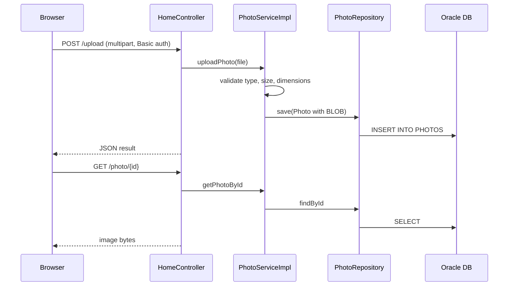

# API and Service Contracts

The application exposes HTTP endpoints only; it has no outbound service calls other than the Oracle database.

| Method | Path | Auth | Description |
|---|---|---|---|
| GET | `/` | Public | Gallery page (all photos, newest first) |
| POST | `/upload` | HTTP Basic (ADMIN) | Multipart `files` (list); JSON response `{success, uploadedPhotos[], failedUploads[]}` |
| GET | `/detail/{id}` | Public | Photo detail page with previous/next navigation |
| POST | `/detail/{id}/delete` | HTTP Basic (ADMIN) | Deletes photo, redirects to `/` with flash message |
| GET | `/photo/{id}` | Public | Streams photo bytes with stored MIME type, no-cache headers, `X-Photo-*` headers |

Upload validation: allowed MIME types `image/jpeg,image/png,image/gif,image/webp`; max 10 MB per file; max 50 MB per request; max 40M pixels.

