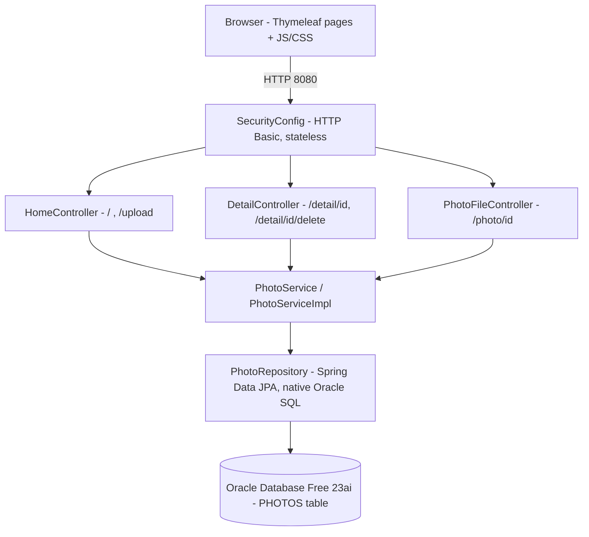

# Architecture Diagram

PhotoAlbum is a layered Spring Boot 2.7.18 (Java 8) monolith serving a server-rendered Thymeleaf gallery. Photos are stored as BLOBs in an Oracle database.

| Component | Responsibility |
|---|---|
| `config/SecurityConfig` | In-memory admin user (BCrypt); POST `/upload` and `/detail/*/delete` require auth; rest public |
| `controller/*` | HTTP endpoints and view selection |
| `service/impl/PhotoServiceImpl` | Upload validation (MIME type, size, pixel limit), CRUD, prev/next navigation |
| `repository/PhotoRepository` | Native Oracle queries (ROWNUM, TO_CHAR, analytic functions) |
| `model/Photo`, `UploadResult` | JPA entity and upload outcome DTO |
| Deployment | `Dockerfile` + `docker-compose.yml` (app + `gvenzl/oracle-free`), Azure setup scripts |
