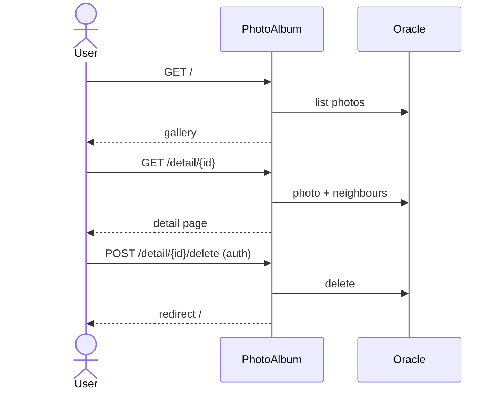

# Business Workflows

## Upload photos
1. Admin authenticates (HTTP Basic) and submits one or more files to `POST /upload`.
2. For each file the service checks MIME type, size > 0 and <= 10 MB, reads bytes, reads image dimensions from the header and rejects images over 40M pixels.
3. A `Photo` with a UUID-based stored name is saved with the BLOB; per-file success/failure is returned as JSON.

## Browse gallery and view detail
1. `GET /` lists photos newest first.
2. `GET /detail/{id}` shows metadata with previous (older) / next (newer) links; `GET /photo/{id}` returns the image bytes.

## Delete photo
1. Admin posts `POST /detail/{id}/delete`; the photo is looked up and deleted, and a flash message is shown on the gallery.

