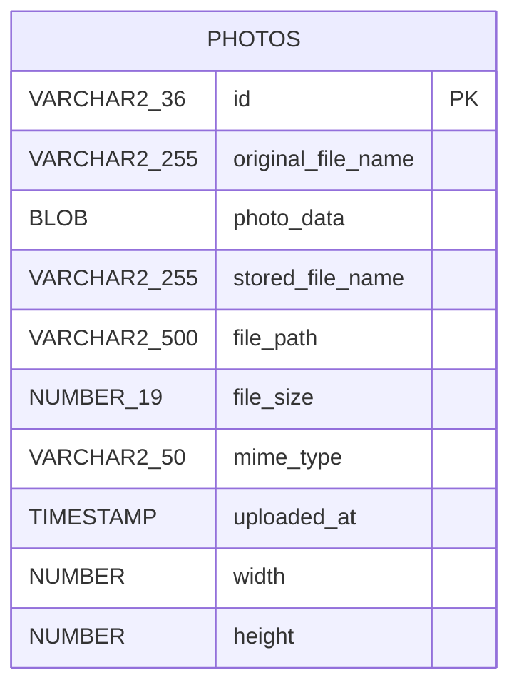

# Data Architecture

Single Oracle database (Oracle Free 23ai in Docker; Hibernate `OracleDialect`, `ddl-auto=create`). Photo binaries are stored in the database as BLOBs; the file system is not used.

- Entity: `com.photoalbum.model.Photo`; index `idx_photos_uploaded_at` on `uploaded_at`.
- Repository: `PhotoRepository extends JpaRepository<Photo,String>` with native Oracle SQL (ROWNUM pagination, `NVL`, `TO_CHAR`, `RANK()/SUM() OVER`), which ties the app to Oracle.
- Schema is auto-created by Hibernate (`ddl-auto=create` recreates on every start); `oracle-init/` holds container init scripts.
- Tests use in-memory H2 (`application-test.properties`).
