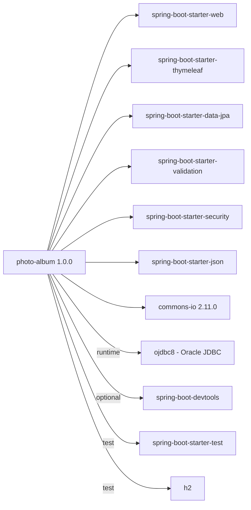

# Dependency Map

Build tool: Maven. Parent: `spring-boot-starter-parent:2.7.18`. Java source/target: 8.

| Dependency | Scope | Notes |
|---|---|---|
| spring-boot-starter-* (web, thymeleaf, data-jpa, validation, security, json) | compile | Spring Boot 2.7.x is end of life; uses `javax.*` namespace |
| commons-io 2.11.0 | compile | Known CVE (fixed in 2.14.0) |
| ojdbc8 | runtime | Oracle-specific; version managed by Boot |
| spring-boot-devtools | optional | Dev only |
| spring-boot-starter-test, h2 | test | H2 used by the test profile |
