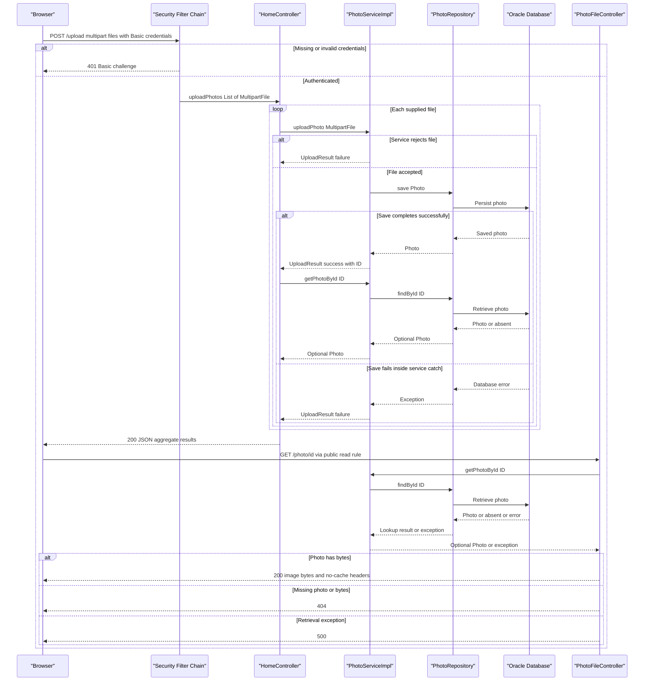

# API & Service Communication Contracts

Five explicit HTTP handlers expose gallery/detail pages, multipart upload, deletion, and binary photo retrieval. Browser requests and backend operations are request/response based; no message-driven service contracts were found.

## Service Catalog

| Service | Port | Category | Purpose |
|---|---|---|---|
| `photoalbum-java-app` / Maven `com.photoalbum:photo-album` | 8080, published as 8080 | Business; also serves the API/UI layer | Single source-built application serving gallery pages and photo operations. Dependencies include Spring Web, Thymeleaf, Data JPA, Security, Validation, JSON, and Oracle JDBC. |
| `oracle-db` | 1521, published as 1521 | Infrastructure | Third-party `gvenzl/oracle-free` container providing the application's database; no application HTTP API. |

Evidence: `pom.xml:15-18,30-79`; `docker-compose.yml:1-11,24-43`; `src/main/resources/application.properties:2`; `Dockerfile:21-25`. The build declares one application artifact, not multiple Maven modules. No Kubernetes, Helm, or IaC service definitions were found in the inspected conventional deployment directories.

## API Endpoints Inventory

All handlers belong to `photoalbum-java-app`. Paths are unversioned; no header/query version selection or controller-level base API prefix is implemented.

| Service / controller | Method | Path | Request Type | Response Type |
|---|---|---|---|---|
| Application / `HomeController` | GET | `/` | No required parameters | Normally 200 HTML, template `index`; model contains `List<Photo>` and a timestamp. A caught retrieval exception produces the same page with an empty photo list. |
| Application / `HomeController` | POST | `/upload` | `multipart/form-data`, required repeated part `files` bound to `List<MultipartFile>`; HTTP Basic authentication | 200 JSON `Map<String,Object>` containing aggregate success and per-file results, including when all files fail at service level. Explicit empty-list guard returns 400 JSON; missing required part is rejected by framework binding. Unauthenticated/invalid credentials: 401. Unhandled service/transaction exceptions may produce framework 5xx responses. |
| Application / `DetailController` | GET | `/detail/{id}` | Path `id: String` | Normally 200 HTML, template `detail`, with `Photo` and optional neighboring photo IDs. Missing photo, blank ID, or caught exception returns `redirect:/` (normally 302), not a 404 JSON response. |
| Application / `DetailController` | POST | `/detail/{id}/delete` | Path `id: String`; no body DTO; HTTP Basic authentication | `redirect:/` (normally 302), with success/error flash attribute, including missing photo or caught deletion error. Unauthenticated/invalid credentials: 401. |
| Application / `PhotoFileController` | GET | `/photo/{id}` | Path `id: String`; browser may append `_t` as an ignored cache-busting query value | 200 raw image bytes as `ResponseEntity<Resource>` / `ByteArrayResource`; MIME type taken from stored metadata. 404 for blank/missing ID or absent bytes; 500 for caught exceptions. |

Evidence: `src/main/java/com/photoalbum/controller/HomeController.java:37-49,55-98`; `src/main/java/com/photoalbum/controller/DetailController.java:17-18,32-58,64-78`; `src/main/java/com/photoalbum/controller/PhotoFileController.java:22-23,37-86`; authentication rules in `src/main/java/com/photoalbum/config/SecurityConfig.java:45-61`; browser cache-busting in `src/main/resources/static/js/upload.js:176-179`.

**Upload response semantics:** the JSON envelope uses `success`, `uploadedPhotos`, and `failedUploads`; the explicit 400 guard instead uses `success` and `error`. `success` means at least one photo was added to `uploadedPhotos`, not that every supplied file succeeded. A successful save is followed by another lookup; if that lookup returns empty, that file appears in neither result list. Service-level file rejection is represented in `failedUploads`, not by a per-file HTTP status (`HomeController.java:62-97`, at the controller path above). Framework multipart limits can reject requests before this handler; no application-specific oversize-error mapping was found.

**Binary response headers:** `Cache-Control: no-cache, no-store, must-revalidate, private`, `Pragma: no-cache`, `Expires: 0`, and `X-Photo-ID`, `X-Photo-Name`, `X-Photo-Size` are explicitly emitted (`src/main/java/com/photoalbum/controller/PhotoFileController.java:74-83`). Upload metadata's compatibility `filePath` is not the binary retrieval contract; clients use `/photo/{id}` (`src/main/java/com/photoalbum/service/impl/PhotoServiceImpl.java:112-115,160-166`; `src/main/resources/static/js/upload.js:176-179`).

Static assets are framework-served resources rather than additional controller APIs; the gallery references `/css/site.css` and `/js/upload.js` (`src/main/resources/templates/index.html:8,124-125`). No separate list/detail JSON API, pagination endpoint, PUT/PATCH handler, or HTTP DELETE handler was found; deletion uses POST.

## Management & Observability Endpoints

| Service | Endpoint | Custom Metrics (if any) |
|---|---|---|
| `photoalbum-java-app` | No explicit management, health, metrics, Swagger UI, or OpenAPI endpoint found | No custom metric names, `@Timed`, metric registry, or metrics exporter found |
| `oracle-db` | No application HTTP management API declared | Not an application metric producer in this repository |

Evidence: application dependencies in `pom.xml:30-101` do not include Actuator or an OpenAPI/metrics library; all explicit route handlers are listed above. The container-level database health check is not an HTTP application contract (`docker-compose.yml:17-22`). Logging is present in controllers and services, but does not establish a metrics API.

## DTOs & Contracts

| Class / type | API role | Mutability |
|---|---|---|
| `Photo` | Service-owned domain entity used in HTML view models and as the source for upload-response metadata and binary image responses; not accepted as a JSON request body or returned wholesale by an explicit JSON endpoint | Mutable POJO with setters |
| `UploadResult` | Internal per-file outcome from `PhotoService.uploadPhoto`, translated by `HomeController` into the upload JSON envelope; not directly serialized as the endpoint response | Mutable POJO with setters |
| `MultipartFile` / `List<MultipartFile>` | Framework multipart request contract for upload | Framework-provided request abstraction |
| `Map<String,Object>` and nested lists/maps | Ad hoc upload JSON response; no dedicated public request/response DTO class | Mutable collections |
| `Resource` / `ByteArrayResource` | Raw binary response abstraction for photo retrieval; not a JSON model | No application DTO immutability guarantee |

Evidence: `src/main/java/com/photoalbum/model/Photo.java:19,93-118,120-199`; `src/main/java/com/photoalbum/model/UploadResult.java:6-29,32-63`; `src/main/java/com/photoalbum/controller/HomeController.java:57-97`; `src/main/java/com/photoalbum/controller/PhotoFileController.java:58-83`.

No gateway-level aggregation DTOs, immutable records, or Lombok value classes were found. For entity fields and persistence structure, see the companion `data-architecture.md`; individual validation rules belong in `business-workflows.md`.

JSON is provided through the Spring Boot JSON starter and normal Spring MVC message conversion; upload uses `@ResponseBody` and `ResponseEntity`, while page handlers return template names. No custom Jackson configuration or serializers were found in the inspected Java/configuration files. Consumers parse upload JSON and construct dates from its timestamp metadata (`pom.xml:75-79`; `src/main/java/com/photoalbum/controller/HomeController.java:55-57,79`; `src/main/resources/static/js/upload.js:110-120,161-170`). No OpenAPI/Swagger documents or annotations, protobuf schemas, or GraphQL schemas were found in the inspected application/build files.

## Communication Patterns

- **Browser to application:** same-origin HTTP page navigation, multipart upload through `fetch`, and binary image requests. JavaScript uses `async`/`await`, but this is asynchronous browser execution of an ordinary request/response HTTP exchange, not queue-based messaging. The delete operation is an HTML form POST (`src/main/resources/static/js/upload.js:90-106`; `src/main/resources/templates/detail.html:50-59,67-70`).
- **Inside the application:** controllers call `PhotoService` synchronously; `PhotoServiceImpl` calls `PhotoRepository` synchronously under Spring transactions. Repository access uses JPA/JDBC, not a second REST service (`src/main/java/com/photoalbum/controller/HomeController.java:28-31,40,68-72`; `src/main/java/com/photoalbum/service/impl/PhotoServiceImpl.java:28-47,53-75,172-185`; `src/main/java/com/photoalbum/repository/PhotoRepository.java:15-16`).
- **External dependency:** the configured database target uses the Compose service hostname `oracle-db` on port 1521; this is network/DNS name resolution, not Eureka/Consul registration. No Feign, RestTemplate, WebClient, gRPC clients, discovery registry, client-side load balancing, API gateway, or cross-service aggregation was found. Detail-page composition combines photo data with neighboring IDs within the same service (`src/main/resources/application.properties:12,15`; `docker-compose.yml:3,32,39-43`; `src/main/java/com/photoalbum/controller/DetailController.java:38-54`).
- **Other browser traffic:** page templates reference Bootstrap CSS/JavaScript from an external HTTPS CDN. These are browser asset dependencies, not backend business-service calls (`src/main/resources/templates/index.html:7,124`; `src/main/resources/templates/detail.html:7,147`).
- **Async messaging:** no message broker, pub/sub, queue client, or asynchronous backend event contract was found in `pom.xml:30-101` or the inspected application sources.
- **Retries, timeouts, isolation:** no application-defined HTTP/JDBC request timeout, retry policy, circuit breaker, bulkhead, or retry fallback was found. The upload browser call does not set an abort timeout or retry (`src/main/resources/static/js/upload.js:102-132`); repository operations have no explicit retry wrapper (`src/main/java/com/photoalbum/service/impl/PhotoServiceImpl.java:53-75,172-217`). Framework/driver defaults are not documented timeout guarantees. Compose's process restart policy is not a request retry (`docker-compose.yml:44`).
- **Error/fallback contract:** gallery lookup errors render an empty gallery; detail errors redirect home; binary retrieval returns 404/500; delete errors redirect with a flash message; upload catches many per-file errors and returns failed outcomes. These are local error-handling paths, not circuit-breaker fallbacks. Transaction-commit failures can still escape the upload service call because the controller has no surrounding catch (`src/main/java/com/photoalbum/controller/HomeController.java:38-49,68-97`; `src/main/java/com/photoalbum/controller/DetailController.java:38-58,64-78`; `src/main/java/com/photoalbum/controller/PhotoFileController.java:44-86`; `src/main/java/com/photoalbum/service/impl/PhotoServiceImpl.java:28-29,181-192`).
- **Availability dependencies:** Compose starts the application after database readiness; required externally supplied database and administrator credentials also affect successful startup. Full startup/configuration details belong in `configuration-inventory.md` (`docker-compose.yml:30-41`; `src/main/java/com/photoalbum/config/SecurityConfig.java:33-42`). No secret values are reproduced here.
- **API security:** stateless HTTP Basic protects POST `/upload` and POST `/detail/*/delete`; anonymous or invalidly authenticated callers receive the framework Basic challenge/401. All other requests are permitted. The configured user is assigned an admin role, but route rules check authentication only, not roles or ownership. CSRF is explicitly disabled; no JWT/OAuth flow, method-level authorization, or custom CORS policy was found (`src/main/java/com/photoalbum/config/SecurityConfig.java:33-61`). The upload JavaScript supplies no explicit authorization header or login flow; it relies on browser authentication behavior and displays a generic error for non-2xx results (`src/main/resources/static/js/upload.js:102-131`).
- **Transport:** no application HTTPS listener, TLS enforcement, or database TLS configuration was found in the supplied runtime settings. Port 8080 is exposed directly in Compose; any production TLS termination outside this repository is unverified (`src/main/resources/application.properties:1-15`; `src/main/resources/application-docker.properties:1-6,25`; `docker-compose.yml:37-38`). External CDN URLs use HTTPS, which does not establish TLS for the application's API.

## Service Technology Matrix

| Service | Web | Data Access | Discovery | Gateway | Actuator / Health | Cache | Metrics |
|---|---|---|---|---|---|---|---|
| `photoalbum-java-app` | Spring MVC; Thymeleaf; JSON and binary responses | Spring Data JPA / JDBC | Compose hostname only; no registry client | None | No application health endpoint found | No application cache found; binary responses explicitly prohibit caching | No exporter/custom instruments found |
| `oracle-db` | None declared | Database server, not an application data-access client | Compose network hostname | None | Container-level check only | Not assessed as an application cache | No repository-defined exporter |

Evidence: `pom.xml:30-79`; `docker-compose.yml:3-22,24-44`; `src/main/java/com/photoalbum/repository/PhotoRepository.java:15-16`; `src/main/java/com/photoalbum/controller/PhotoFileController.java:74-83`. Negative capability entries refer to the inspected application sources, build file, and runtime definitions, not guarantees about external infrastructure.

## Service Communication Sequence

Primary upload-and-display flow, including authentication rejection and per-file failure. Solid arrows are synchronous calls; dashed arrows are responses, not broker events. No gateway, broker, or circuit breaker is present.

The aggregate response assumes no unhandled lookup/transaction exception; these can abort processing with framework error handling. Empty-file requests follow the separate 400 guard documented above. Sequence evidence: `src/main/java/com/photoalbum/config/SecurityConfig.java:45-61`; `src/main/java/com/photoalbum/controller/HomeController.java:55-98`; `src/main/java/com/photoalbum/service/impl/PhotoServiceImpl.java:69-75,81-192`; `src/main/java/com/photoalbum/controller/PhotoFileController.java:37-86`; `src/main/resources/static/js/upload.js:97-120,176-179`.
