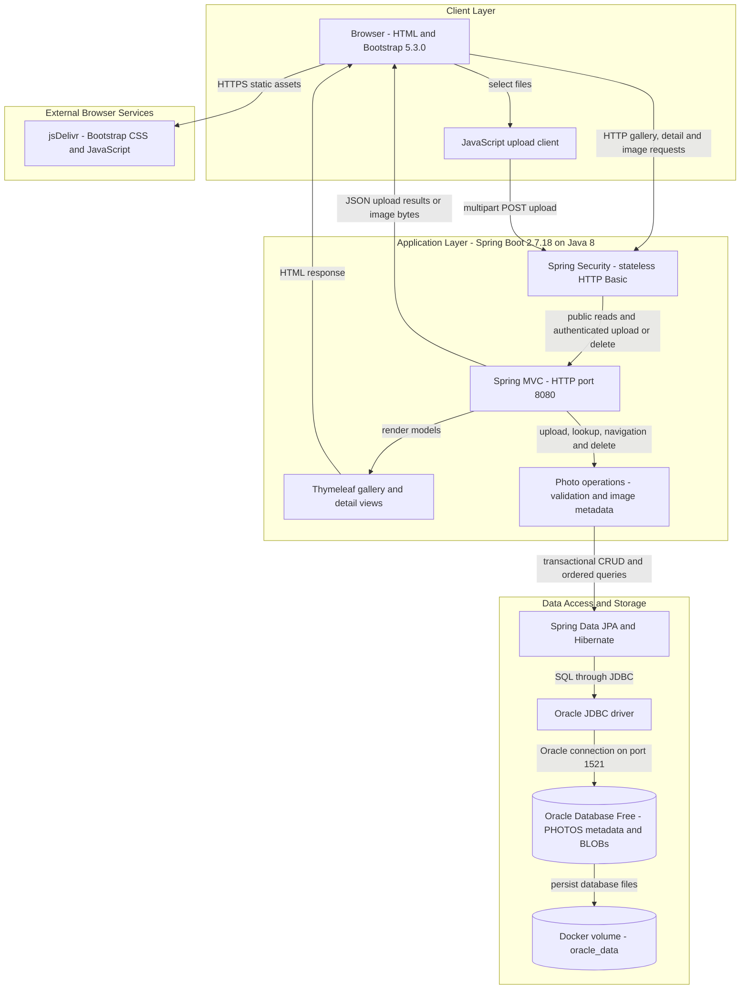
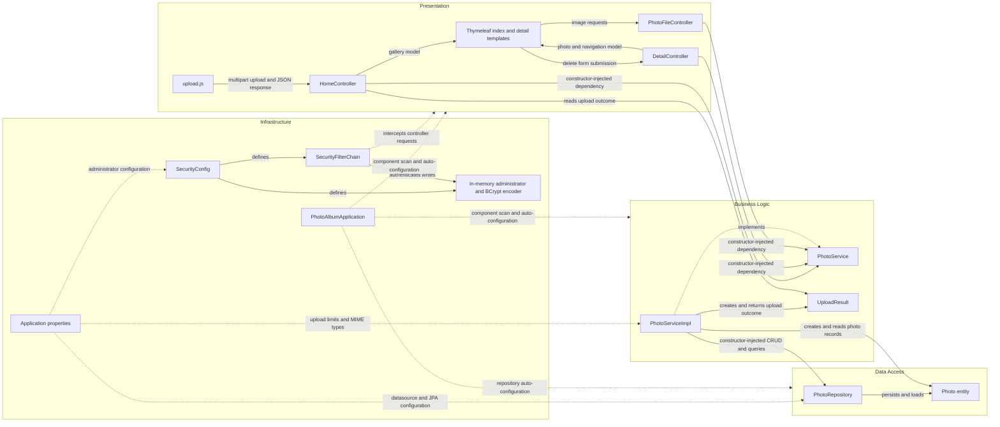

# Architecture Diagram

Photo Album is a single-module Java web application with server-rendered gallery pages, a multipart upload API, and database-backed image delivery. These diagrams describe repository-defined behavior and Docker Compose topology, not a verified live deployment; secret values are omitted.

## Application Architecture

### Technology Stack Summary

| Layer | Technology | Version | Purpose |
|---|---|---|---|
| Runtime and packaging | Java, Maven, executable JAR | Java 8; Docker build Maven 3.9.6 | Single application process. Evidence: `pom.xml:15-26`; `Dockerfile:2-22`. |
| Application | Spring Boot | 2.7.18 | Auto-configuration and application bootstrap. Evidence: `pom.xml:8-12`; `src/main/java/com/photoalbum/PhotoAlbumApplication.java:9-14`. |
| Presentation | Spring MVC, Thymeleaf | Spring Boot-managed; individual versions not pinned | Server-rendered pages, multipart upload responses and image delivery. Evidence: `pom.xml:30-41`; `src/main/java/com/photoalbum/controller/HomeController.java:37-57`; `src/main/java/com/photoalbum/controller/PhotoFileController.java:23-38`. |
| Browser | Bootstrap, vanilla JavaScript Fetch | Bootstrap 5.3.0; JavaScript version unspecified | Gallery styling and asynchronous uploads. Evidence: `src/main/resources/templates/index.html:7,124-125`; `src/main/resources/static/js/upload.js:97-103`. |
| Security | Spring Security, BCrypt | Spring Boot-managed | In-memory administrator, stateless HTTP Basic and authenticated writes. Evidence: `pom.xml:62-66`; `src/main/java/com/photoalbum/config/SecurityConfig.java:28-61`. |
| Business logic | Spring services, transactions, Java ImageIO | Spring Boot-managed; Java 8 APIs | Upload validation, image dimensions, navigation and deletion. Evidence: `src/main/java/com/photoalbum/service/impl/PhotoServiceImpl.java:28-47,81-174,198-237`. |
| Data access | Spring Data JPA, Hibernate, Oracle ojdbc8 | Spring Boot-managed; driver version not explicitly pinned | Entity persistence and Oracle-specific native queries. Evidence: `pom.xml:43-54`; `src/main/java/com/photoalbum/repository/PhotoRepository.java:15-56`. |
| Database | Oracle Database Free | Compose image tag `latest`; exact version unpinned | Stores photo metadata and binary images. Evidence: `docker-compose.yml:3-14`; `src/main/java/com/photoalbum/model/Photo.java:15-41`. |
| Deployment | Docker multi-stage build, Docker Compose | Engine and Compose versions unspecified | Java 8 runtime container, database health dependency and bridge network. Evidence: `Dockerfile:2-31`; `docker-compose.yml:25-51`. |

### Data Storage & External Services

Oracle is the runtime system of record: the `photos` entity contains UUID identifiers, filenames, timestamps, dimensions and a `photo_data` BLOB (`src/main/java/com/photoalbum/model/Photo.java:15-97`). Uploads save bytes to the database, not an upload directory; stored filenames and file paths remain compatibility metadata (`src/main/java/com/photoalbum/service/impl/PhotoServiceImpl.java:112-124,160-174`). Image responses read those bytes through the service (`src/main/java/com/photoalbum/controller/PhotoFileController.java:44-83`). Compose persists database files in `oracle_data` and mounts initialization scripts (`docker-compose.yml:12-14`). Both application profiles configure Hibernate schema creation at startup, so a persistent database volume does not imply schema/data preservation across application restarts (`src/main/resources/application.properties:17-21`; `src/main/resources/application-docker.properties:13-17`).

The browser fetches Bootstrap from jsDelivr, rather than the backend calling a business API (`src/main/resources/templates/index.html:7,124`). No runtime cache, message broker or object-storage integration is evident in the inspected application sources and dependencies. H2 is test-scoped, not the runtime database (`pom.xml:88-93`). Database and administrator passwords are externally supplied; no secret values are reproduced here (`docker-compose.yml:30-36`; `src/main/java/com/photoalbum/config/SecurityConfig.java:34-42`).

### Key Architectural Decisions

- **Layered monolith with constructor injection:** controllers depend on the `PhotoService` interface; its implementation receives `PhotoRepository` and upload configuration. Business operations use Spring transactions, with read-only retrieval methods (`src/main/java/com/photoalbum/controller/HomeController.java:28-32`; `src/main/java/com/photoalbum/service/impl/PhotoServiceImpl.java:28-55`).
- **Database-centric image persistence:** metadata and BLOBs share one entity; the repository uses Oracle-specific SQL, including `ROWNUM`, `NVL` and `TO_CHAR`, rather than a database-neutral query layer (`src/main/java/com/photoalbum/model/Photo.java:15-79`; `src/main/java/com/photoalbum/repository/PhotoRepository.java:34-71`).
- **Public reads, authenticated mutations:** HTTP Basic protects upload and delete POST routes; other requests are permitted. Credentials are BCrypt-encoded in memory, sessions are stateless, and CSRF protection is explicitly disabled (`src/main/java/com/photoalbum/config/SecurityConfig.java:28-61`). This describes configuration, not a security assurance.

## Component Relationships

### Component Inventory

| Component | Layer | Type | Responsibility |
|---|---|---|---|
| `index.html`, `detail.html`, `upload.js` | Presentation | Thymeleaf templates and browser script | Render gallery/detail, request images, submit delete forms and upload multipart data. Evidence: `src/main/resources/templates/index.html:95,124-125`; `src/main/resources/templates/detail.html:50,67`; `src/main/resources/static/js/upload.js:97-103,178-185`. |
| `HomeController` | Presentation | MVC controller | `GET /` gallery and `POST /upload` JSON results; constructor-injected service. Evidence: `src/main/java/com/photoalbum/controller/HomeController.java:23-57,68-97`. |
| `DetailController` | Presentation | MVC controller | `GET /detail/{id}`, previous/next navigation and `POST /detail/{id}/delete`. Evidence: `src/main/java/com/photoalbum/controller/DetailController.java:17-32,38-54,64-78`. |
| `PhotoFileController` | Presentation | Binary HTTP response controller | `GET /photo/{id}` serves database image bytes with MIME type and no-cache headers. Evidence: `src/main/java/com/photoalbum/controller/PhotoFileController.java:22-38,44-83`. |
| `PhotoService` | Business Logic | Service interface | Shared upload, retrieval, deletion and navigation contract. Evidence: `src/main/java/com/photoalbum/service/PhotoService.java:13-54`. |
| `PhotoServiceImpl` | Business Logic | Transactional Spring service | Validates MIME and file size, reads image dimensions with a pixel bound, creates BLOB-backed photos and delegates persistence/navigation queries. Evidence: `src/main/java/com/photoalbum/service/impl/PhotoServiceImpl.java:28-47,81-174,198-237`. |
| `UploadResult` | Business Logic | Result DTO | Carries success status, filename, error message and photo identifier between service and upload controller. Evidence: `src/main/java/com/photoalbum/model/UploadResult.java:6-10`; `src/main/java/com/photoalbum/controller/HomeController.java:68-89`. |
| `PhotoRepository` | Data Access | Spring Data JPA repository | UUID-keyed CRUD plus native Oracle ordering, navigation, month, pagination and statistics queries; not every declared query is used by the service. Evidence: `src/main/java/com/photoalbum/repository/PhotoRepository.java:15-100`; `src/main/java/com/photoalbum/service/impl/PhotoServiceImpl.java:55-71,225-237`. |
| `Photo` | Data Access | JPA entity | Maps `photos`, metadata, BLOB bytes and upload-time index; initializes UUID and timestamp. Evidence: `src/main/java/com/photoalbum/model/Photo.java:15-97`. |
| `PhotoAlbumApplication` | Infrastructure | Spring Boot entry point | Starts the application and enables framework auto-configuration/component scanning. Evidence: `src/main/java/com/photoalbum/PhotoAlbumApplication.java:9-14`. |
| `SecurityConfig`, `SecurityFilterChain` | Infrastructure | Configuration and request filter chain | Defines stateless HTTP Basic, protected write routes, public reads and disabled CSRF. Evidence: `src/main/java/com/photoalbum/config/SecurityConfig.java:25-61`. |
| In-memory administrator and BCrypt encoder | Infrastructure | Authentication beans | Encodes externally supplied administrator credentials and supplies the authentication user store; no database user directory. Evidence: `src/main/java/com/photoalbum/config/SecurityConfig.java:28-42`. |
| Application properties | Infrastructure | Externalized configuration | Configures datasource, schema creation, HTTP/multipart limits and service MIME/size settings; Docker selects its profile. Evidence: `src/main/resources/application.properties:2-30`; `src/main/resources/application-docker.properties:13-30`; `docker-compose.yml:30-36`. |

Arrows represent direct component dependencies or HTTP/view interactions, not asynchronous messaging. Framework-provided transactions and per-component SLF4J logging are cross-cutting concerns (`src/main/java/com/photoalbum/service/impl/PhotoServiceImpl.java:7-11,28-32,53-60`). `MathUtil` is an isolated utility with no observed application-layer caller and is omitted from the interaction diagram (`src/main/java/com/photoalbum/util/MathUtil.java:6-21`).
