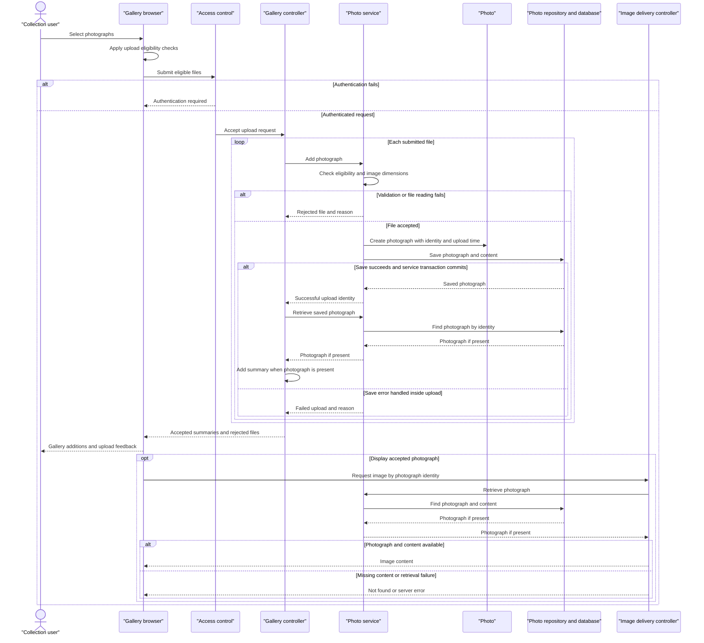

# Core Business Workflows

Photo Album lets visitors browse a shared collection of photographs, inspect individual images, and navigate by upload time. Authenticated users can add photographs in batches and remove photographs from the collection.

## Domain Entities

| Entity | Service / Bounded Context | Description | Key Relationships |
| --- | --- | --- | --- |
| Photo | PhotoService / Photo Collection | Independently managed photograph combining image content with information needed for display and chronological navigation. | No owner, album, or other domain-entity association is modeled; previous and next photos are derived from upload times. |
| UploadResult (operation result, not a persisted entity) | PhotoService / Upload Processing | Per-file acceptance or rejection outcome used to assemble batch feedback. | References a successfully created Photo or identifies a rejected input file and reason. |

Evidence: `src/main/java/com/photoalbum/model/Photo.java:19-108`; `src/main/java/com/photoalbum/model/UploadResult.java:6-29`; `src/main/java/com/photoalbum/service/impl/PhotoServiceImpl.java:225-237`.

## Service-to-Domain Mapping

This is one application with one business service, not independently deployed domain services. The controller roles below are internal presentation boundaries, not separate sources of truth.

| Service | Domain Context | Owned Entities | External Dependencies |
| --- | --- | --- | --- |
| PhotoService / PhotoServiceImpl | Photo collection, upload acceptance, chronological browsing, removal | Photo; produces UploadResult | PhotoRepository and the photo database; image-header inspection |
| HomeController | Gallery and batch-upload orchestration | None; composes Photo summaries and upload outcomes | Internal PhotoService |
| DetailController | Individual viewing, navigation, deletion feedback | None; composes current and adjacent Photos | Internal PhotoService |
| PhotoFileController | Image delivery | None; serves content from Photo | Internal PhotoService |

The Photo repository is the collection's source of truth. These roles exchange in-process calls and photo identifiers, not events or inter-service requests. Evidence: `src/main/java/com/photoalbum/service/impl/PhotoServiceImpl.java:28-48,160-174,199-217`; `src/main/java/com/photoalbum/controller/HomeController.java:28-40,68-83`; `src/main/java/com/photoalbum/controller/DetailController.java:23-27,39-52`; `src/main/java/com/photoalbum/controller/PhotoFileController.java:28-32,46-69`.

## Primary Workflows

### Workflow 1: Upload a batch and publish accepted photos

1. A user selects or drops files. The browser applies the **Upload eligibility** checks and submits eligible files to `POST /upload`; the security boundary requires authentication.
2. HomeController applies **Batch acceptance**, then calls PhotoService once per file, sequentially.
3. PhotoService applies **Upload eligibility** and **Image dimension handling**, generates a compatibility filename, reads content, and creates a Photo with its upload identity and time.
4. The service saves the Photo with its content. Rejected files or handled read/save failures produce a failed UploadResult rather than a successful photo.
5. For each successful result, HomeController rereads the Photo by identifier and assembles a display summary. It separates summaries from rejected-file reasons under **Batch outcome composition**.
6. The browser displays success/error feedback and prepends accepted photos to the gallery. Rendering uses the real photo-serving URL, not the compatibility upload path.

There is no external service orchestration or all-or-nothing batch transaction. Save/commit or subsequent reread exceptions can still abort the request rather than produce a complete per-file response; successful service return is not a guarantee that every later step succeeds.

Evidence: `src/main/resources/static/js/upload.js:48-131,154-179`; `src/main/java/com/photoalbum/config/SecurityConfig.java:45-60`; `src/main/java/com/photoalbum/controller/HomeController.java:55-97`; `src/main/java/com/photoalbum/service/impl/PhotoServiceImpl.java:82-192`.

### Workflow 2: Browse the collection and inspect neighboring photos

1. A visitor opens `GET /`. The application retrieves photos newest first and renders gallery cards.
2. If collection retrieval fails, HomeController supplies an empty collection; visitors see the same empty-gallery presentation used when no photos exist.
3. Opening `GET /detail/{id}` retrieves the chosen Photo and composes older/newer navigation using **Chronological navigation**. Invalid, missing, or failed lookups redirect to the gallery.
4. The browser separately requests `GET /photo/{id}` for the image content. The serving controller applies **Image availability** and returns image bytes or an error; it does not substitute a default image.
5. The detail view displays available image dimensions and human-readable file size; navigation buttons appear only when a corresponding neighbor exists.

Evidence: `src/main/java/com/photoalbum/controller/HomeController.java:37-49`; `src/main/java/com/photoalbum/repository/PhotoRepository.java:22-56`; `src/main/java/com/photoalbum/controller/DetailController.java:32-58`; `src/main/java/com/photoalbum/controller/PhotoFileController.java:37-86`; `src/main/resources/templates/index.html:82-108`; `src/main/resources/templates/detail.html:67-93,114-125`.

### Workflow 3: Remove a photograph and return to the gallery

1. The detail page asks for browser confirmation before submitting `POST /detail/{id}/delete`; authentication is required by the security boundary.
2. PhotoService retrieves the Photo. If present, it deletes the record containing the image content; no separate file deletion is performed.
3. A missing Photo yields a not-found outcome. A repository exception becomes a service exception.
4. DetailController converts the outcome into success, not-found, or failure flash feedback and redirects to the gallery. There is no soft-delete or recovery workflow.

Evidence: `src/main/resources/templates/detail.html:50-59`; `src/main/java/com/photoalbum/config/SecurityConfig.java:54-60`; `src/main/java/com/photoalbum/service/impl/PhotoServiceImpl.java:199-217`; `src/main/java/com/photoalbum/controller/DetailController.java:64-78`.

No scheduled, message-driven, or business-state initialization entry point was found in the Java source. The application entry point only starts the application (`src/main/java/com/photoalbum/PhotoAlbumApplication.java:9-14`). Month filtering, pagination, and statistics repository methods have no invocation in the inspected business service/controllers, so they are not presented as active user workflows (`src/main/java/com/photoalbum/repository/PhotoRepository.java:58-100`).

## Cross-Service Data Flows

There is no gateway aggregation, remote business service, message exchange, or circuit breaker in these workflows. Composition happens inside the application:

- **Upload composition:** per-file UploadResult supplies a photo identifier; HomeController rereads that Photo and maps it to a gallery summary. A successful result whose reread returns empty contributes neither a summary nor a failed-file entry (`src/main/java/com/photoalbum/controller/HomeController.java:68-95`).
- **Detail composition:** DetailController combines the current Photo with identifiers derived from older/newer photo queries; all data comes from the same collection (`src/main/java/com/photoalbum/controller/DetailController.java:39-52`).
- **Content delivery:** gallery/detail markup points the browser at the image-serving controller, which retrieves content from the same Photo. The `/uploads/` path produced during upload is compatibility metadata, not the serving route (`src/main/java/com/photoalbum/service/impl/PhotoServiceImpl.java:112-115,160-174`; `src/main/resources/templates/index.html:94-95`; `src/main/java/com/photoalbum/controller/PhotoFileController.java:46-83`).

Business-relevant degradation is local: collection errors appear as an empty gallery, detail errors redirect home, image-content failures return not-found/server-error, and handled per-file upload errors allow remaining files to be attempted. There is no remote fallback or compensating process (`src/main/java/com/photoalbum/controller/HomeController.java:44-48,68-97`; `src/main/java/com/photoalbum/controller/DetailController.java:34-58`; `src/main/java/com/photoalbum/controller/PhotoFileController.java:48-61,84-86`).

## Business Workflow Sequence

The sequence covers handled failures, not an automatic retry guarantee. Transaction-completion and post-upload reread exceptions can escape the controller loop. Evidence: `src/main/java/com/photoalbum/service/impl/PhotoServiceImpl.java:28-29,150-190`; `src/main/java/com/photoalbum/controller/HomeController.java:68-97`; `src/main/java/com/photoalbum/controller/PhotoFileController.java:44-86`.

## Business Rules & Decision Logic

### Acceptance and validation

- **Upload eligibility:** browser accepts JPEG, PNG, GIF, and WebP and limits each file to 10 MiB. Server checks the lowercased declared content type against the configured allowlist, then the configured size limit, then rejects zero-length content. Current configuration matches those formats and the 10 MiB service limit. These are declared MIME checks, not proof that content matches its declared format (`src/main/resources/static/js/upload.js:65-79`; `src/main/java/com/photoalbum/service/impl/PhotoServiceImpl.java:86-110`; `src/main/resources/application.properties:24-29`).
- **Image dimension handling:** header inspection rejects images exceeding 40,000,000 pixels when dimensions can be read. An I/O failure rejects the upload, but unavailable readers or other dimension-extraction failures allow processing without dimensions. Full image decoding is not required for acceptance (`src/main/java/com/photoalbum/service/impl/PhotoServiceImpl.java:34-35,122-158`).
- **Batch acceptance:** no files produces a bad-request response. The configuration declares a ten-files-per-upload setting, but the inspected controller and browser do not enforce that count; the multipart request-size limit is 50 MB (`src/main/java/com/photoalbum/controller/HomeController.java:62-69`; `src/main/resources/static/js/upload.js:60-106`; `src/main/resources/application.properties:24-30`).
- **Entity validation declarations:** original and stored filenames must be nonblank and at most 255 characters; compatibility path at most 500; MIME type nonblank and at most 50; file size required and positive; upload time required. These are model annotations, not a separate controller validation pass. Content and dimensions have no equivalent required-value validation annotation (`src/main/java/com/photoalbum/model/Photo.java:31-91`).

### Outcomes, lifecycle, and derived behavior

- **Batch outcome composition:** a nonempty submitted batch returns an OK response after normal completion, even if every per-file result fails. Top-level success means at least one saved Photo was reread and included in the response, not that every input succeeded (`src/main/java/com/photoalbum/controller/HomeController.java:68-97`).
- **Photo lifecycle:** input becomes either rejected or a newly stored Photo; a stored Photo can later be physically deleted. There are no moderation, edit, approval, or soft-delete states. New Photos receive generated identities and the current upload time; there is no content-based deduplication check in upload (`src/main/java/com/photoalbum/model/Photo.java:93-107`; `src/main/java/com/photoalbum/service/impl/PhotoServiceImpl.java:112-115,160-174,199-213`).
- **Chronological navigation:** gallery order is descending upload time. Previous is the first strictly older result ordered newest first; next is the first strictly newer result ordered oldest first. Equal timestamps are excluded from both neighbor searches, and no tie-breaker is specified (`src/main/java/com/photoalbum/repository/PhotoRepository.java:22-56`; `src/main/java/com/photoalbum/service/impl/PhotoServiceImpl.java:225-237`).
- **Image availability:** blank identifiers, absent Photos, and missing/empty content return not-found; other serving exceptions return server-error. No generated thumbnail or replacement image is created (`src/main/java/com/photoalbum/controller/PhotoFileController.java:37-86`).
- **Display derivations:** file size is formatted in bytes/KB/MB on the detail page; dimensions are displayed only when both are present. Newly uploaded gallery cards are prepended as each returned summary is processed; full-page ordering comes from the repository (`src/main/resources/templates/detail.html:114-125`; `src/main/resources/static/js/upload.js:154-174,195-196`; `src/main/java/com/photoalbum/repository/PhotoRepository.java:22-27`).

### Cross-cutting controls

- **Transactions:** PhotoServiceImpl has a class-level transaction boundary; collection, identifier, and neighbor reads explicitly use read-only transactions. The controller is not transactional, so separate upload calls are separate transaction invocations; no batch-wide rollback or saga is implemented. Catching a save exception does not guarantee that transaction completion will succeed (`src/main/java/com/photoalbum/service/impl/PhotoServiceImpl.java:28-29,53-75,173-190,223-237`; `src/main/java/com/photoalbum/controller/HomeController.java:68-97`).
- **Error handling:** upload uses per-file result messages for handled validation, read, save, and unexpected exceptions. Read/delete service failures become runtime exceptions; controllers map these to the workflow-specific degradation described above. No automatic retry, dead-letter handling, or compensation is present in these paths (`src/main/java/com/photoalbum/service/impl/PhotoServiceImpl.java:55-75,150-190,199-217`).
- **Authorization:** upload and delete require an authenticated caller; other requests are permitted publicly. An in-memory account is assigned an administrator role, but route checks require authentication rather than checking that role or photo ownership. Credentials are configuration-supplied; secret values are intentionally omitted. The security configuration uses stateless Basic authentication and disables CSRF (`src/main/java/com/photoalbum/config/SecurityConfig.java:33-60`).
- **Audit/logging:** upload acceptance/rejection, retrieval failures, and deletion outcomes are logged. Image delivery also logs filenames, content sizes, and a short byte preview; these are operational logs, not a dedicated actor-linked business audit trail (`src/main/java/com/photoalbum/service/impl/PhotoServiceImpl.java:91-101,179-189,203-216`; `src/main/java/com/photoalbum/controller/PhotoFileController.java:45-72`).
