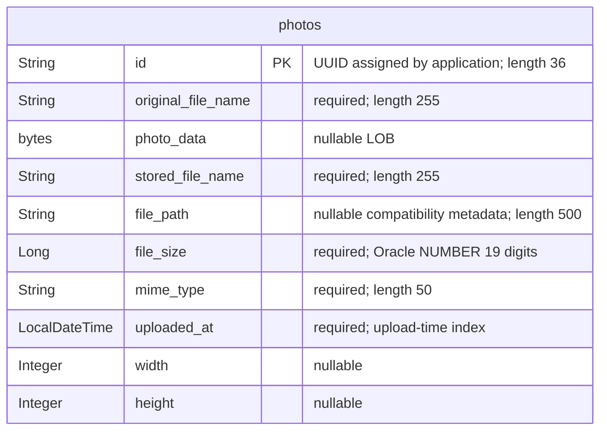

# Data Architecture & Persistence Layer

The data layer has one JPA entity, `Photo`, persisted through Spring Data JPA/Hibernate to Oracle, with H2 configured for tests. Image bytes and metadata occupy the same relational row rather than separate object storage (`pom.xml:43-54,88-93`; `src/main/java/com/photoalbum/model/Photo.java:15-91`).

## Database Configuration

| Service/Module | DB Type | Profile | Driver | Connection | Migration Tool |
| --- | --- | --- | --- | --- | --- |
| Photo Album | Oracle | Default/base | `com.oracle.database.jdbc:ojdbc8`; `oracle.jdbc.OracleDriver` | Environment-overridable Oracle Thin JDBC connection, defaulting to an internal database service and pluggable database; credentials externalized. No explicit pool sizing or custom pool implementation configured. | No Flyway/Liquibase dependency found; Hibernate recreates the mapped schema at startup. |
| Photo Album | Oracle | `docker` | Same Oracle driver | Same environment-overridable Oracle connection; no profile-specific pool tuning observed. | Hibernate recreates the mapped schema at startup. |
| Photo Album tests | H2 | `test` | Test-scoped `com.h2database:h2`; `org.h2.Driver` | In-memory JDBC database with test-local authentication; no explicit Oracle compatibility mode configured. | Hibernate creates the schema and drops it when the persistence context shuts down. |

Evidence: `src/main/resources/application.properties:9-21`; `src/main/resources/application-docker.properties:1-17`; `src/test/resources/application-test.properties:1-10`; `pom.xml:43-54,88-93`. The context test explicitly activates the test profile (`src/test/java/com/photoalbum/PhotoAlbumApplicationTests.java:7-12`).

Schema creation is destructive rather than a versioned migration strategy. No migration, initial-schema, or seed SQL files were found under the scanned source and conventional database/script directories; no seed initializer was identified in the application sources. The entity specifies Oracle-oriented numeric and timestamp column definitions (`src/main/java/com/photoalbum/model/Photo.java:63-79`). H2 configuration alone does not demonstrate compatibility with these definitions or the Oracle-specific native queries; tests were not run for this assessment.

Connection details are intentionally summarized without credentials. See `configuration-inventory.md` for the full property inventory; raw property assignments and deployment details are outside this document's scope.

## Data Ownership per Service

| Service | Tables Owned | ORM Framework | Caching | Notes |
| --- | --- | --- | --- | --- |
| Photo Album / `PhotoServiceImpl` | `photos` | Spring Data JPA / Hibernate, `javax.persistence` mappings | No explicit application cache or second-level cache configuration identified | One entity/repository; binary image data and metadata are co-located. Admin identities are held in memory, not in a mapped user table. |

Evidence: `src/main/java/com/photoalbum/model/Photo.java:15-41`; `src/main/java/com/photoalbum/repository/PhotoRepository.java:15-16`; `src/main/java/com/photoalbum/service/impl/PhotoServiceImpl.java:28-47`; `src/main/java/com/photoalbum/config/SecurityConfig.java:33-43`.

## Entity Model

All ten persistent fields are declared in `src/main/java/com/photoalbum/model/Photo.java:24-91`; Java camelCase properties map to the snake_case columns shown above. The table has a non-unique index on upload timestamp (`Photo.java:15-18`). IDs and timestamps are initialized in the Java constructor, not by a database sequence; the timestamp column also declares an Oracle database default (`Photo.java:77-97`).

There are no foreign keys or JPA relationship annotations in this entity, so there are no cardinality edges, bidirectional mappings, relationship cascades, or relationship fetch policies to depict. The LOB has no explicit lazy-fetch annotation (`Photo.java:39-41`). `file_path` and `stored_file_name` are compatibility metadata; image bytes are persisted with the entity (`src/main/java/com/photoalbum/service/impl/PhotoServiceImpl.java:112-124,160-174`).

`UploadResult` is a non-persistent result object, not another entity (`src/main/java/com/photoalbum/model/UploadResult.java:3-10`).

**Transactions:** `PhotoServiceImpl` has class-level transactional behavior. Read operations explicitly use read-only transactions; upload and deletion inherit the read/write setting (`src/main/java/com/photoalbum/service/impl/PhotoServiceImpl.java:28-30,53-71,81-82,172-185,198-216,223-237`). No explicit isolation, propagation override, or optimistic-lock version field is declared in the inspected service/entity.

## Key Repository Methods

`PhotoRepository extends JpaRepository<Photo, String>` supplies inherited CRUD and paging support; standard inherited methods are omitted from the table (`src/main/java/com/photoalbum/repository/PhotoRepository.java:15-16`). Every custom query below is native SQL, not a derived finder or JPQL query.

| Service | Repository | Notable Methods | Purpose |
| --- | --- | --- | --- |
| Photo Album | `PhotoRepository` | `List<Photo> findAllOrderByUploadedAtDesc()` | Returns all rows newest first, including image LOB column; no pagination. Evidence: `src/main/java/com/photoalbum/repository/PhotoRepository.java:22-27`. |
| Photo Album | `PhotoRepository` | `List<Photo> findPhotosUploadedBefore(LocalDateTime uploadedAt)` | Returns older rows ordered newest first, capped at ten by Oracle `ROWNUM`. Evidence: `src/main/java/com/photoalbum/repository/PhotoRepository.java:34-42`. |
| Photo Album | `PhotoRepository` | `List<Photo> findPhotosUploadedAfter(LocalDateTime uploadedAt)` | Returns newer rows oldest first, without a row limit; substitutes a fallback for null path metadata using Oracle `NVL`. Evidence: `src/main/java/com/photoalbum/repository/PhotoRepository.java:49-56`. |
| Photo Album | `PhotoRepository` | `List<Photo> findPhotosByUploadMonth(String year, String month)` | Filters formatted upload year/month using Oracle `TO_CHAR`, newest first. Evidence: `src/main/java/com/photoalbum/repository/PhotoRepository.java:64-71`. |
| Photo Album | `PhotoRepository` | `List<Photo> findPhotosWithPagination(int startRow, int endRow)` | Inclusive, one-based row-range retrieval using nested Oracle `ROWNUM` queries. Evidence: `src/main/java/com/photoalbum/repository/PhotoRepository.java:79-87`. |
| Photo Album | `PhotoRepository` | `List<Object[]> findPhotosWithStatistics()` | Raw result rows containing photo columns, file-size rank, and running size total via analytic functions. Evidence: `src/main/java/com/photoalbum/repository/PhotoRepository.java:93-100`. |

The service calls the ordered-all, before, and after queries, plus inherited ID lookup, save, and delete operations (`src/main/java/com/photoalbum/service/impl/PhotoServiceImpl.java:53-71,172-174,198-210,223-237`). Month, explicit pagination, and statistics methods are not called by this service. There are no stored-procedure calls or cross-service batch aggregation methods in the repository.

## Caching Strategy

| Layer | Observed behavior | Evidence |
| --- | --- | --- |
| Application/distributed cache | No Spring Cache annotations, Redis, Caffeine, Ehcache, JCache provider, cache regions, TTL, or eviction policy identified in application sources/configuration or declared dependencies. Reads call the repository directly; no cache-aside/read-through/write-through implementation identified. | `pom.xml:30-101`; `src/main/java/com/photoalbum/service/impl/PhotoServiceImpl.java:53-71,223-237`; `src/main/resources/application.properties:9-21` |
| ORM | Ordinary transaction-scoped JPA persistence-context identity management applies; no explicit Hibernate second-level or query-result cache setup found. This is not an independently configured shared cache. | `pom.xml:43-47`; `src/main/java/com/photoalbum/service/impl/PhotoServiceImpl.java:28-30`; `src/main/resources/application.properties:17-21` |
| Image responses | Explicit private/no-store/no-cache response policy; photos are read from database-backed entity bytes, not a server-side image cache. No TTL-based caching is configured here. | `src/main/java/com/photoalbum/controller/PhotoFileController.java:44-69,74-83` |
| Sessions | Security is stateless, with an in-memory identity manager rather than a session-cache backing store. | `src/main/java/com/photoalbum/config/SecurityConfig.java:33-43,48-60` |

The code explicitly prevents image response caching, but does not document a broader performance or cache-selection rationale.

## Data Ownership Boundaries

The inspected application has one repository and one configured datasource per active environment, with no database-per-service split, separate read model, or tenant/owner partition in `Photo`. Reads and writes use the same entity/table through `PhotoServiceImpl`; there is no CQRS persistence separation or cross-service data aggregation in the inspected persistence code (`src/main/java/com/photoalbum/repository/PhotoRepository.java:15-100`; `src/main/java/com/photoalbum/service/impl/PhotoServiceImpl.java:37-47,53-71,172-174,198-237`; `src/main/java/com/photoalbum/model/Photo.java:15-91`).

Both image bytes and metadata belong to the photo persistence boundary. Compatibility filenames/paths do not designate an independently authoritative filesystem or blob store: upload reads bytes into the entity, and image delivery reads those bytes back (`src/main/java/com/photoalbum/service/impl/PhotoServiceImpl.java:112-124,160-174`; `src/main/java/com/photoalbum/controller/PhotoFileController.java:53-69`). Test storage is an in-memory H2 alternative, not an additional production data owner (`src/test/resources/application-test.properties:1-9`).

### Data Classification & Sensitivity

| Entity | Sensitive Fields | Classification (PII/PHI/PCI/None) | Controls in Place |
| --- | --- | --- | --- |
| `Photo` | `photoData` may contain identifiable people, documents, or embedded personal metadata; `originalFileName` may contain personal identifiers. | Potential PII; content-dependent, not proven from schema alone. No explicit PHI/PCI fields detected. | Mutations require authentication; photo reads are public. No field-level encryption, masking, owner-based access restriction, or embedded-metadata scrubbing identified. Encryption at rest is not established by repository configuration. |
| `Photo` | `id`, `storedFileName`, `filePath`, `fileSize`, `mimeType`, `uploadedAt`, `width`, `height` | No explicit PII/PHI/PCI semantics; identifiers and timestamps can be linkable metadata. | UUID identifiers and a no-store response policy exist, but neither provides confidentiality or per-record authorization. No field-level masking identified. |

Evidence: stored fields and initialization in `src/main/java/com/photoalbum/model/Photo.java:24-97`; direct upload-byte storage in `src/main/java/com/photoalbum/service/impl/PhotoServiceImpl.java:123-124,160-174`; public reads/authenticated mutations and BCrypt-encoded in-memory admin identity in `src/main/java/com/photoalbum/config/SecurityConfig.java:28-60`; image response cache controls in `src/main/java/com/photoalbum/controller/PhotoFileController.java:74-83`.

Original filenames are logged during upload; image serving also logs filenames and the first bytes of image data, so no comprehensive log masking is evident (`src/main/java/com/photoalbum/service/impl/PhotoServiceImpl.java:179-182`; `src/main/java/com/photoalbum/controller/PhotoFileController.java:53-66`). Database credentials are externalized, not entity fields; secret values are omitted from this report. Infrastructure-level encryption and actual uploaded-content sensitivity cannot be verified from these source files.
