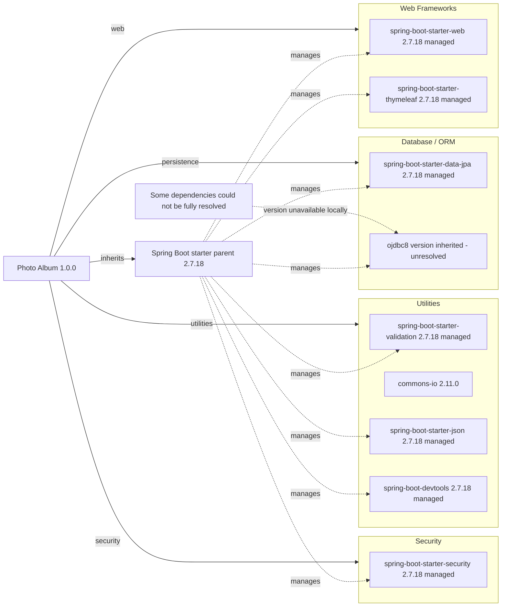

# Dependency Map

Photo Album (`com.photoalbum:photo-album:1.0.0`) declares **11 external dependencies: 9 non-test and 2 test** in its single Maven build (`pom.xml:15-21,30-101`). Counts exclude the parent POM and build plugin; analysis covers build/package declarations only, not application source or a resolved transitive dependency tree.

## Dependencies

The parent is `org.springframework.boot:spring-boot-starter-parent:2.7.18` (`pom.xml:8-13`). Spring Boot artifacts above use the parent's managed release; their dependency declarations omit explicit versions. Oracle and H2 versions are also inherited but cannot be established from this repository's POM alone. No imported BOM or lockfile was found locally; upstream parent/BOM contents were not fetched, and no transitive dependencies are counted or asserted.

### Dependency Summary

| Category | Count | Key Libraries | Notes |
|----------|-------|---------------|-------|
| Web Frameworks | 2 | Spring Boot Web, Thymeleaf — managed 2.7.18 | HTTP and server-side templating starters (`pom.xml:31-41`) |
| Database / ORM | 2 | Spring Boot Data JPA — managed 2.7.18; Oracle ojdbc8 — inherited version | JPA starter and runtime JDBC driver (`pom.xml:43-54`) |
| Security | 1 | Spring Boot Security — managed 2.7.18 | Security starter (`pom.xml:62-66`) |
| Utilities | 4 | Validation, JSON, DevTools — managed 2.7.18; Commons IO 2.11.0 | Validation, serialization, file utilities and optional development tooling (`pom.xml:56-60,68-79,95-100`) |
| **Total non-test** | **9** | | Test dependencies excluded |

Declared non-test coordinates and scopes:

| Dependency | Version declaration / management | Scope | Evidence |
|------------|----------------------------------|-------|----------|
| `org.springframework.boot:spring-boot-starter-web` | Omitted; parent-managed 2.7.18 | compile (default) | `pom.xml:32-35` |
| `org.springframework.boot:spring-boot-starter-thymeleaf` | Omitted; parent-managed 2.7.18 | compile (default) | `pom.xml:38-41` |
| `org.springframework.boot:spring-boot-starter-data-jpa` | Omitted; parent-managed 2.7.18 | compile (default) | `pom.xml:44-47` |
| `com.oracle.database.jdbc:ojdbc8` | Omitted; inherited version unresolved | runtime | `pom.xml:50-54` |
| `org.springframework.boot:spring-boot-starter-validation` | Omitted; parent-managed 2.7.18 | compile (default) | `pom.xml:57-60` |
| `org.springframework.boot:spring-boot-starter-security` | Omitted; parent-managed 2.7.18 | compile (default) | `pom.xml:63-66` |
| `commons-io:commons-io` | Explicit 2.11.0 | compile (default) | `pom.xml:69-73` |
| `org.springframework.boot:spring-boot-starter-json` | Omitted; parent-managed 2.7.18 | compile (default) | `pom.xml:76-79` |
| `org.springframework.boot:spring-boot-devtools` | Omitted; parent-managed 2.7.18 | compile (default), optional | `pom.xml:96-100` |

### Version & Compatibility Risks

Spring Boot 2.7.18 is a legacy release outside its original open-source support window; commercial support availability is not established here (`pom.xml:8-13`). The build targets Java 8 (`pom.xml:23-26`), so migration to Spring Boot 3 or later requires a newer Java baseline and review of Jakarta namespace compatibility. Commons IO is pinned to the older 2.11.0 release (`pom.xml:69-73`); review current supported versions and security advisories before retaining it. Oracle and H2 compatibility cannot be assessed precisely until their managed versions are resolved. These are compatibility observations, not a vulnerability scan.

### Notable Observations

- Versions are centralized through the Spring Boot parent except for the explicit Commons IO pin; no local dependency-management override or imported BOM is declared (`pom.xml:8-13,30-101`).
- The JSON starter is separately declared alongside the Web starter. Potential transitive overlap should be checked with a resolved dependency tree; despite its “Image processing” comment, the declared artifact is a JSON starter, not an image-processing library (`pom.xml:31-35,75-79`).
- DevTools is optional but has default compile scope, not test scope; it is therefore included in the non-test count (`pom.xml:95-100`).
- The build declares `org.springframework.boot:spring-boot-maven-plugin` without an explicit version. This is build tooling, excluded from library counts and the diagram (`pom.xml:103-109`).

## Test Dependencies

| Framework | Version | Notes |
|-----------|---------|-------|
| `org.springframework.boot:spring-boot-starter-test` | Omitted; parent-managed 2.7.18 | Test support starter; individual bundled frameworks and versions are not enumerated locally. Explicit test scope (`pom.xml:81-86`). |
| `com.h2database:h2` | Omitted; inherited version unresolved | In-memory database support; explicit test scope (`pom.xml:88-93`). |

Total test-scope dependencies: 2

No separate integration-test or contract-testing dependency is explicitly declared (`pom.xml:81-100`). H2 differs from the runtime Oracle driver, so database-specific behavior requires attention; this inventory does not establish test coverage or execution results (`pom.xml:49-54,88-93`).
