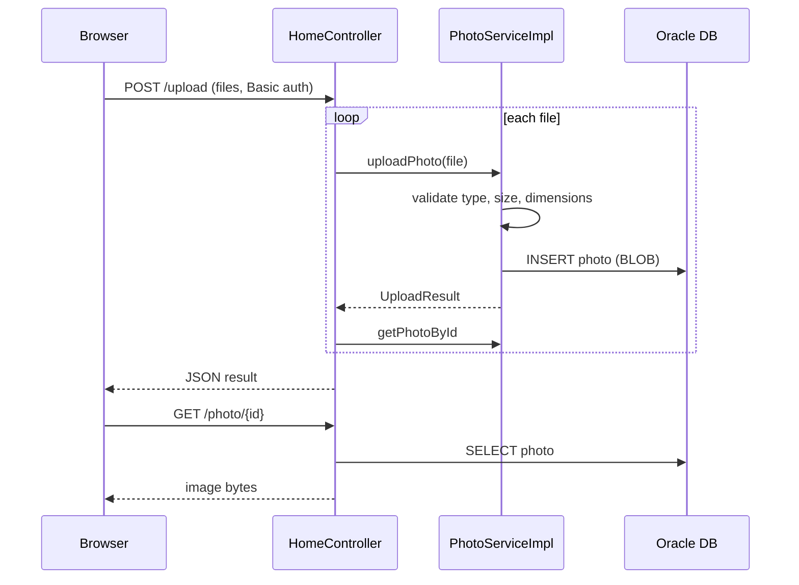

# API and Service Contracts

The application exposes HTTP endpoints only; it has no outbound service calls other than the Oracle database.

| Method | Path | Auth | Description |
|--------|------|------|-------------|
| GET | `/` | Public | Gallery page (`index` view) |
| POST | `/upload` | HTTP Basic (ADMIN) | Multipart `files` (list); returns JSON `{success, uploadedPhotos[], failedUploads[]}` |
| GET | `/detail/{id}` | Public | Photo detail page with previous/next ids |
| POST | `/detail/{id}/delete` | HTTP Basic (ADMIN) | Deletes photo, redirects to `/` with flash message |
| GET | `/photo/{id}` | Public | Returns photo bytes with stored MIME type and no-cache headers; 404 if missing |

Upload constraints: allowed MIME types `image/jpeg,png,gif,webp`, max 10 MB per file, max 10 files, 40 M pixel limit.

