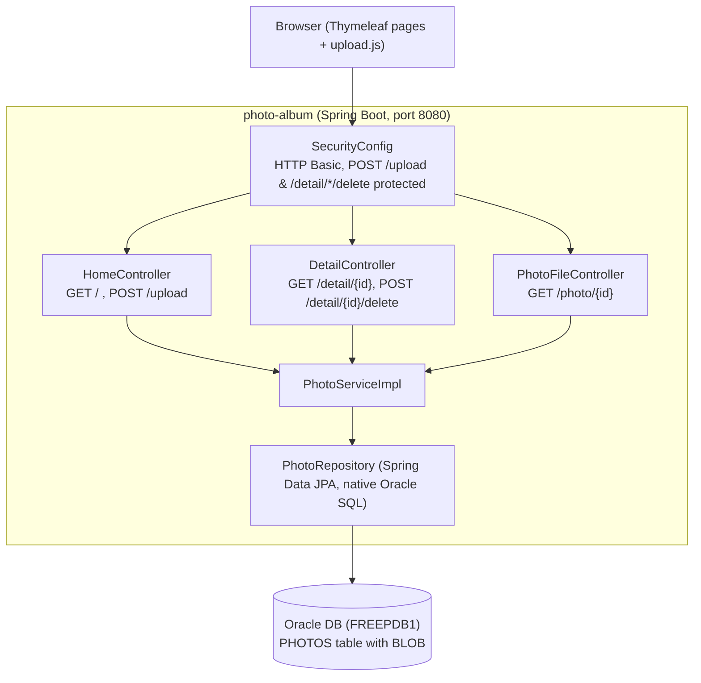

# Architecture Diagram

Photo Album is a single-deployable Spring Boot 2.7.18 (Java 8) monolith that serves a server-rendered Thymeleaf gallery and stores uploaded photos as BLOBs in an Oracle database.

## Components

| Component | Responsibility |
|-----------|----------------|
| `HomeController` | Gallery page and multi-file upload JSON API |
| `DetailController` | Photo detail page, previous/next navigation, delete |
| `PhotoFileController` | Streams photo bytes from the BLOB column |
| `PhotoServiceImpl` | Validation (MIME type, size, pixel limit), persistence, navigation queries |
| `PhotoRepository` | Oracle-specific native queries (ROWNUM, NVL, TO_CHAR) |
| `SecurityConfig` | Stateless HTTP Basic auth with an in-memory admin user |

Deployment: `docker-compose.yml` runs the app and `gvenzl/oracle-free`; Azure setup scripts (`azure-setup.ps1`) exist for cloud provisioning.
