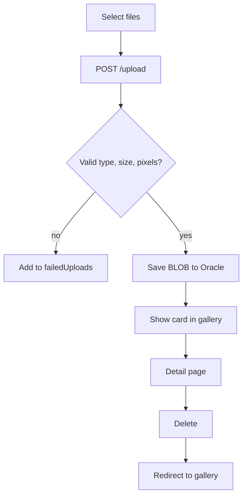

# Business Workflows

## Upload photos
1. Authenticated admin selects one or more images in the gallery page.
2. `upload.js` posts them to `/upload`.
3. For each file the service checks MIME type, size, non-empty, and decoded pixel count, generates a UUID stored name, reads the bytes, and saves a `Photo` with BLOB data.
4. The JSON response lists successes and failures; the page prepends new cards.

## Browse gallery and view detail
1. `GET /` lists all photos newest first.
2. `GET /detail/{id}` shows one photo with previous (older) / next (newer) navigation based on `uploaded_at`.
3. Images are loaded from `GET /photo/{id}`.

## Delete photo
1. Authenticated admin posts to `/detail/{id}/delete`.
2. The photo row is removed; user is redirected to `/` with a success or error message.

