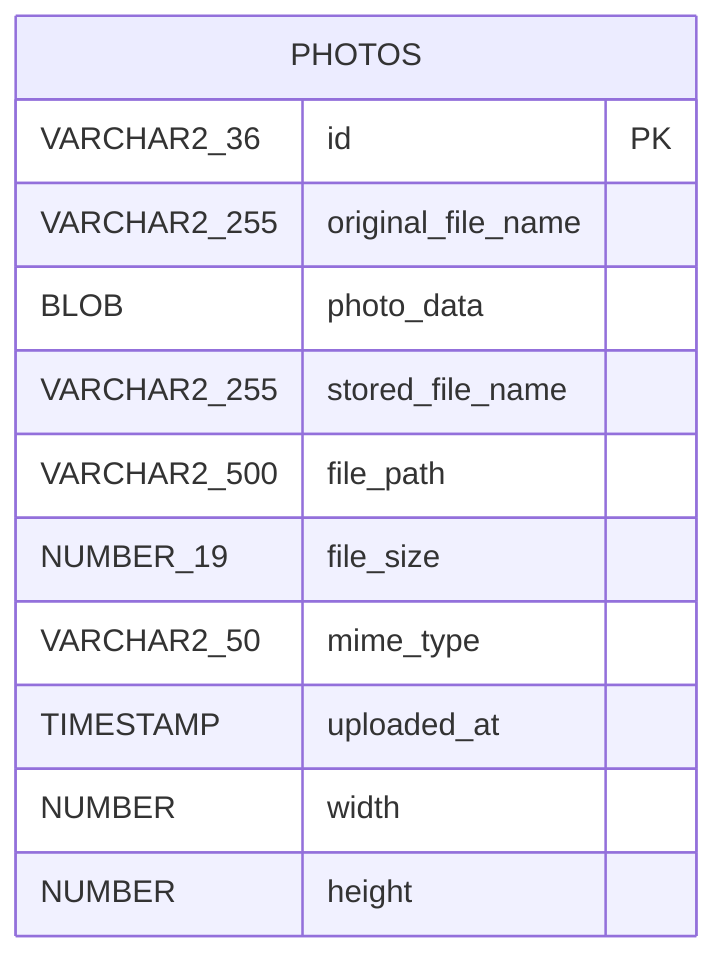

# Data Architecture

Single relational store: Oracle Database (Free 23ai in docker-compose), accessed through Spring Data JPA/Hibernate. `spring.jpa.hibernate.ddl-auto=create` recreates the schema on every start. Tests use H2.

- Entity: `com.photoalbum.model.Photo` (UUID string id, index `idx_photos_uploaded_at`).
- Image binaries are stored in the `photo_data` BLOB column; `file_path` is retained for compatibility only. A legacy file exists under `src/main/resources/static/uploads/`.
- Repository uses Oracle-specific native SQL (`ROWNUM`, `NVL`, `TO_CHAR`), which couples the data layer to Oracle.
- Init scripts in `oracle-init/` create the application user.
