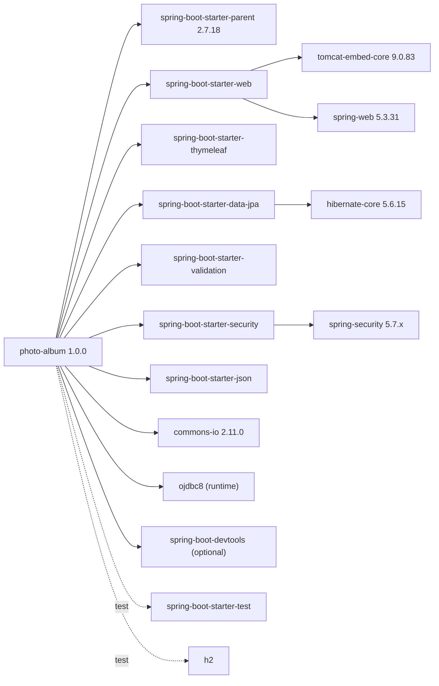

# Dependency Map

| Dependency | Version | Scope | Notes |
|------------|---------|-------|-------|
| Spring Boot parent | 2.7.18 | - | End of OSS support; Java 8 baseline |
| commons-io | 2.11.0 | compile | Declared explicitly; CVE-2024-47554 fixed in 2.14.0 |
| ojdbc8 | managed | runtime | Oracle JDBC driver |
| h2 | managed | test | In-memory DB for tests |
| spring-boot-devtools | managed | optional | Development only |

Build tool: Maven. Java source/target: 8.
