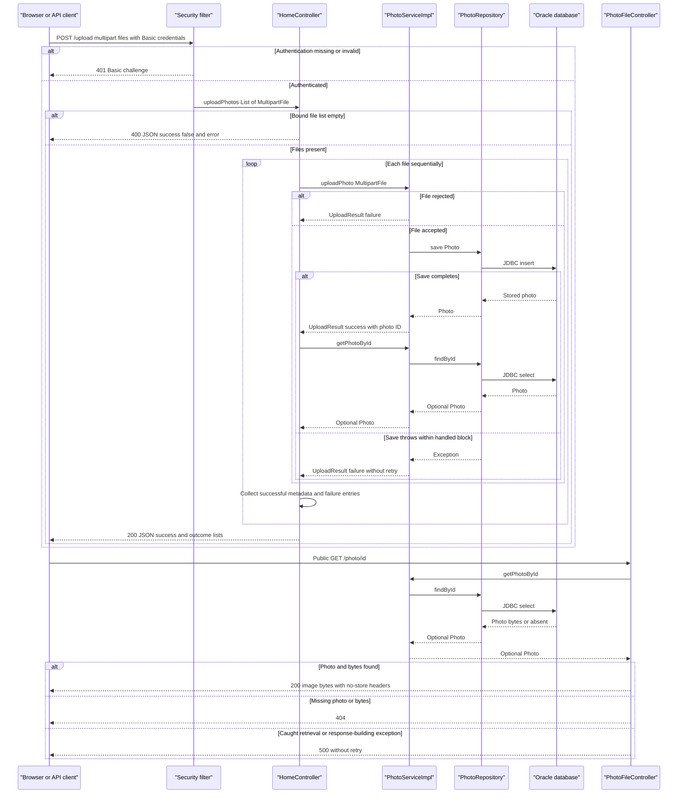

# API & Service Communication Contracts

The application defines five controller endpoints: two HTML reads, one binary image read, one multipart-to-JSON upload, and one deletion action. Browser requests and downstream persistence calls are synchronous; no application messaging or remote business-service API clients were found.

Evidence references below are workspace-relative source paths and line numbers. This is a static source assessment, not a runtime verification; credential values are intentionally omitted.

## Service Catalog

| Service | Port | Category | Purpose |
| --- | --- | --- | --- |
| `photoalbum-java-app` / Maven `com.photoalbum:photo-album` | HTTP 8080; Compose host 8080 → container 8080 | Business; includes API Layer | Single source-built deployable serving the gallery, upload, photo bytes, and delete actions. Key dependencies: Spring Boot Web, Thymeleaf, Data JPA, Validation, Security, JSON, and Oracle JDBC. |
| `oracle-db` | TCP 1521; Compose host 1521 → container 1521 | Infrastructure | Third-party `gvenzl/oracle-free:latest` container used by the application over JDBC; not a source-owned HTTP service. |

Evidence: `pom.xml:8–21,30–79` defines one JAR and its dependencies, without Maven modules; `docker-compose.yml:1–44` defines both services, port mappings, and the application build; `Dockerfile:21–31` launches that JAR.

`azure-setup.ps1:69–153` additionally provisions registry, Kubernetes, and PostgreSQL infrastructure. These are provisioning resources, not additional implemented API services: the application runtime configuration and JDBC dependency still target Oracle (`src/main/resources/application.properties:9–20`, `pom.xml:49–54`). No Kubernetes deployment, Helm chart, or additional application module was identified.

## API Endpoints Inventory

| Service / Controller | Method | Path | Request Type | Response Type |
| --- | --- | --- | --- | --- |
| `photoalbum-java-app` / `HomeController` | GET | `/` | No explicit parameters | Normally 200 HTML, Thymeleaf `index` view; model contains `List<Photo>` and a timestamp. A retrieval exception is caught and renders the same view with an empty list. |
| `photoalbum-java-app` / `HomeController` | POST | `/upload` | Authenticated multipart request; required repeated part `files`, bound as `List<MultipartFile>` | 200 JSON `Map<String,Object>` containing overall success and per-file success/failure lists, including when all processed files fail; explicit 400 JSON for a null/empty bound list. Missing required part can be rejected by Spring binding with 400 before controller entry. Unauthenticated requests receive a Basic challenge / 401. |
| `photoalbum-java-app` / `DetailController` | GET | `/detail/{id}` | String path parameter `id` | Normally 200 HTML, Thymeleaf `detail` view with `Photo` and previous/next identifiers. Missing photo, blank ID, or caught exception returns `redirect:/` (normally 302), not 404. |
| `photoalbum-java-app` / `DetailController` | POST | `/detail/{id}/delete` | Authenticated request; String path parameter `id`; no request-body DTO | `redirect:/` (normally 302) for success, missing photo, or caught deletion error; outcome is carried by a flash attribute, not JSON. Unauthenticated requests receive 401. |
| `photoalbum-java-app` / `PhotoFileController` | GET | `/photo/{id}` | String path parameter `id`; browser may append cache-busting `_t` query value, which the controller does not bind | 200 binary `ResponseEntity<Resource>` backed by `ByteArrayResource`, using the stored MIME type; 404 for blank/unknown ID or absent/empty bytes; caught exceptions yield an empty 500 response. |

Evidence: `src/main/java/com/photoalbum/controller/HomeController.java:37–98`; `src/main/java/com/photoalbum/controller/DetailController.java:18–78`; `src/main/java/com/photoalbum/controller/PhotoFileController.java:23–86`; `src/main/java/com/photoalbum/config/SecurityConfig.java:46–61`; `src/main/resources/static/js/upload.js:97–106,176–179`. Binding-generated 400 and normal redirect statuses are framework behavior, not explicit `ResponseEntity` statuses in those handlers.

- **Versioning:** no URL, header, or query-based API versioning is declared.
- **Upload outcome semantics:** overall `success` means at least one photo was added to the successful response list. Clients must inspect both lists; HTTP 200 alone does not establish upload success. Each file is processed sequentially, followed by a lookup for successful uploads. An absent post-save lookup is silently omitted; a lookup exception is not caught by `uploadPhotos` and may yield framework-level 500 (`HomeController.java:68–97`).
- **Upload limits:** configured multipart ceilings are 10 MB per file and 50 MB per request. There is no custom multipart-size exception handler in the inspected source, so no application-specific oversize error envelope is established. No controller/service enforcement of a maximum file count was found. Per-file service rejections become entries in the 200 JSON response rather than 400 responses. Constraint details belong in [business-workflows.md](business-workflows.md). Evidence: `src/main/resources/application.properties:23–30`; `PhotoServiceImpl.java:82–109,138–154,181–189`.
- **Image headers:** successful binary responses set `Cache-Control: no-cache, no-store, must-revalidate, private`, `Pragma: no-cache`, `Expires: 0`, and `X-Photo-ID`, `X-Photo-Name`, `X-Photo-Size` (`PhotoFileController.java:74–83`).
- **Framework/static surface:** `/css/**`, `/js/**`, and bundled `/uploads/**` resources are additional static content, not controller APIs. `/error` is a potential Spring Boot default error dispatch, not a custom management endpoint. No custom global error handler or standardized error DTO was found.

## Management & Observability Endpoints

| Service | Endpoint | Custom Metrics (if any) |
| --- | --- | --- |
| `photoalbum-java-app` | No explicit health, readiness, Actuator, metrics, Prometheus, Swagger UI, or API-documentation endpoint found | None found; application logging is present, but no custom metric registrations or `@Timed` annotations were identified. |
| `oracle-db` | No HTTP management endpoint declared by this application | None declared; its container-local readiness mechanism is not a public API contract. |

Evidence: complete dependency list in `pom.xml:30–101` contains no Actuator, metrics exporter, or Swagger/Springdoc dependency; all controller mappings are listed above. Compose defines a database readiness check (`docker-compose.yml:17–22`), not a management HTTP service. See [configuration-inventory.md](configuration-inventory.md) for operational readiness details.

## DTOs & Contracts

| Class / Contract | API role | Mutability / representation |
| --- | --- | --- |
| `Photo` | Service-owned domain entity used in server-rendered view models and as the source of upload-response metadata; not directly accepted as a request body or returned as a whole JSON entity | Mutable Java POJO with setters; no gateway aggregation DTO. |
| `UploadResult` | Internal service-to-controller upload outcome, mapped into public success/failure entries | Mutable Java POJO; not serialized directly by the upload handler. |
| `MultipartFile` / `List<MultipartFile>` | Framework multipart upload request contract | Framework abstraction; no custom upload request DTO. |
| `Map<String,Object>` and nested lists/maps | Public JSON upload response envelope | Mutable, dynamically assembled contract rather than a typed response class. |
| `Resource` / `ByteArrayResource` | Binary image response body | Framework response abstraction; not a JSON DTO. |
| String `id`, `Model`, `RedirectAttributes` | Path identity, HTML view composition, and deletion feedback | Server-side MVC contracts; models/flash attributes are not standalone JSON responses. |

The upload envelope has `success`, `uploadedPhotos`, and `failedUploads`; the explicit empty-input error instead contains `success` and `error`. Failure entries provide `fileName` and `error`; successful entries are selected metadata projections, not the complete `Photo` entity or binary content. For entity fields and persistence details, see [data-architecture.md](data-architecture.md).

Serialization uses the Spring Boot JSON/Jackson dependency and standard MVC message conversion. No custom Jackson configuration, serializer, naming strategy, immutable record DTO, OpenAPI/Swagger specification, protobuf schema, or GraphQL schema was found in the application source. HTML responses are rendered with Thymeleaf rather than JSON serialization; image bodies are served as bytes.

Evidence: `src/main/java/com/photoalbum/model/Photo.java:19,93–198`; `src/main/java/com/photoalbum/model/UploadResult.java:6–63`; `HomeController.java:55–97`; `PhotoFileController.java:68–83`; `pom.xml:31–41,75–79`.

## Communication Patterns

- **Inbound and internal synchronous calls:** browser navigation/forms and `fetch('/upload')` call MVC handlers. Controllers invoke `PhotoService` directly; `PhotoServiceImpl` invokes `PhotoRepository` synchronously through JPA/JDBC. The repository is an in-process component, not a separate network service. Database access is the implemented backend network boundary (`HomeController.java:28–40,68–74`; `PhotoServiceImpl.java:28–30,53–75,172–185`; `src/main/java/com/photoalbum/repository/PhotoRepository.java:15–27`).
- **Browser async is not messaging:** the JavaScript upload function uses `async`/`await`, but it still makes one request/response HTTP call. No queue, broker, pub/sub, background processing contract, streaming API, or event subscription was identified (`src/main/resources/static/js/upload.js:90–132`).
- **Browser external dependency:** templates load Bootstrap assets over HTTPS from jsDelivr. This is client-side static asset delivery, not an application-to-service business API (`src/main/resources/templates/layout.html`, `index.html`, `detail.html`).
- **No gateway aggregation:** no gateway, BFF, remote REST/gRPC client, service registry, client-side load balancer, or downstream-service composition was found. Upload aggregation merely collects local per-file outcomes; detail-page composition joins the photo and adjacent-photo identifiers through local service calls (`HomeController.java:58–95`; `DetailController.java:38–54`).
- **Address resolution:** the application connects to the Compose database service by the configured hostname `oracle-db`, using network DNS, not Eureka/Consul registration (`docker-compose.yml:30–43`; `src/main/resources/application.properties:9–15`). No additional service discovery mechanism is implemented.
- **Resilience and timeouts:** no application-level retry, circuit breaker, bulkhead, fallback library, explicit HTTP client timeout, or explicit JDBC connection/query timeout was found. Dependency defaults are not asserted as application policies. Compose process restart-on-failure is not a request retry. Upload failures are converted into `UploadResult`; gallery read errors render an empty gallery; detail errors redirect; image-serving errors return 500; deletion errors redirect with feedback. No automatic retry occurs in the browser upload handler (`PhotoServiceImpl.java:55–75,82–193,199–217`; controller evidence above; `docker-compose.yml:44`; `upload.js:102–132`).
- **Availability prerequisite:** Compose starts the app after the database is healthy; a required administrator password must also be supplied for security bean creation. Detailed startup/configuration mechanics belong in [configuration-inventory.md](configuration-inventory.md), not this contract inventory (`docker-compose.yml:35–41`; `SecurityConfig.java:33–42`).
- **Authentication and authorization:** stateless HTTP Basic authentication protects exactly POST `/upload` and POST `/detail/*/delete`. Other requests are permitted without authentication, including gallery and image reads. An in-memory user is assigned the `ADMIN` role and its password is BCrypt-encoded, but endpoint rules require only authentication, not an explicit role check. CSRF is disabled; no JWT/OAuth2, method-level role checks, or application TLS configuration was identified (`SecurityConfig.java:28–61`).
- **Transport and client behavior:** the checked-in deployment exposes HTTP 8080; HTTPS termination is not demonstrated by the runtime configuration or Compose file. JDBC uses an Oracle thin connection without explicit TLS configuration. Browser code does not supply an explicit Basic `Authorization` header or implement a login flow; callers must arrange valid Basic credentials for mutations (`src/main/resources/application.properties:1–15`; `docker-compose.yml:30–38`; `upload.js:102–106`). No credential values are reproduced here.

## Service Technology Matrix

Columns unused by every service—service discovery frameworks, gateway, application cache, and metrics export—are omitted.

| Service | Web | Data Access | Actuator / Health |
| --- | --- | --- | --- |
| `photoalbum-java-app` | Spring MVC; Thymeleaf; multipart, JSON, binary bodies | Spring Data JPA / Hibernate; Oracle JDBC | No declared management endpoint or application health check |
| `oracle-db` | Not an HTTP application | Oracle database server; JDBC target | Container-local readiness check, not Actuator |

Evidence: `pom.xml:30–79`; `docker-compose.yml:3–22`; controller mappings above. Binary-response cache-control headers do not imply a server-side cache.

## Service Communication Sequence

The upload flow illustrates request authentication, local outcome aggregation, and the binary read that follows a successful upload. Dashed arrows represent responses, not queued events; no broker, gateway, retry, or circuit breaker exists in this flow.

Diagram evidence: `HomeController.java:55–97`, `PhotoServiceImpl.java:69–75,82–193`, `PhotoFileController.java:37–86`, and `SecurityConfig.java:46–61`. The successful post-save lookup is shown; its absent-result/uncaught-exception edge cases are described in the endpoint inventory. Exceptions raised later at transaction completion can likewise escape the service's internal save catch; the diagram does not imply every persistence failure is converted to a normal JSON outcome.
