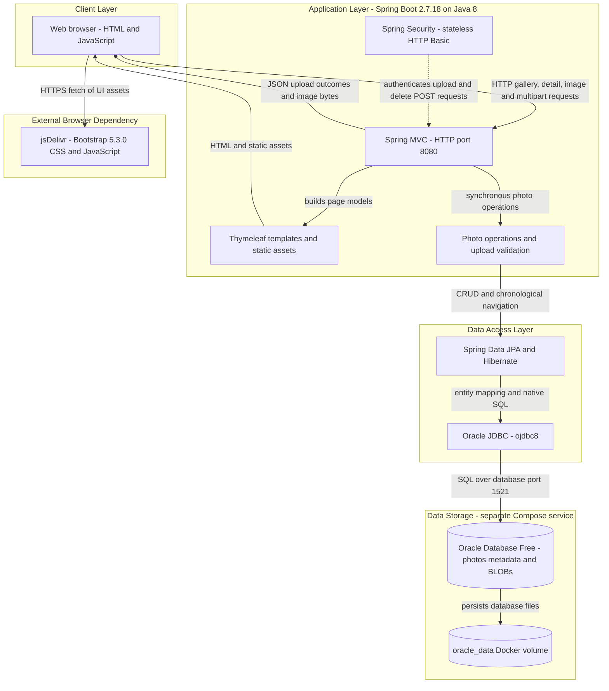
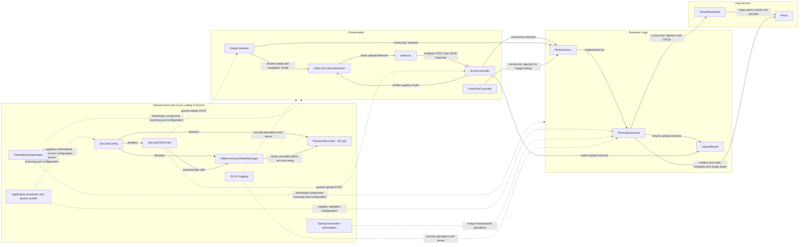

# Architecture Diagram

Photo Album is a single-module Java 8 Spring Boot application providing a browser-based photo gallery, uploads, detail navigation, deletion, and image delivery. The diagrams describe the checked-in implementation and Docker Compose topology, not a verified running deployment; credentials are intentionally omitted.

## Application Architecture

### Technology Stack Summary

| Layer | Technology | Version | Purpose |
|---|---|---|---|
| Build and runtime | Maven, Java, executable Spring Boot JAR | Docker build Maven 3.9.6; Java 8; application 1.0.0 | Build and run a single deployable application. |
| Application and HTTP | Spring Boot Web / Spring MVC | Boot 2.7.18; individual transitive versions not explicitly declared | MVC routing, multipart uploads, JSON responses, and binary photo responses on port 8080. |
| Presentation | Thymeleaf, browser JavaScript, Bootstrap | Thymeleaf Boot-managed; Bootstrap 5.3.0 | Server-rendered gallery and detail pages, asynchronous uploads, and styling. |
| Security | Spring Security, BCrypt, in-memory user store | Boot-managed | HTTP Basic authentication for mutation endpoints; public gallery and photo reads. |
| Business | Spring services and transaction management; Java ImageIO | Boot-managed Spring; Java 8 ImageIO | Upload checks, image dimensions, persistence orchestration, and chronological navigation. |
| Persistence | Spring Data JPA, Hibernate, Oracle JDBC `ojdbc8` | Boot-managed; not separately pinned in the POM | JPA CRUD plus Oracle-specific native queries. |
| Database | Oracle Database Free | Compose image `gvenzl/oracle-free:latest`; exact server version not pinned | Store metadata and binary photo contents in the `photos` table. |
| Containers | Docker multi-stage build and Docker Compose | Runtime image `eclipse-temurin:8-jre`; Docker/Compose versions unspecified | Run the application and Oracle as separate services on a bridge network, with persistent Oracle storage. |

Evidence: `pom.xml:8-27,30-66,103-108`; `Dockerfile:1-31`; `docker-compose.yml:1-51`; `src/main/resources/application.properties:1-30`; `src/main/resources/templates/index.html` and `detail.html` (Bootstrap references and Thymeleaf bindings).

### Data Storage & External Services

Oracle is the sole production data store identified in the inspected application code and configuration. `Photo` maps UUID identifiers, filenames, MIME type, size, timestamp, dimensions, and a byte-array LOB to `photos`; uploads persist bytes in the database and `/photo/{id}` returns them rather than reading an uploaded file from disk. The `/uploads/` path retained in metadata is compatibility information, not the image-serving path. Compose mounts `oracle_data` for Oracle files and an initialization directory, connects the two services through `photoalbum-network`, and starts the application after the database health check succeeds. Both application profiles set `spring.jpa.hibernate.ddl-auto=create`, so persistent database storage does not imply preservation of application tables across application starts. The browser loads Bootstrap assets from jsDelivr; no backend remote API, cache, or message broker is identified. H2 is a test-scoped dependency, not a production database.

Evidence: `src/main/java/com/photoalbum/model/Photo.java:15-108`; `src/main/java/com/photoalbum/service/impl/PhotoServiceImpl.java:112-179`; `src/main/java/com/photoalbum/controller/PhotoFileController.java:23-83`; `docker-compose.yml:10-50`; `src/main/resources/application.properties:17-25`; `src/main/resources/application-docker.properties:13-17`; `pom.xml:88-93`.

### Key Architectural Decisions

- **Layered monolith with constructor injection:** three MVC controllers depend on the `PhotoService` interface; its transactional implementation depends on `PhotoRepository`. Templates, JSON upload results, and binary image responses share one application process. Evidence: `HomeController.java:23-32,37-97`, `DetailController.java:17-27,32-78`, `PhotoFileController.java:22-38`, and `PhotoServiceImpl.java:28-48` under `src/main/java/com/photoalbum/`.
- **Database-backed media with Oracle coupling:** image bytes and metadata live together; native repository queries use Oracle features such as `ROWNUM`, `NVL`, and `TO_CHAR`, rather than a database-neutral repository alone. Evidence: `src/main/java/com/photoalbum/model/Photo.java:36-41`; `src/main/java/com/photoalbum/repository/PhotoRepository.java:16-100`.
- **Public reads, authenticated mutations:** the security filter chain requires authentication for POST `/upload` and `/detail/*/delete`, permits other requests, uses stateless HTTP Basic, and disables CSRF. The admin account is built in memory with BCrypt from externalized configuration; no credential values are reproduced here. Evidence: `src/main/java/com/photoalbum/config/SecurityConfig.java:28-61`.

## Component Relationships

### Component Inventory

Paths below are relative to `src/main/` unless stated otherwise. External systems are intentionally excluded from this component diagram.

| Component | Layer | Type | Responsibility |
|---|---|---|---|
| `PhotoAlbumApplication` | Infrastructure | Spring Boot entry point | Starts application and component discovery. Evidence: `java/com/photoalbum/PhotoAlbumApplication.java:9-14`. |
| `HomeController` | Presentation | MVC controller | GET `/` renders gallery; POST `/upload` processes files through the service and returns JSON containing successful photos and failures. Evidence: `java/com/photoalbum/controller/HomeController.java:23-97`. |
| `DetailController` | Presentation | MVC controller | GET `/detail/{id}` renders metadata and adjacent-photo links; POST `/detail/{id}/delete` deletes and redirects with feedback. Evidence: `java/com/photoalbum/controller/DetailController.java:17-78`. |
| `PhotoFileController` | Presentation | MVC binary-response controller | GET `/photo/{id}` reads stored bytes through the service and returns a resource with MIME type and no-cache headers. Evidence: `java/com/photoalbum/controller/PhotoFileController.java:22-83`. |
| `index.html`, `detail.html`, `layout.html`, `site.css` | Presentation | Thymeleaf templates and static stylesheet | Gallery cards, upload UI, photo detail, navigation, and shared layout/styling resources; controllers explicitly return `index` and `detail`. Evidence: `resources/templates/`, `resources/static/css/site.css`; controller view return statements. |
| `upload.js` | Presentation | Browser JavaScript | Drag-and-drop selection, client-side MIME and size checks, multipart fetch, JSON feedback, and dynamic gallery insertion. Evidence: `resources/static/js/upload.js:48-132,135-202`. |
| `PhotoService` | Business Logic | Service interface | Contract for list, lookup, upload, deletion, and older/newer navigation. Evidence: `java/com/photoalbum/service/PhotoService.java:13-54`. |
| `PhotoServiceImpl` | Business Logic | Transactional Spring service | Constructor-injected repository and validation settings; validates uploads, extracts dimensions with an image pixel limit, stores BLOB data, and coordinates queries/deletes. Read operations declare read-only transactions. Evidence: `java/com/photoalbum/service/impl/PhotoServiceImpl.java:28-75,82-193,199-237`. |
| `UploadResult` | Business Logic | Result DTO | Carries success, filename, error message, and photo identifier from service to upload controller. Evidence: `java/com/photoalbum/model/UploadResult.java:6-10`; `java/com/photoalbum/controller/HomeController.java:68-89`. |
| `PhotoRepository` | Data Access | Spring Data JPA repository | UUID-string keyed CRUD and native SQL for chronology, month filtering, pagination, and statistics; the current service uses CRUD and chronology operations. Evidence: `java/com/photoalbum/repository/PhotoRepository.java:16-100`; `java/com/photoalbum/service/impl/PhotoServiceImpl.java:55-75,174,201-237`. |
| `Photo` | Data Access | JPA entity | Maps `photos`, binary image LOB, metadata, timestamp index, generated UUID, and initial timestamp. Evidence: `java/com/photoalbum/model/Photo.java:15-108`. |
| `SecurityConfig`, `SecurityFilterChain` | Infrastructure | Configuration and security filter chain | Configures mutation authentication, public reads, stateless sessions, HTTP Basic, and disabled CSRF. Evidence: `java/com/photoalbum/config/SecurityConfig.java:25-61`. |
| `InMemoryUserDetailsManager`, `PasswordEncoder` | Infrastructure | Security beans | Holds the configured admin user and BCrypt-encodes its supplied password. Evidence: `java/com/photoalbum/config/SecurityConfig.java:28-43`. |
| Application properties and Docker profile | Infrastructure | Externalized configuration | Defines HTTP port, Oracle datasource, JPA behavior, multipart constraints, validation settings, and logging levels. Evidence: `resources/application.properties:1-34`; `resources/application-docker.properties:1-35`. |
| Transaction interception and SLF4J logging | Infrastructure | Cross-cutting framework facilities | Service transaction boundaries and controller/service operational logging; no custom logging middleware was identified. Evidence: transaction annotations in `java/com/photoalbum/service/impl/PhotoServiceImpl.java:28-29,54,68,224,234`; logger declarations in controllers and service. |
| `MathUtil` | Supporting utility | Standalone Java utility | Provides GCD calculation; not connected to the traced request/service flow and therefore omitted from the diagram. Evidence: `java/com/photoalbum/util/MathUtil.java:6-21`. |
