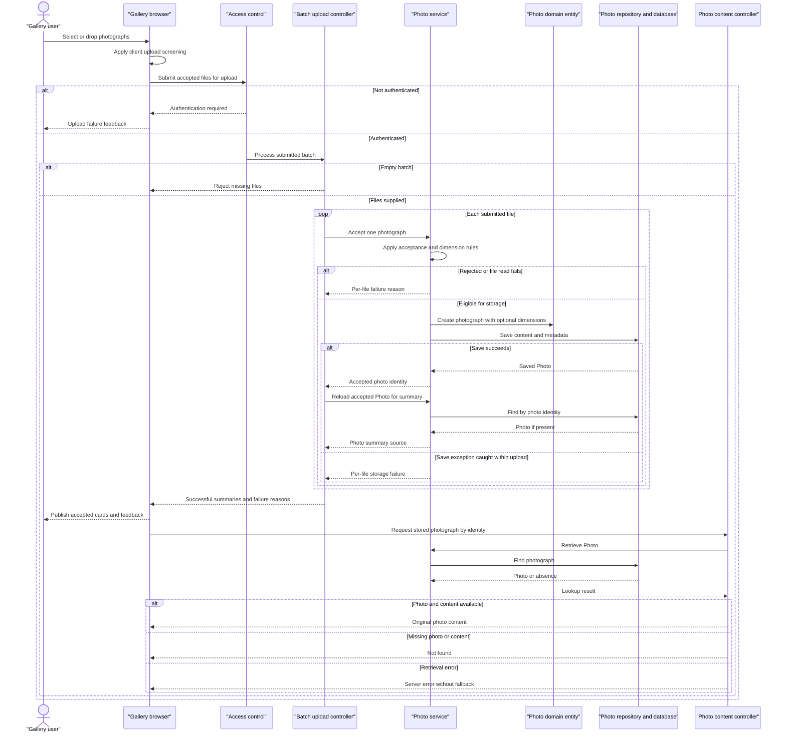

# Core Business Workflows

Photo Album lets visitors browse a shared gallery, open individual photographs, and navigate by upload time. Authenticated users can add photographs in batches and permanently remove them.

Evidence references below use repository-relative paths and line ranges. This is a static analysis of the current implementation; no runtime behavior or external-service availability was tested. No credential values are reproduced.

## Domain Entities

| Entity | Service / Bounded Context | Description | Key Relationships |
| --- | --- | --- | --- |
| Photo | PhotoService / Photo collection management | A photograph with its original content and display information; the only persisted business entity found. | Displayed in the shared gallery; earlier and later photos are derived from upload times, not explicit relationships. No album grouping or uploader ownership relationship is modeled. |
| UploadResult (operation result, not an entity) | PhotoService / Upload processing | Communicates acceptance or rejection of one submitted file. | A successful result references the created Photo; a failed result identifies the submitted filename and reason. |

Evidence: `src/main/java/com/photoalbum/model/Photo.java:19-108`; `src/main/java/com/photoalbum/model/UploadResult.java:6-29`; `src/main/java/com/photoalbum/service/impl/PhotoServiceImpl.java:220-237`.

## Service-to-Domain Mapping

The application has one local business service, not independently deployed domain microservices. Controller responsibilities are included to make orchestration boundaries explicit.

| Service | Domain Context | Owned Entities | External Dependencies |
| --- | --- | --- | --- |
| PhotoService / PhotoServiceImpl | Photo collection management: acceptance, storage, retrieval, ordering, deletion | Photo; produces UploadResult | PhotoRepository and its database; local image-header readers for optional dimensions |
| HomeController | Gallery presentation and batch upload orchestration | None; composes photo summaries and per-file outcomes | Local PhotoService |
| DetailController | Individual-photo browsing and removal | None; composes current and neighboring Photo references | Local PhotoService |
| PhotoFileController | Delivery of stored photo content | None; reads Photo content | Local PhotoService |
| SecurityConfig | Access control, separate from the photo domain | No business entities; configures an in-memory administrative identity | Externally supplied credentials; values intentionally omitted |

PhotoRepository is the persistence boundary and the stored Photo is the source of truth for both content and metadata. There is no separate object-storage write or filesystem-write step in the upload workflow. The generated compatibility path is not the content-serving source.

Evidence: `src/main/java/com/photoalbum/service/impl/PhotoServiceImpl.java:37-48,112-185`; `src/main/java/com/photoalbum/repository/PhotoRepository.java:15-27`; `src/main/java/com/photoalbum/controller/HomeController.java:28-32,55-97`; `src/main/java/com/photoalbum/controller/DetailController.java:23-27,32-78`; `src/main/java/com/photoalbum/controller/PhotoFileController.java:28-83`; `src/main/java/com/photoalbum/config/SecurityConfig.java:28-61`.

## Primary Workflows

### Workflow 1: Upload a batch and publish accepted photos

**Entry:** A user selects or drops files in the gallery; the browser submits `POST /upload`. The protected write requires authentication.

1. The browser applies **Client upload screening**, collects accepted files into one multipart request, and shows upload progress.
2. HomeController applies **Nonempty batch**. It then calls PhotoService once per submitted file, sequentially.
3. PhotoService applies **Server file acceptance** and **Image dimension ceiling**. It reads the content, derives optional dimensions, and assigns a compatibility filename/path.
4. A new Photo receives its identity and upload time, then the service saves its content and metadata together. The result reports the new photo ID or a failure reason.
5. For every successful result, the controller separately reloads the Photo and builds the gallery summary. Rejected files contribute to a separate failure list.
6. The response aggregates successful summaries and failed-file messages. The browser prepends accepted photos to the gallery and shows any server-reported failures; each new image loads separately through the photo-content workflow.

**Outcome and boundaries:** This is partial-success processing, not an atomic batch: each service upload call has its own transaction. Overall response success means at least one summary was added. If a successful upload cannot be found on the follow-up read, it is omitted from the summaries without a corresponding failure entry. An exception from that follow-up read is not caught by the batch controller, so already completed file uploads can remain persisted even when the request fails.

**Failure branches:** Service-level validation or caught processing errors yield per-file failure results. Browser request/network failures yield generic upload feedback; no automatic retry or compensating deletion is implemented. Commit-time transaction failures can escape the method's internal save-error handling.

Evidence: `src/main/resources/static/js/upload.js:48-132,135-179`; `src/main/java/com/photoalbum/controller/HomeController.java:55-97`; `src/main/java/com/photoalbum/service/impl/PhotoServiceImpl.java:28-29,82-192`; `src/main/java/com/photoalbum/model/Photo.java:93-107`; `src/main/java/com/photoalbum/config/SecurityConfig.java:46-61`.

### Workflow 2: Browse the gallery, inspect a photo, and navigate

**Entries:** Visitors open `GET /` and follow a photo link to `GET /detail/{id}`.

1. HomeController requests the collection from PhotoService and renders the gallery using **Chronological browsing**.
2. The gallery creates a detail link and a separate photo-content request for each photograph.
3. DetailController applies **Photo existence**, loads the current Photo, then asks the service for the older and newer neighbors.
4. The service queries upload times and selects the first matching photo in each direction. The detail view includes only the navigation links that have a neighbor.
5. The detail page presents the original name, upload time, human-readable size, type, and available dimensions.

**Degradation:** A gallery retrieval exception is logged and replaced with an empty collection, making an unavailable collection look like an empty gallery. Blank/missing detail IDs, missing photos, and detail-loading exceptions redirect to the gallery; a neighbor-query exception also prevents the detail page from being returned.

Evidence: `src/main/java/com/photoalbum/controller/HomeController.java:37-49`; `src/main/java/com/photoalbum/controller/DetailController.java:32-58`; `src/main/java/com/photoalbum/service/impl/PhotoServiceImpl.java:53-75,223-237`; `src/main/java/com/photoalbum/repository/PhotoRepository.java:22-56`; `src/main/resources/templates/index.html:81-113`; `src/main/resources/templates/detail.html:62-132`.

### Workflow 3: Deliver a photograph for display

**Entry:** A gallery or detail image requests `GET /photo/{id}`.

1. PhotoFileController applies **Photo existence** and loads the Photo through PhotoService.
2. It checks for available stored content and returns those bytes with the Photo's recorded media type.
3. The browser receives the original stored content, not a generated thumbnail or resized derivative. Responses discourage cached reuse so subsequent displays request fresh content.

**Degradation:** Blank IDs, unknown photos, or missing/empty content yield not found. Other exceptions yield a server error. There is no alternate content source or placeholder fallback in this controller.

Evidence: `src/main/java/com/photoalbum/controller/PhotoFileController.java:37-86`; `src/main/resources/templates/index.html:94-95`; `src/main/resources/templates/detail.html:65-70`.

### Workflow 4: Confirm and permanently remove a photograph

**Entry:** A user confirms the detail-page delete form, submitting `POST /detail/{id}/delete`; authentication is required.

1. The browser asks for confirmation; cancellation prevents submission. This confirmation is presentation behavior, not a server-side approval rule.
2. DetailController delegates removal to PhotoService.
3. The service checks existence. A missing Photo returns false; an existing Photo is deleted from the database, including its stored content as part of the same entity.
4. The controller redirects to the gallery with a success, not-found, or generic failure flash message.

There is no soft-delete lifecycle, recovery operation, separate file cleanup, or ownership-based eligibility check in this flow.

Evidence: `src/main/resources/templates/detail.html:50-59`; `src/main/java/com/photoalbum/controller/DetailController.java:64-78`; `src/main/java/com/photoalbum/service/impl/PhotoServiceImpl.java:198-217`; `src/main/java/com/photoalbum/config/SecurityConfig.java:54-60`.

**Other entry-point findings:** No scheduled business tasks, message/event listeners, command-line business runners, or startup domain-state initialization were found in `src/main/java`. The application entry point only starts the application. Repository methods for month filtering, pagination, and statistics exist but are not invoked by the inspected service/controller workflows, so they are not treated as exposed business processes.

Evidence: `src/main/java/com/photoalbum/PhotoAlbumApplication.java:9-14`; `src/main/java/com/photoalbum/repository/PhotoRepository.java:58-100`; `src/main/java/com/photoalbum/service/impl/PhotoServiceImpl.java:50-237`.

## Cross-Service Data Flows

There are no backend-to-backend domain-service calls, gateway aggregation, event choreography, or circuit breakers in the inspected application. The business context communicates through local controller-to-service-to-repository calls.

- **Batch composition:** HomeController joins each accepted UploadResult to a reloaded Photo using the returned photo ID, then combines summaries with failed-file results. PhotoService and the database provide all business data; no remote domain is consulted.
- **Detail composition:** DetailController combines the current Photo with older/newer photo IDs derived from the same collection by timestamp. This is local composition, not a cross-service join.
- **Presentation/content split:** Pages and upload responses carry photo identity and display information. The browser subsequently requests content by the same identity. The compatibility upload path is not used to retrieve the actual content.
- **Unavailable dependency behavior:** Database listing failures become an empty gallery; detail failures redirect; content failures return a server error; caught upload failures become per-file rejections; deletion failures become flash feedback. No secondary database, remote fallback, durable retry, or compensation is implemented in these paths.

Evidence: `src/main/java/com/photoalbum/controller/HomeController.java:37-97`; `src/main/java/com/photoalbum/controller/DetailController.java:38-78`; `src/main/java/com/photoalbum/controller/PhotoFileController.java:44-86`; `src/main/java/com/photoalbum/service/impl/PhotoServiceImpl.java:112-185,198-237`; `src/main/resources/static/js/upload.js:172-179`.

## Business Workflow Sequence

Primary workflow: upload a batch, publish successful items, and display their stored content. Error branches below reflect implemented decisions, not a hypothetical circuit breaker.

Evidence: `src/main/resources/static/js/upload.js:60-132,172-179`; `src/main/java/com/photoalbum/config/SecurityConfig.java:46-61`; `src/main/java/com/photoalbum/controller/HomeController.java:55-97`; `src/main/java/com/photoalbum/service/impl/PhotoServiceImpl.java:82-192`; `src/main/java/com/photoalbum/controller/PhotoFileController.java:37-86`.

## Business Rules & Decision Logic

### Acceptance and validation

- **Client upload screening:** The browser accepts JPEG, PNG, GIF, or WebP MIME types and at most 10 MiB per file. Accepted files may proceed even when other selected files fail screening. Empty file collections are ignored by the browser; empty files are rejected by the server. Evidence: `src/main/resources/static/js/upload.js:60-87`.
- **Nonempty batch:** A null or empty bound file list produces a bad-request response. The controller does not implement a file-count ceiling. Evidence: `src/main/java/com/photoalbum/controller/HomeController.java:57-68`.
- **Server file acceptance:** The service lowercases the submitted content type and checks the configured allowlist, rejects content larger than 10,485,760 bytes, and rejects zero-length content. A missing content type causes the outer generic-error path rather than a dedicated type-validation response. Content-type acceptance is not equivalent to verifying that the bytes are a decodable image. Evidence: `src/main/java/com/photoalbum/service/impl/PhotoServiceImpl.java:86-110,186-190`; `src/main/resources/application.properties:28-29`.
- **Image dimension ceiling:** When an image reader recognizes the content, width multiplied by height must not exceed 40,000,000 pixels. Header inspection avoids full image decoding. No recognized reader means upload can proceed without dimensions; an IOException rejects the file, while other dimension-extraction exceptions are logged and processing continues. Evidence: `src/main/java/com/photoalbum/service/impl/PhotoServiceImpl.java:34-35,122-158`.
- **Declared Photo constraints:** Original and stored filenames must be nonblank and at most 255 characters; the compatibility path is at most 500 characters; file size is required and positive; MIME type must be nonblank and at most 50 characters; upload time is required. These are entity validation declarations, not explicit controller prechecks. Evidence: `src/main/java/com/photoalbum/model/Photo.java:28-79`.
- **Configured versus implemented limits:** Multipart configuration limits individual files to 10 MB and requests to 50 MB. A setting specifies ten files per upload, but no consuming Java check was found; it must not be described as an enforced ten-photo business limit. Evidence: `src/main/resources/application.properties:24-30`; `src/main/java/com/photoalbum/controller/HomeController.java:57-91`; `src/main/java/com/photoalbum/service/impl/PhotoServiceImpl.java:37-48`.

### Ordering, identity, and lifecycle

- **Chronological browsing:** Gallery order is newest first. Previous means an earlier upload, choosing the first descending-time result; next means a later upload, choosing the first ascending-time result. Timestamp comparisons are strict, so photos sharing the same timestamp are excluded as neighbors; there is no explicit tie-breaker or wraparound. Evidence: `src/main/java/com/photoalbum/repository/PhotoRepository.java:22-56`; `src/main/java/com/photoalbum/service/impl/PhotoServiceImpl.java:223-237`.
- **Photo existence:** Blank detail IDs redirect; absent detail photos redirect. Content requests with blank/unknown IDs or unavailable bytes return not found. Deleting an absent Photo returns false. Evidence: `src/main/java/com/photoalbum/controller/DetailController.java:32-42`; `src/main/java/com/photoalbum/controller/PhotoFileController.java:37-62`; `src/main/java/com/photoalbum/service/impl/PhotoServiceImpl.java:199-205`.
- **Identity and derived values:** New Photos receive generated identities and the current local upload time. Compatibility filenames are independently generated with the original extension; dimensions are optional derived information. Display sizes are calculated from stored byte size. Duplicate-content detection and original-filename uniqueness checks are not implemented in the traced upload flow. Evidence: `src/main/java/com/photoalbum/model/Photo.java:93-107`; `src/main/java/com/photoalbum/service/impl/PhotoServiceImpl.java:112-170,243-249`; `src/main/resources/templates/detail.html:114-125`.
- **Lifecycle:** Submitted file → rejected result or persisted Photo → permanently deleted Photo. These are observed operations, not a stored status enum or approval state machine. No draft, moderation, retention, or restore workflow is present in the inspected domain/service. Evidence: `src/main/java/com/photoalbum/model/Photo.java:19-108`; `src/main/java/com/photoalbum/service/impl/PhotoServiceImpl.java:82-217`.

### Transactions, errors, logging, and authorization

- **Transactions and integrity:** PhotoServiceImpl is transactional, with read-only overrides for reads and navigation. Each controller-invoked upload is a separate service transaction; the batch controller has no enclosing transaction. Content and metadata belong to one Photo, so there is no cross-store synchronization or bidirectional business relationship maintenance. Caught save failures return a result inside the method, but transaction flush/commit may still fail at the proxy boundary; per-file failure reporting is not guaranteed for every persistence error. Evidence: `src/main/java/com/photoalbum/service/impl/PhotoServiceImpl.java:28-29,53-75,160-192,223-237`; `src/main/java/com/photoalbum/controller/HomeController.java:55-97`.
- **Error handling:** Upload errors normally become UploadResult failures; read/delete service errors are wrapped as runtime exceptions and handled as described in the workflows. No domain-specific exception hierarchy, saga, dead-letter queue, or automatic retry appears in these paths. Evidence: `src/main/java/com/photoalbum/service/impl/PhotoServiceImpl.java:55-75,150-190,199-217`; controller evidence cited above.
- **Business logging:** Upload acceptance/rejection, database errors, missing/deleted photos, and content delivery are logged. Content delivery additionally logs a small byte prefix. These application logs are not a modeled business audit trail; the Photo has no uploader or deletion-history relationship. Evidence: `src/main/java/com/photoalbum/service/impl/PhotoServiceImpl.java:91-102,179-189,201-216`; `src/main/java/com/photoalbum/controller/PhotoFileController.java:45-72`; `src/main/java/com/photoalbum/model/Photo.java:19-108`.
- **Authorization:** Gallery, details, and photo content are publicly readable. Upload and deletion require authentication through stateless HTTP Basic. A configured identity has the ADMIN role, but the route rules check authentication, not that role; no per-photo ownership rule exists. CSRF protection is disabled. Credential values are intentionally omitted. Evidence: `src/main/java/com/photoalbum/config/SecurityConfig.java:33-61`; `src/main/java/com/photoalbum/model/Photo.java:19-108`.
