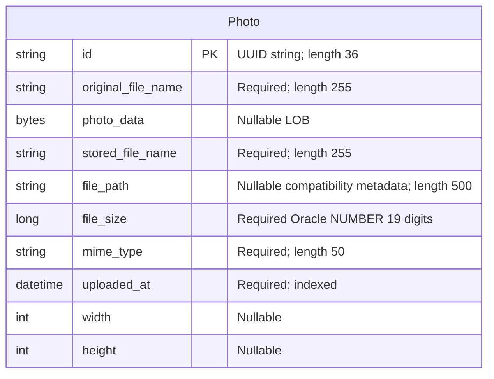

# Data Architecture & Persistence Layer

The data layer contains one JPA entity, `Photo`, persisted through Spring Data JPA/Hibernate to Oracle, with H2 substituted for the test profile. Image bytes and metadata share the same table; there is no separately mapped album or user entity.

Evidence references below are repository-relative file paths and line numbers. Credentials are intentionally omitted; configuration behavior is described here, with the full property inventory delegated to `configuration-inventory.md`.

## Database Configuration

| Service/Module | DB Type | Profile | Driver | Connection | Migration Tool |
|---|---|---|---|---|---|
| `photo-album` | Oracle | Default/base | `com.oracle.database.jdbc:ojdbc8`; `oracle.jdbc.OracleDriver` | Environment-overridable Oracle Thin connection; fallback targets the `oracle-db` host, port 1521, service `FREEPDB1`. Credentials supplied externally. | No Flyway/Liquibase dependency or versioned migrations found; Hibernate recreates schema at startup. |
| `photo-album` | Oracle | `docker` | Same runtime Oracle driver | Same environment-overridable database connection behavior as base configuration. | Hibernate recreates schema at startup. |
| `photo-album` tests | H2, in-memory | `test` | Test-scoped `com.h2database:h2`; `org.h2.Driver` | Named, process-local in-memory database; test credentials omitted. | Hibernate creates schema at startup and drops it at shutdown. |

**Evidence:** `pom.xml:43-54,88-93`; `src/main/resources/application.properties:9-21`; `src/main/resources/application-docker.properties:1-17`; `src/test/resources/application-test.properties:1-10`. The existing context test explicitly activates the test profile (`src/test/java/com/photoalbum/PhotoAlbumApplicationTests.java:7-13`).

- **Schema authority and durability:** JPA mappings drive schema generation, not versioned SQL migrations. Recreating the Oracle schema on application startup is destructive to existing table contents; persistent database storage alone does not prevent this.
- **Initialization scripts:** `oracle-init/01-create-user.sql:1-30` documents externally created schema credentials and grants schema-object privileges, quota, and tablespaces. It is not domain-table DDL or a schema-version migration. `oracle-init/02-verify-user.sql:1-12` inspects account status and grants.
- **Seed data:** No application seed SQL or programmatic entity seeding was found in the inspected source/resources. A bundled image under `src/main/resources/static/uploads/` is not a database seed.
- **Pooling:** The JPA starter supplies the conventional Spring Boot datasource stack; HikariCP is the expected auto-configured pool, not an explicitly selected custom implementation. No pool-size, timeout, or datasource bean customization was found in the inspected application configuration/source. Runtime pool settings were not verified.
- **Portability:** The entity contains Oracle-specific numeric and timestamp column definitions, and custom repository SQL uses Oracle functions and pagination. The H2 context-load test is not evidence that those native queries work against H2.

## Data Ownership per Service

| Service | Tables Owned | ORM Framework | Caching | Notes |
|---|---|---|---|---|
| `photo-album` / `PhotoServiceImpl` | `photos` (`Photo`) | JPA using `javax.persistence`, Hibernate via Spring Data JPA | No explicit application cache or ORM second-level/query cache found | One repository owns access to both BLOB payloads and metadata; no outbox, join table, or persisted account entity found. |

**Evidence:** `pom.xml:43-47`; `src/main/java/com/photoalbum/model/Photo.java:15-91`; `src/main/java/com/photoalbum/repository/PhotoRepository.java:15-16`; `src/main/java/com/photoalbum/service/impl/PhotoServiceImpl.java:28-47`.

## Entity Model

`Photo` maps to `photos`. There are no foreign keys, association mappings, bidirectional links, cascade rules, or relationship fetch modes to represent. Source: `src/main/java/com/photoalbum/model/Photo.java:15-91`.

| Java field | Java type | Persistence characteristics |
|---|---|---|
| `id` | `String` | Primary key, length 36; UUID assigned in the constructor rather than a database-generated sequence. |
| `originalFileName` | `String` | Non-null column, length 255. |
| `photoData` | `byte[]` | Nullable `@Lob`; no explicit lazy-loading annotation. |
| `storedFileName` | `String` | Non-null column, length 255; no unique constraint declared. |
| `filePath` | `String` | Nullable column, length 500; compatibility metadata rather than the authoritative image location. |
| `fileSize` | `Long` | Non-null column with Oracle `NUMBER(19,0)` definition. |
| `mimeType` | `String` | Non-null column, length 50. |
| `uploadedAt` | `LocalDateTime` | Non-null timestamp with database current-timestamp default; constructor also initializes the value using the application clock. Non-unique `idx_photos_uploaded_at` index. No timezone field. |
| `width`, `height` | `Integer` | Nullable columns. |

**Evidence:** `src/main/java/com/photoalbum/model/Photo.java:15-108`. No optimistic-lock version field is declared. `UploadResult` is an operation-result DTO, not an entity (`src/main/java/com/photoalbum/model/UploadResult.java:3-10`).

**Transaction scope:** `PhotoServiceImpl` is transactional at class level. Retrieval/list/navigation methods override this with read-only transactions; upload and deletion retain the class-level write transaction (`src/main/java/com/photoalbum/service/impl/PhotoServiceImpl.java:28-30,53-71,172-185,198-216,223-237`). Photo content is saved as bytes in the entity, not written to a filesystem (`PhotoServiceImpl.java:112-124,160-174`).

## Key Repository Methods

All custom methods below belong to `PhotoRepository extends JpaRepository<Photo, String>` in `src/main/java/com/photoalbum/repository/PhotoRepository.java:15-100`. Standard inherited CRUD operations are omitted from the table; the service uses those operations for individual reads, saves, and deletes.

| Service | Repository | Notable Methods | Purpose |
|---|---|---|---|
| `photo-album` | `PhotoRepository` | `List<Photo> findAllOrderByUploadedAtDesc()` | Native query returns every photo newest first, explicitly selecting the BLOB and metadata; no result limit (`:22-27`). |
| `photo-album` | `PhotoRepository` | `List<Photo> findPhotosUploadedBefore(LocalDateTime uploadedAt)` | Strict timestamp comparison for older records, descending order, and outer Oracle row limit of 10 (`:34-42`). |
| `photo-album` | `PhotoRepository` | `List<Photo> findPhotosUploadedAfter(LocalDateTime uploadedAt)` | Strict timestamp comparison for newer records, ascending order; Oracle null substitution for compatibility path, with no row limit (`:49-56`). |
| `photo-album` | `PhotoRepository` | `List<Photo> findPhotosByUploadMonth(String year, String month)` | Oracle timestamp-to-string comparisons by year/month, newest first (`:64-71`). |
| `photo-album` | `PhotoRepository` | `List<Photo> findPhotosWithPagination(int startRow, int endRow)` | Nested Oracle row-number pagination over newest-first results, inclusive bounds (`:79-87`). |
| `photo-album` | `PhotoRepository` | `List<Object[]> findPhotosWithStatistics()` | Native projection includes metadata/BLOB plus file-size rank and running size total using analytic functions (`:93-100`). |

Every custom method uses native SQL; parameterized methods bind named parameters. No derived custom finder, stored-procedure invocation, cross-service bulk lookup, or separate metadata-only projection was found. The current service calls the ordered listing and before/after methods; the month, pagination, and statistics queries are declared but are not used in that implementation (`src/main/java/com/photoalbum/service/impl/PhotoServiceImpl.java:53-75,223-237`).

## Caching Strategy

| Layer | Observed strategy | TTL / eviction / rationale |
|---|---|---|
| Application/domain | No Redis, Ehcache, Caffeine, JCache provider, cache starter, or Spring caching annotations found in inspected dependencies/source. | No configured regions, TTLs, eviction, or cache-aside/read-through/write-through implementation; no caching rationale documented. |
| ORM | No explicit Hibernate second-level or query cache configuration found. Ordinary JPA persistence-context identity management is not a shared result cache. | No configured shared-cache lifetime or invalidation policy found. |
| Photo delivery | Responses explicitly discourage browser/proxy storage and reuse. | No storage, revalidation required, immediate expiry. This is HTTP cache prevention, not a database cache. |
| Gallery presentation | Adds a current timestamp for cache busting. | Per-render timestamp; not a data cache. |
| Authentication/session | In-memory admin account store; stateless request authentication. | Not a photo-data cache or distributed session store. |

**Evidence:** `pom.xml:30-101`; `src/main/resources/application.properties:17-21`; `src/main/resources/application-docker.properties:13-17`; `src/main/java/com/photoalbum/controller/PhotoFileController.java:74-83`; `src/main/java/com/photoalbum/controller/HomeController.java:38-47`; `src/main/java/com/photoalbum/config/SecurityConfig.java:33-58`.

The gallery listing loads BLOBs along with metadata, so the current read path does not avoid image payload retrieval through a cache or metadata projection (`PhotoRepository.java:22-27`; `PhotoServiceImpl.java:53-57`).

## Data Ownership Boundaries

- **Store topology:** One application module owns one configured datasource and the `photos` table. Base and Docker profiles target Oracle; the test profile substitutes an isolated in-memory store. There is no evidence of independently owned database-per-service boundaries or a database shared by multiple application services in the inspected implementation.
- **Access boundary:** Controllers consume `PhotoService`, which accesses the database through `PhotoRepository`. No cross-service data retrieval, direct access to another service's tables, or gateway aggregation enablers were found (`src/main/java/com/photoalbum/controller/HomeController.java:28-40`; `src/main/java/com/photoalbum/controller/PhotoFileController.java:28-46`; `src/main/java/com/photoalbum/service/impl/PhotoServiceImpl.java:37-47,53-75`).
- **Read/write semantics:** Reads and writes use the same entity, repository, and datasource; no separate CQRS read model, event sourcing, replication routing, or outbox is present. Read-only transaction annotations do not establish a separate read store.
- **Payload ownership:** Image bytes are authoritative in the relational BLOB; generated filename and path are compatibility metadata. Metadata and payload consequently share transaction and deletion boundaries (`PhotoServiceImpl.java:112-124,160-174,198-210`).
- **Record ownership:** No user/tenant foreign key or per-photo owner field exists. The admin principal is maintained in memory rather than a domain table (`Photo.java:15-91`; `SecurityConfig.java:33-42`).

### Data Classification & Sensitivity

Classification describes what the model can hold, not an inspection of actual uploaded images. No explicit PHI or payment-card fields were detected, but arbitrary image bytes cannot be presumed free of either.

| Entity | Sensitive Fields | Classification (PII/PHI/PCI/None) | Controls in Place |
|---|---|---|---|
| `Photo` | `photoData` | Potential PII: images may identify people or contain personal documents. PHI/PCI content is possible but not established by the schema. | No field encryption, masking, content redaction, or per-record access control found. Photo reads are public; configured writes require authentication. HTTP no-storage headers are present. Database encryption-at-rest is not established by inspected configuration. |
| `Photo` | `originalFileName` | Potential PII if uploader-supplied names contain identifying information. | No masking or field-level access restriction found; original filename is also logged and included in photo response metadata. |
| `Photo` | `id`, `storedFileName`, `filePath`, `fileSize`, `mimeType`, `uploadedAt`, `width`, `height` | None inherently; identifiers, timestamps, and paths may become linkable metadata. | UUID identifiers; no tenant/owner isolation or field-level controls. Read-only/write transaction distinctions are not confidentiality controls. |

**Evidence:** entity fields in `src/main/java/com/photoalbum/model/Photo.java:24-91`; original bytes retained in `src/main/java/com/photoalbum/service/impl/PhotoServiceImpl.java:122-124,160-168`; public-read/authenticated-write policy in `src/main/java/com/photoalbum/config/SecurityConfig.java:46-60`; filename and partial binary logging in `src/main/java/com/photoalbum/controller/PhotoFileController.java:53-66`, and response metadata/cache prevention at `:74-83`. These logs are not masked by the displayed implementation.

Datasource secrets are externalized; the separate in-memory administrator password is BCrypt-encoded (`SecurityConfig.java:28-42`). Neither protects stored photo fields or proves database-at-rest encryption. Oracle initialization grants schema-scoped object privileges without granting DBA/system-wide object access (`oracle-init/01-create-user.sql:7-26`); those grants are not row-level or field-level authorization.
