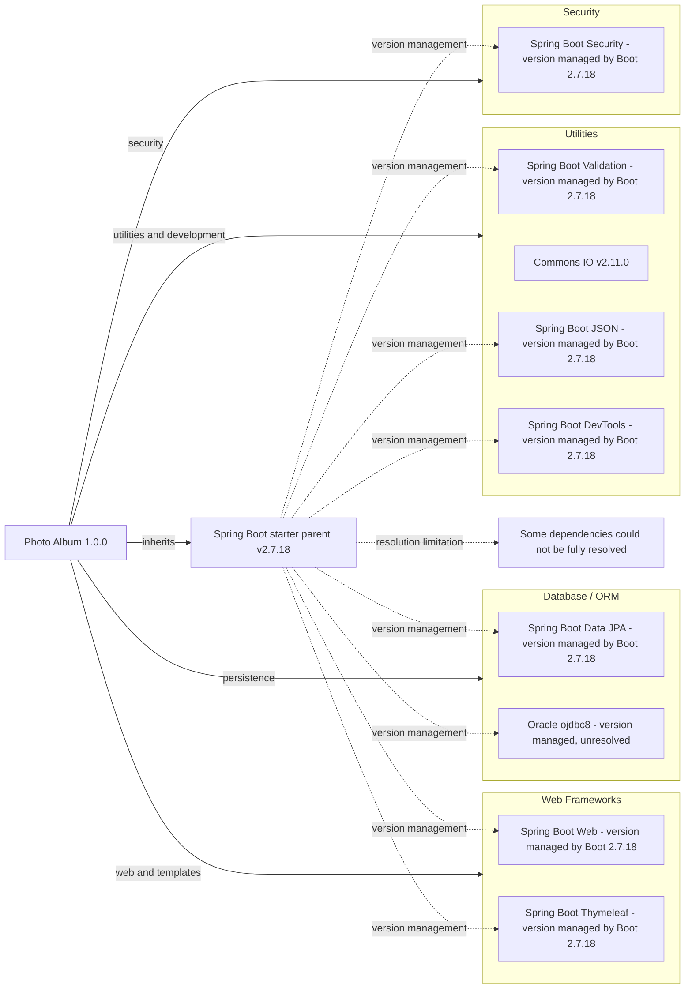

# Dependency Map

Photo Album (`com.photoalbum:photo-album:1.0.0`) declares **11 external dependencies: 9 non-test and 2 test-scoped**, plus one Maven parent and one build plugin. This inventory uses only the repository's `pom.xml`; counts exclude the parent, plugin, and unenumerated transitive dependencies.

## Dependencies

### Dependency Summary

| Category | Count | Key Libraries | Notes |
|---|---:|---|---|
| Web Frameworks | 2 | Spring Boot Web, Thymeleaf | Compile scope; versions inherited through Boot parent management. |
| Database / ORM | 2 | Spring Boot Data JPA, Oracle ojdbc8 | JPA: compile; Oracle: runtime. Versions not explicitly declared. |
| Security | 1 | Spring Boot Security | Compile scope; version managed by parent. |
| Utilities | 4 | Validation, Commons IO 2.11.0, JSON, DevTools | Compile scope; DevTools is optional. Only Commons IO has an explicit dependency version. |
| **Total non-test** | **9** | | Test dependencies excluded. |

The full non-test declaration inventory follows. “Parent-managed” means the dependency omits its version and relies on the `spring-boot-starter-parent:2.7.18` inheritance chain; it is not an independently resolved artifact version.

| Maven coordinates | Declared version | Scope | Evidence |
|---|---|---|---|
| `org.springframework.boot:spring-boot-starter-web` | Omitted; parent-managed | compile (default) | `pom.xml:31–35` |
| `org.springframework.boot:spring-boot-starter-thymeleaf` | Omitted; parent-managed | compile (default) | `pom.xml:37–41` |
| `org.springframework.boot:spring-boot-starter-data-jpa` | Omitted; parent-managed | compile (default) | `pom.xml:43–47` |
| `com.oracle.database.jdbc:ojdbc8` | Omitted; parent-managed; exact version unresolved | runtime | `pom.xml:49–54` |
| `org.springframework.boot:spring-boot-starter-validation` | Omitted; parent-managed | compile (default) | `pom.xml:56–60` |
| `org.springframework.boot:spring-boot-starter-security` | Omitted; parent-managed | compile (default) | `pom.xml:62–66` |
| `commons-io:commons-io` | `2.11.0` | compile (default) | `pom.xml:68–73` |
| `org.springframework.boot:spring-boot-starter-json` | Omitted; parent-managed | compile (default) | `pom.xml:75–79` |
| `org.springframework.boot:spring-boot-devtools` | Omitted; parent-managed | compile (default), optional | `pom.xml:95–100` |

Parent: `org.springframework.boot:spring-boot-starter-parent:2.7.18`, with an empty `relativePath` (`pom.xml:8–13`). No explicit BOM import, dependency-management block, module declaration, or lockfile was found among recognized build/package files. The external parent/BOM contents were not available in the inspected repository build files, so exact managed versions and transitive dependency trees are not enumerated. The diagram's dotted edges represent inherited management, not verified runtime dependency edges.

### Version & Compatibility Risks

The declared baseline is Spring Boot 2.7.18 and Java 8 (`pom.xml:8–13,23–26`), an older stack outside Spring Boot's community support window. A Boot 3 upgrade requires Java 17 or later and consideration of the Jakarta namespace transition, particularly for the JPA, validation, and security stack. Commons IO is explicitly pinned to 2.11.0 rather than left to parent management; review its current advisories and compatibility before retaining that pin. The unresolved Oracle driver version prevents an evidence-based driver support assessment. No vulnerability scan or dependency resolution was performed, and no specific CVE findings are asserted here.

### Notable Observations

- Eight of nine non-test dependencies rely on parent-managed versions; the two test dependencies do as well. A parent upgrade therefore affects most of the declared dependency set (`pom.xml:30–101`).
- `spring-boot-starter-json` is directly declared despite its “Image processing” comment; the declared artifact is a JSON starter, not evidence of a dedicated image-processing library (`pom.xml:75–79`). Potential overlap with the web starter cannot be quantified without the external dependency graph.
- DevTools has `optional=true` but no runtime scope, so its declared scope defaults to compile. Optionality controls downstream propagation; it does not itself establish exclusion from the packaged application (`pom.xml:95–100`).
- `org.springframework.boot:spring-boot-maven-plugin` is declared without a version (`pom.xml:103–109`); its inherited version was not resolved. No standalone messaging, caching, logging, or observability dependencies are directly declared; this does not imply their absence transitively.

## Test Dependencies

| Framework | Version | Notes |
|---|---|---|
| `org.springframework.boot:spring-boot-starter-test` | Omitted; managed through Boot parent 2.7.18 | Explicit test scope (`pom.xml:81–86`). Individual testing libraries and versions are not visible in the local declaration. |
| `com.h2database:h2` | Omitted; parent-managed; exact version unresolved | Explicit test scope; database support for tests (`pom.xml:88–93`). |

Total test-scope dependencies: 2

No standalone contract-testing or container-based integration-testing dependency is declared. H2 is test-scoped while Oracle is runtime-scoped; this inventory does not establish whether tests exercise Oracle-specific behavior or provide database compatibility coverage.
