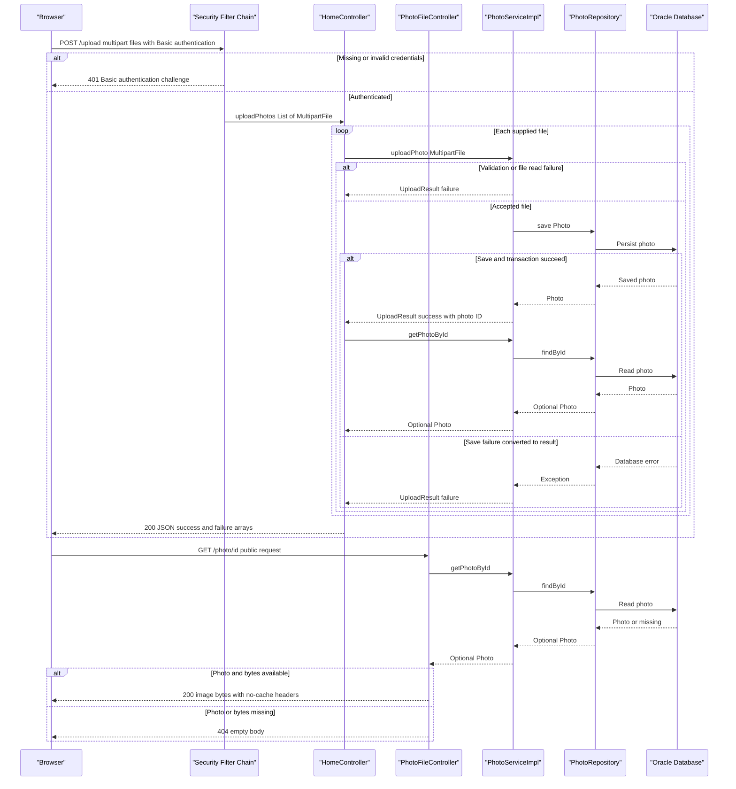

# API & Service Communication Contracts

Five explicit HTTP endpoints provide gallery/detail HTML, multipart upload with JSON results, photo bytes, and deletion. Requests use synchronous controller/service calls and database access; browser uploads use asynchronous JavaScript without server-side messaging.

## Service Catalog

| Service | Port | Category | Purpose |
|---|---|---|---|
| `photoalbum-java-app` — Maven `com.photoalbum:photo-album` | HTTP 8080; Compose host 8080 | Business | Single source-built application serving the gallery and photo operations. Key dependencies: Spring Boot 2.7.18 Web/MVC, Thymeleaf, Data JPA, Validation, Security, Jackson, Oracle JDBC, Commons IO 2.11.0. |
| `oracle-db` — no Maven module | TCP 1521; Compose host 1521 | Infrastructure | Third-party `gvenzl/oracle-free:latest` container providing application persistence; not an HTTP API service. |

One deployable application module was found, with no gateway, discovery server, observability service, Kubernetes/Helm deployment, or IaC service definitions discovered. Controllers, `PhotoService`, and `PhotoRepository` are in-process components, not independently deployed services.

Evidence: `pom.xml`, `docker-compose.yml`, `Dockerfile`, `src/main/java/com/photoalbum/PhotoAlbumApplication.java`.

## API Endpoints Inventory

All five routes belong to `photoalbum-java-app`; no URL, header, or query-based API versioning is implemented.

| Service | Method | Path | Request Type | Response Type |
|---|---|---|---|---|
| `photoalbum-java-app` / `HomeController.index` | GET | `/` | No body or declared parameters | **200 HTML** (`index` view); model contains `List<Photo>` and a cache-busting timestamp. Retrieval exceptions produce an empty gallery rather than an error status. |
| `photoalbum-java-app` / `HomeController.uploadPhotos` | POST | `/upload` | HTTP Basic authentication; `multipart/form-data` with repeated required `files` parts bound to `List<MultipartFile>` | **200 JSON** `Map<String,Object>` containing `success`, `uploadedPhotos`, and `failedUploads`; includes partial-success and all-file-failure outcomes. **400 JSON** for an empty list reaching the handler (`success`, `error`); a missing required part is rejected by Spring binding with **400**, not necessarily that JSON shape. **401** without valid credentials. |
| `photoalbum-java-app` / `DetailController.detail` | GET | `/detail/{id}` | Path `id: String` | **200 HTML** (`detail` view) with `Photo` and optional previous/next navigation IDs. **302** redirect to `/` for missing photo, blank ID reaching the handler, or retrieval exception. |
| `photoalbum-java-app` / `DetailController.deletePhoto` | POST | `/detail/{id}/delete` | HTTP Basic authentication; path `id: String`; no body required | **302** redirect to `/` for success, missing photo, or caught deletion error; flash attributes carry a success/error message, not a JSON response. **401** without valid credentials. |
| `photoalbum-java-app` / `PhotoFileController.servePhoto` | GET | `/photo/{id}` | Path `id: String`; browser may append `_t` for cache busting, but the handler does not bind it | **200** `ResponseEntity<Resource>` with `ByteArrayResource` image bytes and the stored MIME type. **404** for missing photo/data or blank ID reaching the handler; **500** with no body for caught exceptions. |

Photo-byte responses set `Cache-Control: no-cache, no-store, must-revalidate, private`, `Pragma: no-cache`, `Expires: 0`, and `X-Photo-ID`, `X-Photo-Name`, `X-Photo-Size` metadata headers. The compatibility path returned in upload metadata is not the serving endpoint: consumers use `/photo/{id}`.

Per-file validation/read/save failures normally appear in the HTTP 200 upload failure array rather than as per-file HTTP errors. Unhandled lookup or transaction failures can still propagate as server errors; there is no custom global error contract. Framework multipart-size/binding failures occur before the handler and have no application-defined response schema. Detailed validation belongs in `business-workflows.md`.

Evidence: `src/main/java/com/photoalbum/controller/{HomeController,DetailController,PhotoFileController}.java`, `src/main/java/com/photoalbum/config/SecurityConfig.java`, `src/main/resources/static/js/upload.js`.

## Management & Observability Endpoints

| Service | Endpoint | Custom Metrics (if any) |
|---|---|---|
| `photoalbum-java-app` | No explicit health, management, Actuator, Prometheus, or Swagger UI endpoint found | None found; no custom metric registration or timing annotations |
| `photoalbum-java-app` | `/error` — framework-provided error dispatch, not a controller-defined business endpoint | None; default Spring Boot error handling, with no custom schema |
| `oracle-db` | No HTTP management endpoint defined by this repository | None defined |

The build does not include Actuator or an API documentation dependency. Application logging is present but is not a metrics endpoint. Container readiness configuration is outside this inventory; see `configuration-inventory.md`.

## DTOs & Contracts

| Class / type | Contract role | Mutability |
|---|---|---|
| `MultipartFile` / `List<MultipartFile>` | Framework request abstraction for repeated upload parts; no dedicated request DTO | Not an application-defined immutable DTO |
| `Photo` | Service-owned domain entity used in HTML models and projected into upload response metadata; not directly returned as a JSON entity | Mutable POJO with setters |
| `UploadResult` | Internal per-file service result mapped by `HomeController` into the HTTP response; not exposed directly | Mutable POJO with setters |
| `Map<String,Object>` and nested `List<Map<String,Object>>` | Upload response envelope and success/failure items; no named response DTO or generated contract | Mutable collections |
| `Resource` / `ByteArrayResource` | Binary image response contract | Framework resource abstraction |

No gateway-level aggregation DTOs exist. Entity fields and persistence details are covered by `data-architecture.md`, not repeated here. HTML rendering uses Thymeleaf; JSON serialization uses Spring Boot's Jackson defaults through `@ResponseBody`/`ResponseEntity`. No custom `ObjectMapper`, serializer, or date-format override was found; upload metadata includes a `LocalDateTime` consumed as a JavaScript date.

No OpenAPI/Swagger specification or annotations, protobuf definition, gRPC contract, or GraphQL schema was found. No stable typed error envelope is shared across endpoints.

Evidence: `src/main/java/com/photoalbum/model/{Photo,UploadResult}.java`, `src/main/java/com/photoalbum/controller/HomeController.java`, `pom.xml`, `src/main/resources/static/js/upload.js`.

## Communication Patterns

- **Synchronous:** Browser HTTP requests enter Spring MVC controllers, which directly call `PhotoService`/`PhotoServiceImpl`, then `PhotoRepository` via JPA/JDBC. Upload parts are processed sequentially; each successful service result triggers a separate lookup to compose response metadata. Detail rendering combines a photo lookup and older/newer navigation lookups within the same service; this is not gateway aggregation.
- **Asynchronous:** `upload.js` uses `fetch` and `FormData` to avoid blocking the browser UI. No server-side asynchronous jobs, message brokers, pub/sub, or event-consumer contracts were found.
- **Resilience and timeouts:** No application-defined circuit breaker, retry/backoff policy, bulkhead, HTTP client timeout, or JDBC/query timeout was found; no explicit numeric request timeout can be reported. Compose's application restart-on-failure is a process policy, not a request retry. Upload errors are usually represented as per-file results; gallery failures render an empty list, detail failures redirect, deletion failures redirect with flash messages, and binary read failures return 404/500. There is no downstream-service fallback or multi-service response composition.
- **Discovery, routing, balancing:** No REST client, gateway, discovery registration, or client-side load balancer was found. Database access uses a configured JDBC address whose default/Compose host is `oracle-db`, resolved through Compose networking; this is not application service discovery.
- **API availability:** Compose starts the application after database health is established. Database connectivity and externally supplied admin credentials are required for normal application startup. Full dependency/readiness and configuration details belong in `configuration-inventory.md`.
- **Authentication/authorization:** Stateless HTTP Basic protects `POST /upload` and `POST /detail/*/delete`; unauthenticated requests are challenged with 401. The configured in-memory user has an ADMIN role, but matchers require only authentication, not an explicit role check. Gallery, detail, binary reads, and all other requests are permitted without authentication. No JWT/OAuth2 or method-level authorization was found. CSRF protection is explicitly disabled.
- **Transport:** Repository configuration exposes HTTP, with no application TLS listener, forced HTTPS rule, or TLS-terminating proxy definition found. External deployment TLS cannot be inferred. Credential values are intentionally omitted from this report.

Evidence: `src/main/java/com/photoalbum/service/impl/PhotoServiceImpl.java`, `src/main/java/com/photoalbum/repository/PhotoRepository.java`, controller sources, `src/main/java/com/photoalbum/config/SecurityConfig.java`, `docker-compose.yml`, `src/main/resources/application*.properties`, `src/main/resources/static/js/upload.js`.

## Service Technology Matrix

Columns for gateway, discovery, Actuator, cache, and metrics export are omitted because no service implements those application capabilities.

| Service | Web | Data Access |
|---|---|---|
| `photoalbum-java-app` | Spring MVC + Thymeleaf; multipart, JSON, binary responses | Spring Data JPA/Hibernate + Oracle JDBC |
| `oracle-db` | None defined | Oracle database server; external persistence dependency |

Photo response no-cache headers and timestamp query parameters do not constitute an application caching layer.

## Service Communication Sequence

Primary flow: authenticated multipart upload followed by public image retrieval. Dashed arrows represent responses; there is no broker or asynchronous server-to-server message flow.

The diagram shows handled service-result failures; unhandled transaction/read errors can bypass the upload envelope. A caught exception in the photo-serving controller yields 500 rather than the depicted missing-data 404. No retry or circuit-breaker fallback exists.
