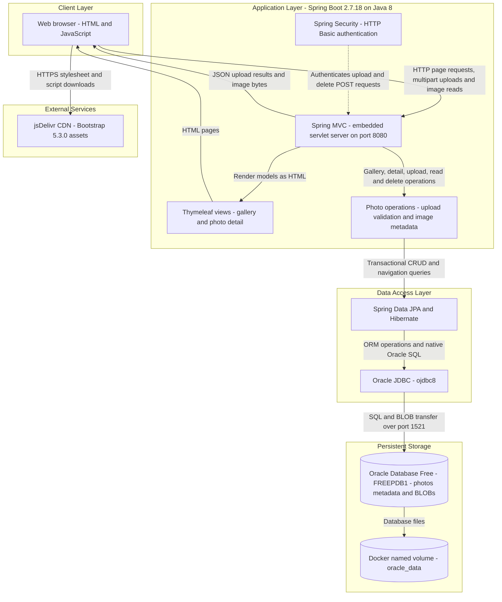
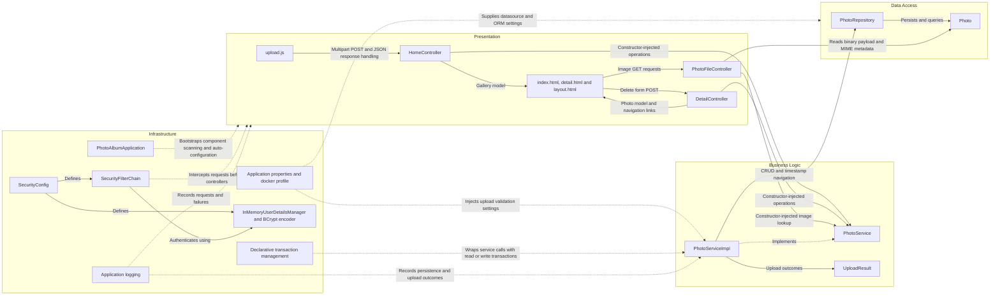

# Architecture Diagram

Photo Album is a single-module Java web application for uploading, browsing, viewing, and deleting photos. This read-only assessment describes the checked-in application and Docker Compose topology; it does not establish a running deployment, and no credential values are reproduced.

## Application Architecture

### Technology Stack Summary

| Layer | Technology | Version | Purpose |
|---|---|---|---|
| Runtime | Java / Eclipse Temurin | Java 8; runtime image `8-jre` | Executes the packaged application JAR |
| Application | Spring Boot | 2.7.18 | Auto-configuration, application startup, and embedded web runtime |
| Presentation | Spring MVC and Thymeleaf | Managed by Spring Boot 2.7.18 | HTML gallery/detail views, multipart upload endpoint, and binary photo responses |
| Browser UI | JavaScript Fetch API and Bootstrap | JavaScript version unspecified; Bootstrap 5.3.0 | Asynchronous uploads, gallery updates, and responsive styling |
| Security | Spring Security | Managed by Spring Boot 2.7.18 | Stateless HTTP Basic authentication with an in-memory administrator and BCrypt encoding |
| Business logic | Spring services and Java ImageIO | Spring Boot-managed; Java 8 API | Photo operations, file-size/MIME checks, image-header dimensions, and pixel-count limits |
| Data access | Spring Data JPA, Hibernate, and Oracle `ojdbc8` | Managed by Spring Boot 2.7.18 | Entity persistence, transactions, and Oracle-specific native queries |
| Storage | Oracle Database Free | Compose image `gvenzl/oracle-free:latest`; exact version unpinned | Stores photo metadata and binary image content in the `photos` table |
| Packaging | Maven and Docker Compose | Build image Maven 3.9.6; Compose version unspecified | Multi-stage JAR build and application/database container orchestration |

Versions are taken from `pom.xml`, `Dockerfile`, `docker-compose.yml`, and the HTML templates. Boot-managed dependency versions are not independently pinned in this repository; the Compose comment describes Oracle Free 23ai, but the `latest` image tag does not guarantee that version.

### Data Storage & External Services

Oracle is the application's runtime datastore. The `Photo` JPA entity maps metadata and a `photo_data` BLOB to `photos`; `PhotoServiceImpl` saves uploaded bytes directly in the database, and the photo-serving endpoint reads those bytes back. Filename and `/uploads/` path fields remain compatibility metadata, not an active filesystem upload store; the repository also contains a static sample image. Compose persists Oracle files in `oracle_data`, mounts `oracle-init` initialization scripts, and starts the application after the database health check passes. Both application property profiles configure Hibernate `ddl-auto=create`, so persistent database files do not imply that application tables survive startup unchanged. Database and administrator credentials are externally configured; values are intentionally omitted.

The browser downloads Bootstrap assets from jsDelivr. No application-side cache, message broker, object-storage integration, or remote business API was identified in the main sources. H2 is declared for tests only, not as runtime storage.

### Key Architectural Decisions

- A layered monolith uses constructor injection: MVC controllers depend on `PhotoService`, whose transactional implementation delegates persistence to `PhotoRepository`. Thymeleaf serves pages while the same application exposes JSON upload responses and binary images.
- Photo binaries and metadata share Oracle storage. Spring Data CRUD is combined with Oracle-specific native SQL for ordering and navigation; additional repository queries use Oracle pagination, date formatting, and analytical functions.
- Gallery and image reads are public; upload and delete POST routes require HTTP Basic authentication. Security is configured as stateless with CSRF disabled, an in-memory administrator, and BCrypt password encoding.

## Component Relationships

### Component Inventory

| Component | Layer | Type | Responsibility |
|---|---|---|---|
| `PhotoAlbumApplication` | Infrastructure | Spring Boot entry point | Starts the application and enables component scanning and auto-configuration |
| `index.html`, `detail.html`, `layout.html` | Presentation | Thymeleaf templates | Gallery, photo metadata/navigation, deletion form, and shared layout template |
| `upload.js` | Presentation | Browser script | Posts selected files to `/upload`, consumes JSON outcomes, and updates gallery links/images |
| `HomeController` | Presentation | MVC controller | Serves `GET /` and handles multipart `POST /upload`; maps results to JSON |
| `DetailController` | Presentation | MVC controller | Serves `GET /detail/{id}`, resolves adjacent photos, and handles `POST /detail/{id}/delete` |
| `PhotoFileController` | Presentation | Binary-response controller | Serves database image bytes through `GET /photo/{id}` with MIME and no-cache headers |
| `PhotoService` | Business logic | Service interface | Defines photo listing, lookup, upload, deletion, and adjacent-photo operations |
| `PhotoServiceImpl` | Business logic | Transactional Spring service | Validates uploads, reads image headers, constructs photo records, and delegates persistence; uses read-only transactions for reads |
| `UploadResult` | Business logic | Result DTO | Carries upload success, filename, photo identifier, and error information |
| `PhotoRepository` | Data access | Spring Data JPA repository | Provides CRUD and native Oracle queries for ordering, navigation, month filtering, pagination, and statistics; only a subset is called by the service |
| `Photo` | Data access | JPA entity | Maps UUID identifier, image BLOB, filenames/path metadata, size, MIME type, timestamps, and dimensions |
| `SecurityConfig` | Infrastructure | Spring configuration | Defines the security filter chain, BCrypt encoder, and externally configured in-memory administrator |
| `SecurityFilterChain` | Infrastructure | Request filter chain bean | Requires authentication for upload/delete POST routes and permits other requests |
| `InMemoryUserDetailsManager` and BCrypt encoder | Infrastructure | Authentication beans | Hold the configured administrator and verify its encoded password |
| Declarative transaction management | Infrastructure | Spring proxy-based concern | Applies service transaction boundaries and read-only semantics |
| Application logging | Infrastructure | SLF4J logging concern | Records controller/service operations and errors; levels are configured per profile |
| `application.properties`, `application-docker.properties` | Infrastructure | Externalized configuration | Configure server port, Oracle/JPA access, multipart limits, upload policy, and logging |
| `MathUtil` | Utility | Standalone Java utility | Provides a greatest-common-divisor calculation; no caller was found in the main application, so it is omitted from the interaction diagram |

Evidence: `pom.xml`; `Dockerfile`; `docker-compose.yml`; `src/main/resources/application*.properties`; `src/main/resources/templates/*.html`; `src/main/resources/static/js/upload.js`; and Java sources under `src/main/java/com/photoalbum/{controller,service,repository,model,config,util}` plus `PhotoAlbumApplication.java`. Relationships describe synchronous in-process calls and browser HTTP requests; no event-driven or inter-service application communication was found.
