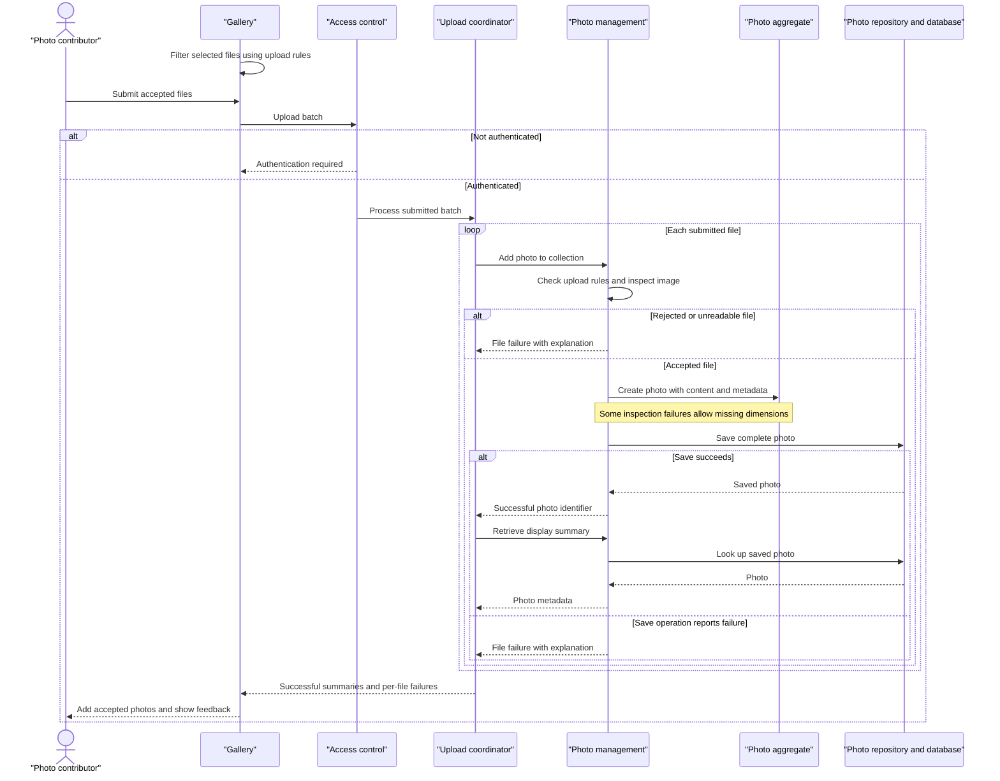

# Core Business Workflows

Photo Album lets visitors browse a shared photo collection, inspect individual images, and navigate between uploads. Authenticated users can add multiple photos and permanently remove photos from the collection.

## Domain Entities

| Entity | Service / Bounded Context | Description | Key Relationships |
| --- | --- | --- | --- |
| Photo | Photo Album / Photo Management | An uploaded image together with the descriptive information needed to display and manage it; the sole persisted business entity and practical aggregate boundary. | Its image content and metadata form one managed item. Chronological neighbors are derived from other photos, not explicit relationships. |
| UploadResult | Photo Album / Upload Processing | A transient per-file operation outcome, not a persisted entity or aggregate. Carries success or failure information for user feedback. | Refers to the created Photo on success; the controller combines multiple outcomes into a batch response. |

There are no modeled Album, User, ownership, tagging, or sharing-permission entities. The collection is shared rather than partitioned into user-owned albums.

Evidence: `src/main/java/com/photoalbum/model/Photo.java:19-108`; `src/main/java/com/photoalbum/model/UploadResult.java:6-29`.

## Service-to-Domain Mapping

This is one application and one business context, not a set of independently deployed domain services. The rows below describe internal responsibilities, not separate microservices.

| Service | Domain Context | Owned Entities | External Dependencies |
| --- | --- | --- | --- |
| PhotoService / PhotoServiceImpl | Photo Management: ingest, retrieve, navigate, delete | Photo; creates transient UploadResult outcomes | PhotoRepository and the photo database; local image-header inspection |
| HomeController | Collection browsing and batch-upload orchestration | None; composes Photo summaries and upload outcomes | Internal PhotoService |
| DetailController | Single-photo viewing, chronological navigation, removal | None; composes a Photo with neighboring identifiers | Internal PhotoService |
| PhotoFileController | Image delivery | None; reads Photo content | Internal PhotoService |

PhotoService is the application authority for photo operations; the database is the durable source of truth for both image content and metadata. There are no cross-context entity references, remote domain-service calls, message exchanges, or gateway aggregation.

Evidence: `src/main/java/com/photoalbum/service/impl/PhotoServiceImpl.java:28-47`; `src/main/java/com/photoalbum/controller/HomeController.java:24-32`; `src/main/java/com/photoalbum/controller/DetailController.java:19-27`; `src/main/java/com/photoalbum/controller/PhotoFileController.java:24-32`.

## Primary Workflows

### Workflow 1: Upload a batch and publish accepted photos

1. A user selects or drops files on the gallery page. Browser-side **Upload admissibility** checks filter files before submission; accepted files are sent together to `POST /upload`.
2. The security filter requires authentication before upload processing. HomeController applies **Batch admission**, then calls PhotoService once per submitted file, sequentially.
3. PhotoService applies **Upload admissibility** and **Image inspection**. Rejected files return an unsuccessful UploadResult; processing can continue with other files.
4. For an accepted file, the service generates a compatibility filename/path, reads image bytes, and extracts dimensions when possible. It creates a Photo and saves content and metadata together.
5. The controller re-fetches each successful Photo by its returned identifier and projects its display metadata into the successful-results list. Failed outcomes are collected separately.
6. The response reports **Batch outcome**. The browser inserts successful photos into the gallery, shows their count, and displays per-file failures. No full-page reload is needed.

This is controller orchestration within one application, not cross-service choreography. **Transaction boundaries** make the batch a set of individual file operations rather than one all-or-nothing upload.

Evidence: `src/main/resources/static/js/upload.js:48-132,135-159`; `src/main/java/com/photoalbum/controller/HomeController.java:55-97`; `src/main/java/com/photoalbum/service/impl/PhotoServiceImpl.java:81-192`; `src/main/java/com/photoalbum/config/SecurityConfig.java:46-60`.

### Workflow 2: Browse the collection and navigate full-size photos

1. A visitor opens `GET /`. HomeController retrieves the collection under **Chronological ordering**, then renders gallery cards.
2. If collection retrieval fails, the page still renders with an empty photo list. This fallback can look like an empty collection; the controller does not add a distinct database-error message.
3. Selecting a card enters `GET /detail/{id}`. DetailController loads the Photo and separately obtains older and newer neighbors under **Chronological navigation**.
4. The detail page composes the selected photo with optional neighbor identifiers. Missing neighbors produce no corresponding navigation button; invalid identifiers, absent photos, or lookup failures redirect to the gallery.
5. Gallery and detail images trigger `GET /photo/{id}`. PhotoFileController retrieves the stored image bytes and serves them using the photo's recorded media type.
6. **Image availability** controls missing-content and retrieval-error outcomes. Browser cache bypassing makes the UI request current image content rather than relying on an old cached image.

Evidence: `src/main/java/com/photoalbum/controller/HomeController.java:37-49`; `src/main/java/com/photoalbum/controller/DetailController.java:32-58`; `src/main/java/com/photoalbum/controller/PhotoFileController.java:37-86`; `src/main/resources/templates/detail.html:67-87`; `src/main/resources/static/js/upload.js:176-179`.

### Workflow 3: Confirm and permanently remove a photo

1. The detail page presents a browser confirmation before submitting `POST /detail/{id}/delete`. This is a user-experience safeguard, not a server-side approval state.
2. Authentication is required. PhotoService looks up the selected Photo and applies **Deletion existence**.
3. An existing Photo is removed from the database, including its stored image content; an absent Photo returns a not-found outcome.
4. DetailController redirects to the gallery with a success, not-found, or failure flash message. There is no soft-delete, recovery, or asynchronous cleanup workflow.

Evidence: `src/main/resources/templates/detail.html:50-51`; `src/main/java/com/photoalbum/controller/DetailController.java:64-78`; `src/main/java/com/photoalbum/service/impl/PhotoServiceImpl.java:198-217`.

No scheduled business processes, event-driven consumers, batch jobs, or business-state initialization hooks were found in `src/main/java`. The application entry point only starts the application. Month filtering, pagination, and statistics queries exist on PhotoRepository but are not invoked by the implemented service/controller workflows; they are not exposed business processes.

Evidence: `src/main/java/com/photoalbum/PhotoAlbumApplication.java:9-14`; `src/main/java/com/photoalbum/repository/PhotoRepository.java:58-100`.

## Cross-Service Data Flows

There are no remote business services or gateway joins. The browser communicates with a single application, which reads and writes the shared photo database through PhotoService and PhotoRepository.

- **Upload composition:** per-file UploadResult identifies a saved Photo; the controller re-reads that Photo and combines its display metadata with other successes and per-file failures. Image bytes are not included in this upload response; the browser fetches them separately using the photo identifier.
- **Detail composition:** the selected Photo supplies its upload timestamp for older/newer lookups. The controller combines the results into a detail view with optional navigation links. These calls are separate service reads, not a single transaction spanning the entire detail response.
- **Content delivery:** the same Photo identifier connects gallery/detail metadata to stored image bytes. The generated `/uploads/` path is compatibility metadata only; it is not a separate filesystem or object-storage delivery flow.
- **Degradation:** collection read failures render an empty gallery; detail lookup/navigation failures redirect home; unavailable image records/content return not found; unexpected image-serving errors return a server error. Upload read failures reject the affected file, while many metadata-inspection problems permit upload without dimensions.
- **Limits of fallback:** no circuit breaker, remote-service fallback, retry queue, or compensating action exists. A controller re-fetch failure after a successful upload is not caught inside the batch loop and can interrupt response assembly after earlier files have already been saved.

Evidence: `src/main/java/com/photoalbum/controller/HomeController.java:37-97`; `src/main/java/com/photoalbum/controller/DetailController.java:38-58`; `src/main/java/com/photoalbum/controller/PhotoFileController.java:44-86`; `src/main/java/com/photoalbum/service/impl/PhotoServiceImpl.java:112-185`.

## Business Workflow Sequence

The primary workflow is authenticated batch upload followed by publication in the shared gallery. Fallback branches below are local business outcomes, not circuit-breaker behavior.

## Business Rules & Decision Logic

- **Upload admissibility:** browser checks allow JPEG, PNG, GIF, and WebP and a maximum size of 10 MiB. The service lowercases the declared MIME type and checks the configured allowlist; it also rejects sizes above the configured limit and empty files. Current application properties set the same allowlist and 10,485,760-byte limit. A missing MIME type results in the generic upload-error path. Declared MIME acceptance is not a guarantee that bytes decode as an image.
- **Batch admission:** a null or empty submitted file list returns a bad request. Multipart settings cap individual files at 10 MB and the whole request at 50 MB. A configured maximum of ten files exists, but neither the controller nor browser enforces a file-count rule.
- **Image inspection:** when an image reader can determine dimensions, more than 40,000,000 pixels is rejected. An I/O exception during data/header reading fails the file. No reader or a different inspection exception allows processing without dimensions; complete image decoding is not required.
- **Photo validity:** original and stored filenames must be nonblank and at most 255 characters; compatibility paths are at most 500 characters; recorded file size must be present and positive; media type must be nonblank and at most 50 characters; upload time must be present. These are declared entity validation constraints, not an explicit controller validation phase.
- **Identity and lifecycle:** construction assigns a fresh photo identifier and current upload time; upload independently generates a compatibility filename, preserving the extracted original extension. No duplicate-content/name rejection is implemented. The lifecycle is transient upload → saved/visible Photo → permanently deleted; rejection is an operation outcome, not a persisted status.
- **Batch outcome:** response success means at least one saved Photo was re-fetched and included in the successful-results list. Per-file failures may coexist with successes; a nonempty batch with all reported failures still receives a normal response with success false. A successful save whose re-fetch returns empty is omitted from both result lists.
- **Chronological ordering/navigation:** initial gallery retrieval orders newest uploads first. Previous selects the closest strictly older upload and next the closest strictly newer upload; equal timestamps are excluded and no secondary tie-break ordering exists. Browser insertion prepends each new card in turn, rather than sorting the entire collection again.
- **Image availability:** blank/missing identifiers, absent photos, or absent/empty stored content produce not found. Unexpected serving failures produce a server error. The recorded media type determines delivery format; no thumbnail transformation is performed.
- **Deletion existence:** absent photos are a nonexceptional false outcome; existing photos are physically deleted. The collection has no user-ownership relationship to check.

### Cross-cutting concerns

- **Transaction boundaries:** PhotoServiceImpl is transactional; retrieval and navigation methods are marked read-only. Each file upload is a separate service invocation, and HomeController has no enclosing batch transaction. There is no distributed transaction, saga, or explicit compensation. Upload catches save exceptions and returns an outcome, but deferred flush/commit errors can still escape the service invocation; a reported failure is not a general recovery guarantee.
- **Authorization:** reads are public; upload and deletion require an authenticated caller. The configured account has an administrative role, but endpoint rules check authentication rather than explicitly requiring that role. Authentication uses HTTP Basic with stateless sessions; CSRF is disabled. Credentials are externally supplied and are intentionally not reproduced here.
- **Error handling:** no custom business exception hierarchy is present. Upload uses UploadResult failures; collection/detail controllers provide the view fallbacks above; deletion maps exceptions to user feedback. No automatic retry or dead-letter mechanism is implemented.
- **Audit/logging:** upload acceptance/rejection, retrieval errors, deletion, and image delivery are logged. Image-delivery debug logging includes filenames, identifiers, and a short binary prefix; this is diagnostic logging, not a durable business audit trail. No audit entity or change history is implemented.
- **Computed values and integrity:** display dimensions come from image headers when available; UI size/date labels are derived for presentation. Navigation is timestamp-derived. With one standalone Photo entity, there are no bidirectional business associations to maintain.

Evidence: `src/main/java/com/photoalbum/service/impl/PhotoServiceImpl.java:28-35,81-249`; `src/main/java/com/photoalbum/model/Photo.java:28-108`; `src/main/java/com/photoalbum/controller/HomeController.java:55-97`; `src/main/java/com/photoalbum/repository/PhotoRepository.java:22-56`; `src/main/java/com/photoalbum/config/SecurityConfig.java:28-61`; `src/main/resources/application.properties:24-30`; `src/main/resources/static/js/upload.js:65-79,154-179`.
