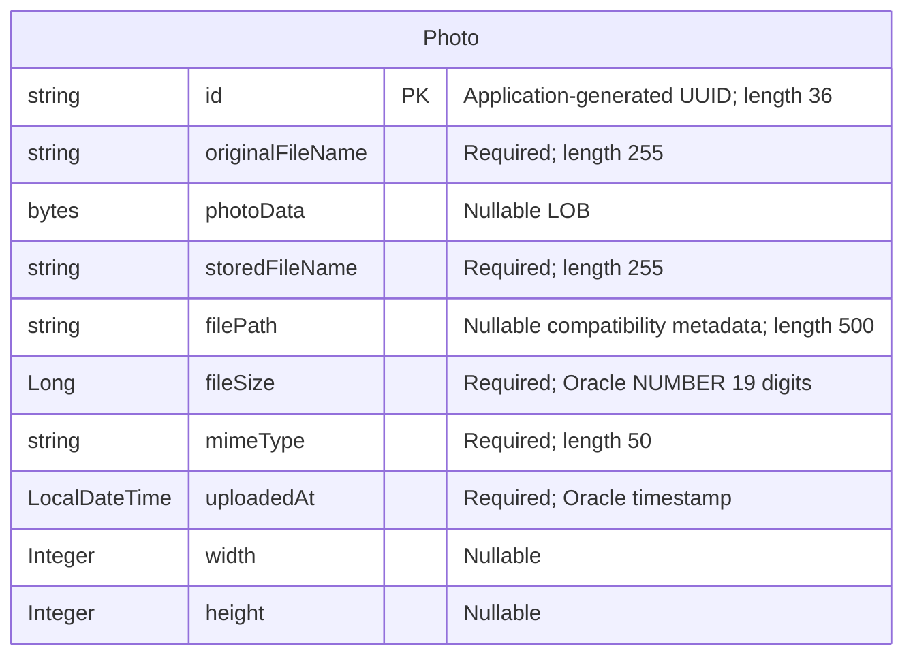

# Data Architecture & Persistence Layer

The data layer contains one persistent entity, `Photo`, mapped to Oracle through Spring Data JPA/Hibernate; H2 is configured for tests. Photo bytes and descriptive metadata reside together in the relational table, rather than in a separate file or object store.

## Database Configuration

| Service/Module | DB Type | Profile | Driver | Connection | Migration Tool |
|---|---|---|---|---|---|
| `photo-album` | Oracle (Free 23ai identified in container configuration) | Default | `com.oracle.database.jdbc:ojdbc8`; `oracle.jdbc.OracleDriver` | Oracle Thin JDBC to a configurable host, port and pluggable database; environment-supplied credentials, not reproduced | None detected; Hibernate recreates the mapped schema at startup |
| `photo-album` | Oracle | `docker` | Same Oracle driver | Same configurable Oracle Thin connection; credentials supplied externally | None detected; Hibernate recreates the mapped schema at startup |
| `photo-album` tests | H2, in memory | `test` | Test-scoped `com.h2database:h2`; `org.h2.Driver` | Named in-memory database; isolated from the configured Oracle database | None detected; Hibernate creates and drops the schema with the persistence context |

- **Schema lifecycle:** Default and Docker configuration use destructive schema creation, not incremental migration or schema validation. Persisting database files does not prevent Hibernate's startup schema recreation. The test profile uses create/drop behavior.
- **Initialization and seeds:** `oracle-init/01-create-user.sql` grants schema-scoped object creation privileges and configures tablespaces/quota; `02-verify-user.sql` checks the account and grants. `oracle-init/create-user.sh` is an additional account-bootstrap script. These are account setup, not versioned domain-schema migrations. No domain seed data, `data.sql`, `import.sql`, Flyway migrations, or Liquibase changelogs were found.
- **Pooling:** JPA starter dependencies imply Spring Boot's default HikariCP pool unless overridden at runtime; no explicit pool implementation, sizes, timeouts, or custom datasource bean were found. Effective runtime values were not verified.
- **Portability:** Oracle-specific native SQL and column definitions remain in use under the H2 test configuration; the configured context-load test does not establish Oracle query compatibility.
- **Property inventory:** See sibling `configuration-inventory.md` for raw configuration keys and environment details; no credential values are reproduced here.

Evidence: `pom.xml:43-54,88-93`; `src/main/resources/application.properties:9-21`; `src/main/resources/application-docker.properties:1-17`; `src/test/resources/application-test.properties:1-10`; `src/test/java/com/photoalbum/PhotoAlbumApplicationTests.java:7-13`; `oracle-init/`; `docker-compose.yml:2-4`.

## Data Ownership per Service

| Service | Tables Owned | ORM Framework | Caching | Notes |
|---|---|---|---|---|
| `photo-album` (`com.photoalbum`) | `photos` (`Photo`) | Spring Data JPA with Hibernate, `javax.persistence` mappings | No explicit application/distributed/query cache | `PhotoServiceImpl` accesses the table through `PhotoRepository`; metadata and binary payload share a row. No outbox or auxiliary domain tables detected. |

Evidence: `src/main/java/com/photoalbum/model/Photo.java:15-19`; `src/main/java/com/photoalbum/repository/PhotoRepository.java:15-16`; `src/main/java/com/photoalbum/service/impl/PhotoServiceImpl.java:28-37`.

## Entity Model

- **Mapping:** `Photo` maps to `photos`; camel-case fields have explicit snake-case column names. `id` is a Java `String`, `photoData` is `byte[]`, and the remaining Java types are shown above (`string` denotes `String`). There are no foreign keys or entity relationships, so no cardinality edges, bidirectional links, cascade rules, or association fetch settings apply.
- **Keys and indexes:** UUID identifiers are assigned in the constructor, not through a database sequence. A nonunique index covers `uploaded_at`. No additional uniqueness constraints or optimistic-lock version field are declared.
- **Binary loading:** `photoData` is an ordinary `@Lob` without an explicit lazy-fetch override; custom entity queries select it alongside metadata. There is no separate metadata-only projection for gallery reads.
- **Timestamp:** The constructor sets the upload timestamp locally; the mapped Oracle timestamp column also declares a database current-timestamp default. No audit entity or timezone-specific field is declared.
- **Transactions:** `PhotoServiceImpl` has class-level `@Transactional`; the four read methods override it with read-only transactions. Upload and delete inherit writable transactions.
- **Nonpersistent model:** `UploadResult` is a response DTO, not a table/entity.

Evidence: `src/main/java/com/photoalbum/model/Photo.java:15-107`; `src/main/java/com/photoalbum/service/impl/PhotoServiceImpl.java:28-30,53-69,195-237`; `src/main/java/com/photoalbum/model/UploadResult.java:1-10`.

## Key Repository Methods

All methods below belong to `PhotoRepository extends JpaRepository<Photo, String>` in `src/main/java/com/photoalbum/repository/PhotoRepository.java`. Standard inherited CRUD methods are omitted from the table. Every listed custom method uses native SQL, not derived queries or JPQL.

| Service | Repository | Notable Methods | Purpose |
|---|---|---|---|
| `photo-album` | `PhotoRepository<Photo, String>` | `List<Photo> findAllOrderByUploadedAtDesc()` | All photos newest first; includes binary data; used by gallery reads |
| `photo-album` | Same | `List<Photo> findPhotosUploadedBefore(LocalDateTime uploadedAt)` | Earlier timestamps, descending order, Oracle `ROWNUM` cap of ten; used by older-photo lookup |
| `photo-album` | Same | `List<Photo> findPhotosUploadedAfter(LocalDateTime uploadedAt)` | Later timestamps, ascending order; Oracle `NVL` supplies a fallback path; used by newer-photo lookup |
| `photo-album` | Same | `List<Photo> findPhotosByUploadMonth(String year, String month)` | Filters timestamp year/month through Oracle `TO_CHAR`; no call found in the service implementation |
| `photo-album` | Same | `List<Photo> findPhotosWithPagination(int startRow, int endRow)` | Inclusive row range over newest-first results using nested Oracle `ROWNUM`; no service call found |
| `photo-album` | Same | `List<Object[]> findPhotosWithStatistics()` | Photo columns plus size rank and cumulative file-size total using SQL analytic functions; no service call found |

Parameters are bound using `@Param`. No stored-procedure calls, named queries, cross-service bulk-ID finders, or repository aggregation interfaces were found. Native listing/navigation methods return full entities rather than pageable metadata projections.

Evidence: `src/main/java/com/photoalbum/repository/PhotoRepository.java:16-100`; `src/main/java/com/photoalbum/service/impl/PhotoServiceImpl.java:53-75,220-237`.

## Caching Strategy

| Layer | Observed strategy | Provider / TTL / eviction |
|---|---|---|
| Application and distributed cache | No cache-aside, read-through, write-through, or write-behind implementation detected | No Redis, Ehcache, Caffeine, JCache binding, Spring Cache annotations, cache names, TTL, or eviction configuration found |
| Hibernate | Ordinary persistence-context first-level caching applies within a persistence context; no explicit second-level or query-cache configuration detected | No shared cache provider or cache region policy declared |
| Binary response caching | Photo responses explicitly discourage browser/proxy storage and reuse | No-cache/no-store response directives and immediate expiry; not a database cache |
| Authentication/session state | Authentication is stateless; admin details are held in memory, not a persistent session store | No session-cache provider or session TTL configuration detected |

No explicit data-cache rationale is documented. Repository reads therefore have no configured shared result cache; listing queries also retrieve BLOB columns. Response no-cache behavior is explicit in `PhotoFileController`, rather than evidence of a cache provider.

Evidence: `pom.xml:30-101`; `src/main/java/com/photoalbum/controller/PhotoFileController.java:74-83`; `src/main/java/com/photoalbum/config/SecurityConfig.java:28-61`; datasource/JPA configuration files listed above.

## Data Ownership Boundaries

One application-owned relational schema contains the discovered domain table. No database-per-service partitioning, shared cross-service tables, remote data aggregation, or cross-service database access was found. H2 is a test substitute, not a second production datastore.

`PhotoServiceImpl` performs both reads and writes through the same repository/entity model. Read-only transactions do not constitute CQRS: there is no separate read store, event stream, synchronization pipeline, or materialized projection. Photo content is persisted in the row's BLOB; stored filenames and paths are compatibility metadata, not evidence of filesystem persistence. There is no per-user owner key or row-level ownership mapping.

Evidence: `src/main/java/com/photoalbum/service/impl/PhotoServiceImpl.java:53-75,112-175,195-237`; `src/main/java/com/photoalbum/model/Photo.java:19-91`.

### Data Classification & Sensitivity

| Entity | Sensitive Fields | Classification (PII/PHI/PCI/None) | Controls in Place |
|---|---|---|---|
| `Photo` | `photoData` | Potential PII: uploaded photographs may identify people or contain embedded metadata. PHI/PCI content cannot be determined from the schema. | No application-level encryption, masking, content redaction, embedded-metadata stripping, or field-level controls found. Read access is public; mutations require authentication. Database encryption-at-rest is not configured in inspected files and runtime database controls are unknown. |
| `Photo` | `originalFileName`; potentially compatibility `filePath` | Potential PII if user-supplied names contain personal information | No masking or field-level access control found. Filenames are logged and returned as response metadata; file serving also logs an initial byte prefix. Generated stored filenames are UUID-based, not anonymization of the original filename or image content. |
| `Photo` | `id`, `storedFileName`, `fileSize`, `mimeType`, `uploadedAt`, `width`, `height` | None intrinsically; identifiers and timestamps can become linkable metadata | No per-record owner restriction or masking. No field encryption is declared. |

There are no explicit person, health-record, or payment-card entities. Potential sensitivity derives from arbitrary uploaded content, not from dedicated PHI/PCI columns. Credentials remain external configuration and are not represented as domain entities; values are intentionally omitted. Admin credentials are BCrypt-encoded in the in-memory security configuration, which does not encrypt photo data.

Evidence: `src/main/java/com/photoalbum/model/Photo.java:24-91,201-213`; `src/main/java/com/photoalbum/service/impl/PhotoServiceImpl.java:112-180`; `src/main/java/com/photoalbum/controller/PhotoFileController.java:53-81`; `src/main/java/com/photoalbum/config/SecurityConfig.java:28-61`.
