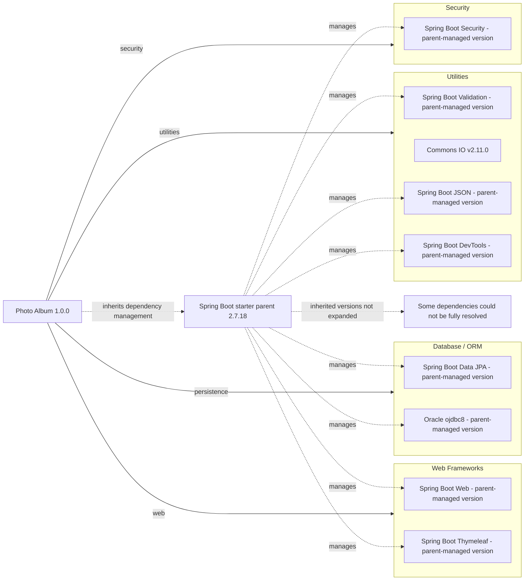

# Dependency Map

Photo Album (`com.photoalbum:photo-album:1.0.0`) declares **11 external dependencies** in `pom.xml`: **9 non-test dependencies** and **2 test dependencies**. This build-file-only inventory excludes the parent POM and build plugin from dependency counts; inherited versions and transitive packages are not resolved locally.

## Dependencies

### Dependency Summary

| Category | Count | Key Libraries | Notes |
|----------|-------|---------------|-------|
| Web Frameworks | 2 | `org.springframework.boot:spring-boot-starter-web`; `org.springframework.boot:spring-boot-starter-thymeleaf` | Both compile scope (default); versions omitted and inherited from parent management. |
| Database / ORM | 2 | `org.springframework.boot:spring-boot-starter-data-jpa`; `com.oracle.database.jdbc:ojdbc8` | Data JPA: compile scope (default). Oracle driver: runtime scope. Both versions parent-managed, not explicitly declared. |
| Security | 1 | `org.springframework.boot:spring-boot-starter-security` | Compile scope (default); version parent-managed, not explicitly declared. |
| Utilities | 4 | `org.springframework.boot:spring-boot-starter-validation`; `commons-io:commons-io:2.11.0`; `org.springframework.boot:spring-boot-starter-json`; `org.springframework.boot:spring-boot-devtools` | All compile scope (default). Commons IO has an explicit version; the others are parent-managed. DevTools is optional, not test-scoped. |
| **Total non-test** | **9** | | Test dependencies excluded. |

The parent is `org.springframework.boot:spring-boot-starter-parent:2.7.18` (`pom.xml:8–13`). No explicit BOM imports or dependency-management overrides appear in the project POM. Exact inherited versions and transitive coordinates cannot be established from this file alone; “parent-managed” is a version-source annotation, not a resolved version. No lockfile was found among the recognized build/package files.

### Version & Compatibility Risks

Spring Boot 2.7.18 is the final 2.7 release and is outside community support; any extended commercial support must be assessed separately. The build targets Java 8 (`pom.xml:23–26`); moving to Spring Boot 3 requires Java 17 or later and migration from Java EE `javax` APIs to Jakarta equivalents, particularly relevant to JPA, validation, and security. Commons IO 2.11.0 is an older explicitly pinned release that will not track parent-managed upgrades. Oracle driver compatibility cannot be assessed precisely without its inherited version. This inventory does not establish CVE status.

### Notable Observations

- `spring-boot-starter-json` is declared explicitly alongside the web starter, which normally includes JSON support transitively; verify redundancy when resolving the dependency tree. Despite its POM comment, this is a JSON starter, not an image-processing library.
- DevTools is optional but compile-scoped, so it is included in the non-test count. Optionality affects downstream dependency propagation rather than changing its Maven scope.
- No logging, caching, messaging, or observability libraries are declared directly. Starter-provided transitive libraries are not enumerated or counted because neither their dependency descriptors nor a resolved lockfile are present in the assessed build files.
- `org.springframework.boot:spring-boot-maven-plugin` is declared without a version; it inherits parent plugin management and is a build tool, not an application dependency.

## Test Dependencies

| Framework | Version | Notes |
|-----------|---------|-------|
| `org.springframework.boot:spring-boot-starter-test` | Parent-managed; not explicitly declared | Explicit test scope. Provides the Spring Boot test bundle; individual framework versions and transitive packages are not visible in the project POM. |
| `com.h2database:h2` | Parent-managed; not explicitly declared | Explicit test scope; embedded database support. |

Total test-scope dependencies: 2

No dedicated integration-testing or contract-testing dependency is declared directly. H2 and the runtime Oracle driver represent different database implementations; test fidelity should be evaluated separately, without assuming what tests actually execute from the build declaration alone.
