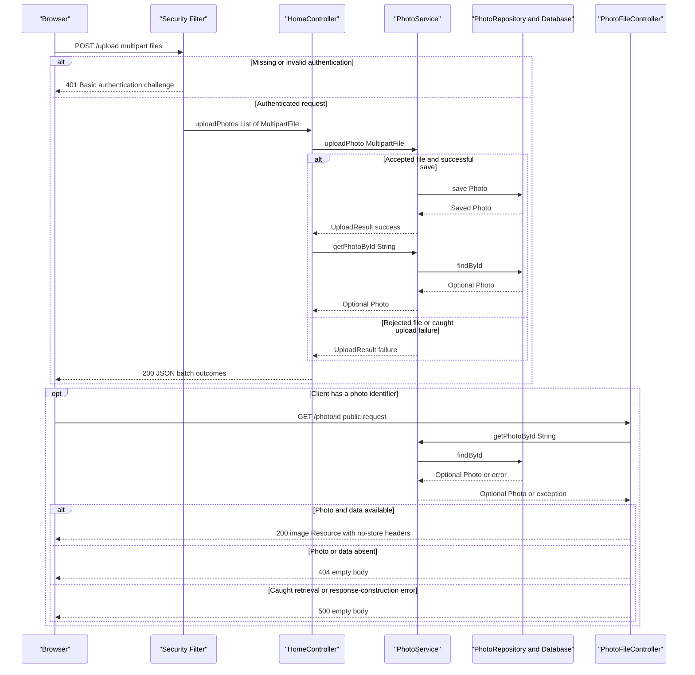

# API & Service Communication Contracts

Five explicit application endpoints provide gallery/detail HTML, multipart upload with JSON results, binary photo retrieval, and deletion by POST. Requests use synchronous controller-to-service calls; no application messaging or downstream HTTP API client was identified.

## Service Catalog

| Service | Port | Category | Purpose |
|---|---|---|---|
| `photoalbum-java-app` / Maven `com.photoalbum:photo-album` | 8080, also published as host 8080 | API Layer | Single source-built application serving gallery pages and photo operations. Dependencies include Spring Web MVC, Thymeleaf, Data JPA, Validation, Security, JSON support, and Oracle JDBC. |
| `oracle-db` | 1521, also published as host 1521 | Infrastructure | Third-party `gvenzl/oracle-free` container providing application data storage; not another source module or HTTP API. |

Evidence: [Maven identity and packaging](../../../../../../pom.xml#L15-L21), [dependencies](../../../../../../pom.xml#L30-L101), and [Compose service definitions](../../../../../../docker-compose.yml#L1-L44). The Maven build has no child module declarations.

Provisioning-only infrastructure is distinct from this runtime topology: [azure-setup.ps1](../../../../../../azure-setup.ps1#L69-L145) contains commands to create a container registry, AKS cluster, and PostgreSQL server/database. These commands do not establish another implemented application API or prove a deployed service; the inspected application dependencies and Compose connections use Oracle. No Kubernetes/Helm service definitions were found in the conventional deployment directories inspected.

## API Endpoints Inventory

Paths are unversioned; no URL/header/query-based API version negotiation is implemented in the controllers. Success/error codes below describe explicit controller behavior and standard MVC/security handling, not runtime-tested responses.

| Service | Method | Path | Request Type | Response Type |
|---|---|---|---|---|
| `photo-album` / `HomeController` | GET | `/` | No application parameters | 200 HTML, view `index`; model includes `List<Photo>` and a timestamp. Retrieval exceptions produce an empty gallery rather than an error status. [Source](../../../../../../src/main/java/com/photoalbum/controller/HomeController.java#L37-L50) |
| `photo-album` / `HomeController` | POST | `/upload` | `multipart/form-data`; repeated required `files` parts bound to `List<MultipartFile>`; authenticated | 200 JSON `Map<String,Object>` containing per-file outcomes, including partial or total per-file failure; explicit 400 JSON for an empty/null list. Missing required multipart parameters normally fail MVC binding with 400 before the handler; 401 if unauthenticated. [Source](../../../../../../src/main/java/com/photoalbum/controller/HomeController.java#L55-L98) |
| `photo-album` / `DetailController` | GET | `/detail/{id}` | String path parameter `id` | 200 HTML, view `detail`; `Photo` and optional previous/next identifiers in the model. Default MVC redirect to `/` (normally 302) for empty/unknown IDs or exceptions. [Source](../../../../../../src/main/java/com/photoalbum/controller/DetailController.java#L32-L59) |
| `photo-album` / `DetailController` | POST | `/detail/{id}/delete` | String path parameter `id`; authenticated; no request body contract | Default MVC redirect to `/` (normally 302) for success, missing photo, or caught failure; outcome is a flash message, not JSON. 401 if unauthenticated. [Source](../../../../../../src/main/java/com/photoalbum/controller/DetailController.java#L64-L79) |
| `photo-album` / `PhotoFileController` | GET | `/photo/{id}` | String path parameter `id` | 200 `ResponseEntity<Resource>` backed by `ByteArrayResource`, using the stored image MIME type; 404 for missing photo/data or blank ID; 500 with no body for caught exceptions. [Source](../../../../../../src/main/java/com/photoalbum/controller/PhotoFileController.java#L23-L87) |

Upload contract details:

- Normal batch responses contain `success`, `uploadedPhotos`, and `failedUploads`. `success` means at least one uploaded photo was added to the response, not that every file succeeded. Failed items contain `fileName` and `error`; the empty-list 400 response instead contains `success: false` and `error`. [HomeController.java:58–97](../../../../../../src/main/java/com/photoalbum/controller/HomeController.java#L58-L97)
- Successful entries are manually selected metadata projections, not serialized `Photo` entities or binary payloads. A successful upload is followed by a lookup; if that lookup returns empty, the controller adds neither a success entry nor a failure entry for that item. [HomeController.java:68–90](../../../../../../src/main/java/com/photoalbum/controller/HomeController.java#L68-L90)
- Per-file rejection and caught upload-processing failures become failed entries in a 200 batch result. No controller advice standardizes multipart-limit or uncaught transaction/lookup failures into this JSON envelope. Individual validation rules belong in `business-workflows.md`; multipart limit configuration belongs in `configuration-inventory.md`. [PhotoServiceImpl.java:82–193](../../../../../../src/main/java/com/photoalbum/service/impl/PhotoServiceImpl.java#L82-L193)

Binary responses set `Cache-Control: no-cache, no-store, must-revalidate, private`, `Pragma: no-cache`, `Expires: 0`, and `X-Photo-ID`, `X-Photo-Name`, `X-Photo-Size`. The upload metadata's compatibility `filePath` is not the implemented binary retrieval contract; clients construct `/photo/{id}`. [PhotoFileController.java:74–83](../../../../../../src/main/java/com/photoalbum/controller/PhotoFileController.java#L74-L83), [PhotoServiceImpl.java:112–115](../../../../../../src/main/java/com/photoalbum/service/impl/PhotoServiceImpl.java#L112-L115), [upload.js:178–179](../../../../../../src/main/resources/static/js/upload.js#L178-L179)

Framework-served CSS, JavaScript, and packaged static resources are not additional controller business endpoints. There is no explicit GET-list JSON API, HTTP DELETE route, or endpoint exposing the repository's additional query methods. [Controller mappings above; repository methods](../../../../../../src/main/java/com/photoalbum/repository/PhotoRepository.java#L58-L100)

## Management & Observability Endpoints

| Service | Endpoint | Custom Metrics (if any) |
|---|---|---|
| `photo-album` | No explicitly configured Actuator, health, info, metrics, Prometheus, or Swagger endpoint found | No `@Timed` or custom meter registration found in application source; controllers/services use SLF4J logging instead. |
| `oracle-db` | No application HTTP management endpoint defined | Container health check is a command, not a public HTTP API. |

Evidence: [complete dependency list without Actuator or OpenAPI libraries](../../../../../../pom.xml#L30-L101), [controller logging](../../../../../../src/main/java/com/photoalbum/controller/HomeController.java#L23-L26), [database health check](../../../../../../docker-compose.yml#L17-L22). This is a source inventory, not evidence that any live management endpoint was probed.

## DTOs & Contracts

| Class/type | Contract role | Mutability |
|---|---|---|
| `MultipartFile` / `List<MultipartFile>` | Framework multipart request abstraction, not a JSON request DTO | Not an application immutable value contract |
| `Photo` | Service-owned domain entity used in HTML models and as the source for selected upload-response metadata; not directly returned as the full JSON entity | Mutable JavaBean |
| `UploadResult` | Internal service-to-controller result for one upload; translated into maps, not exposed directly as the HTTP response DTO | Mutable JavaBean |
| `Map<String,Object>` and lists of maps | Ad hoc JSON upload envelope and per-file projections; no dedicated gateway or public response DTO class | Mutable |
| `Resource` / `ByteArrayResource` | Binary photo response, not JSON | Framework response abstraction |
| `String` view names and MVC `Model` / `RedirectAttributes` | HTML and redirect/flash-message contracts | Framework MVC objects |

Evidence: [Photo constructors and accessors](../../../../../../src/main/java/com/photoalbum/model/Photo.java#L93-L199), [UploadResult](../../../../../../src/main/java/com/photoalbum/model/UploadResult.java#L6-L63), and the endpoint implementations cited above. For entity fields and persistence details, see `data-architecture.md`; no entity field inventory is repeated here.

There are no gateway-level aggregation DTOs. JSON responses use Spring's JSON/Jackson support supplied through the declared starters; no custom mapper, serializer, naming policy, or serialization annotations were found in the application source. HTML responses use view rendering rather than JSON serialization. No OpenAPI/Swagger specification or annotations, protobuf schema, or GraphQL schema was found in the inspected project files. [JSON dependency](../../../../../../pom.xml#L75-L79), [response construction](../../../../../../src/main/java/com/photoalbum/controller/HomeController.java#L55-L98)

## Communication Patterns

- **Browser-to-application:** Same-origin HTTP requests; upload JavaScript creates `FormData`, awaits `fetch('/upload')`, parses JSON only on successful HTTP status, and displays a generic error otherwise. JavaScript promises do not indicate backend queue/event processing. [upload.js:90–132](../../../../../../src/main/resources/static/js/upload.js#L90-L132)
- **Internal synchronous calls:** Controllers inject `PhotoService`; `PhotoServiceImpl` calls `PhotoRepository` synchronously, with transactions around service operations. The repository uses JPA/JDBC to the database through the Compose hostname `oracle-db`, not service-registry discovery. [Service calls and transactions](../../../../../../src/main/java/com/photoalbum/service/impl/PhotoServiceImpl.java#L28-L75), [repository](../../../../../../src/main/java/com/photoalbum/repository/PhotoRepository.java#L15-L27), [connection wiring](../../../../../../docker-compose.yml#L30-L34)
- **Composition:** Upload combines per-file service results into one batch envelope, and detail rendering combines a photo with previous/next navigation IDs. Both are in-process composition, not gateway fan-out to independent services. No API gateway, registry client/server, client-side load balancer, gRPC client, message broker, pub/sub, or event-driven application integration was identified. [Upload aggregation](../../../../../../src/main/java/com/photoalbum/controller/HomeController.java#L68-L97), [detail composition](../../../../../../src/main/java/com/photoalbum/controller/DetailController.java#L38-L54), [dependencies](../../../../../../pom.xml#L30-L101)
- **Resilience and timeouts:** No application retry, circuit breaker, bulkhead, fallback service, explicit HTTP-client timeout, or transaction/query timeout was found. Consequently no application timeout value can be reported; library defaults are not treated as explicit policies. Error behavior is local: gallery becomes empty, detail redirects, deletion redirects with a failure flash message, binary serving returns 404/500, and uploads collect per-file errors. The browser does not implement retries or an explicit fetch timeout. Compose process restart is not request-level retry. [Controller sources above; service error handling](../../../../../../src/main/java/com/photoalbum/service/impl/PhotoServiceImpl.java#L172-L217), [browser handling](../../../../../../src/main/resources/static/js/upload.js#L102-L132), [restart declaration](../../../../../../docker-compose.yml#L44)
- **Startup/API availability:** Compose starts the app only after database health is satisfied; database connectivity and provision of the required administrator password are prerequisites for normal application startup. Detailed startup/configuration information belongs in `configuration-inventory.md`. [Dependency](../../../../../../docker-compose.yml#L35-L41), [administrator creation](../../../../../../src/main/java/com/photoalbum/config/SecurityConfig.java#L33-L42)
- **Authentication and authorization:** Stateless HTTP Basic is enabled. POST `/upload` and `/detail/*/delete` require authentication; other requests are permitted by the filter chain. An in-memory account is assigned an ADMIN role, but the routes require only authentication, not an ADMIN role check. CSRF is explicitly disabled. No JWT/OAuth2 flow or method-level authorization is implemented in the inspected source. Credentials are intentionally not reproduced. [SecurityConfig.java:33–61](../../../../../../src/main/java/com/photoalbum/config/SecurityConfig.java#L33-L61)
- **Transport security:** No application HTTPS listener, TLS termination service, HTTPS requirement, or encrypted JDBC configuration is shown in the inspected application/Compose configuration. Do not assume HTTP Basic credentials are protected in transit without an externally configured TLS terminator. Bootstrap assets are loaded separately by the browser over HTTPS from jsDelivr; this is a frontend asset dependency, not backend service communication. [Application listener/configuration](../../../../../../src/main/resources/application.properties#L1-L15), [Compose topology](../../../../../../docker-compose.yml#L1-L44), [template asset reference](../../../../../../src/main/resources/templates/index.html#L1-L15)
- **Browser authentication integration:** Upload JavaScript sets no explicit Authorization header or login flow; protected actions therefore rely on an already authenticated browser HTTP Basic context or a caller providing credentials. A fresh unauthenticated upload receives the security-layer failure rather than a batch upload result. [upload.js:102–127](../../../../../../src/main/resources/static/js/upload.js#L102-L127), [Basic authentication policy](../../../../../../src/main/java/com/photoalbum/config/SecurityConfig.java#L46-L61)

## Service Technology Matrix

| Service | Web | Data Access | Discovery | Gateway | Actuator/Health | Cache | Metrics |
|---|---|---|---|---|---|---|---|
| `photo-album` | Spring MVC / Thymeleaf; selected JSON and binary responses | Spring Data JPA / Oracle JDBC | Compose DNS hostname; no registry | None | No application health endpoint found | No application cache found; binary responses prohibit caching | Logging only; no explicit exporter found |
| `oracle-db` | Not an HTTP app | Database server | Compose DNS service name | None | Container command health check | Not assessed as an application cache | No exporter defined in Compose |

Evidence: [build dependencies](../../../../../../pom.xml#L30-L101), [Compose](../../../../../../docker-compose.yml#L1-L44), [binary cache headers](../../../../../../src/main/java/com/photoalbum/controller/PhotoFileController.java#L74-L83). Cache implementation details, if assessed separately, belong in `data-architecture.md`.

## Service Communication Sequence

The primary upload-and-display flow below shows one file; the controller repeats the upload/lookup steps sequentially for each part. Solid arrows are synchronous calls, dashed arrows are responses; there is no asynchronous broker or retry/circuit-breaker path to depict. Evidence: [upload controller](../../../../../../src/main/java/com/photoalbum/controller/HomeController.java#L55-L98), [upload service](../../../../../../src/main/java/com/photoalbum/service/impl/PhotoServiceImpl.java#L81-L193), [binary controller](../../../../../../src/main/java/com/photoalbum/controller/PhotoFileController.java#L37-L87).

