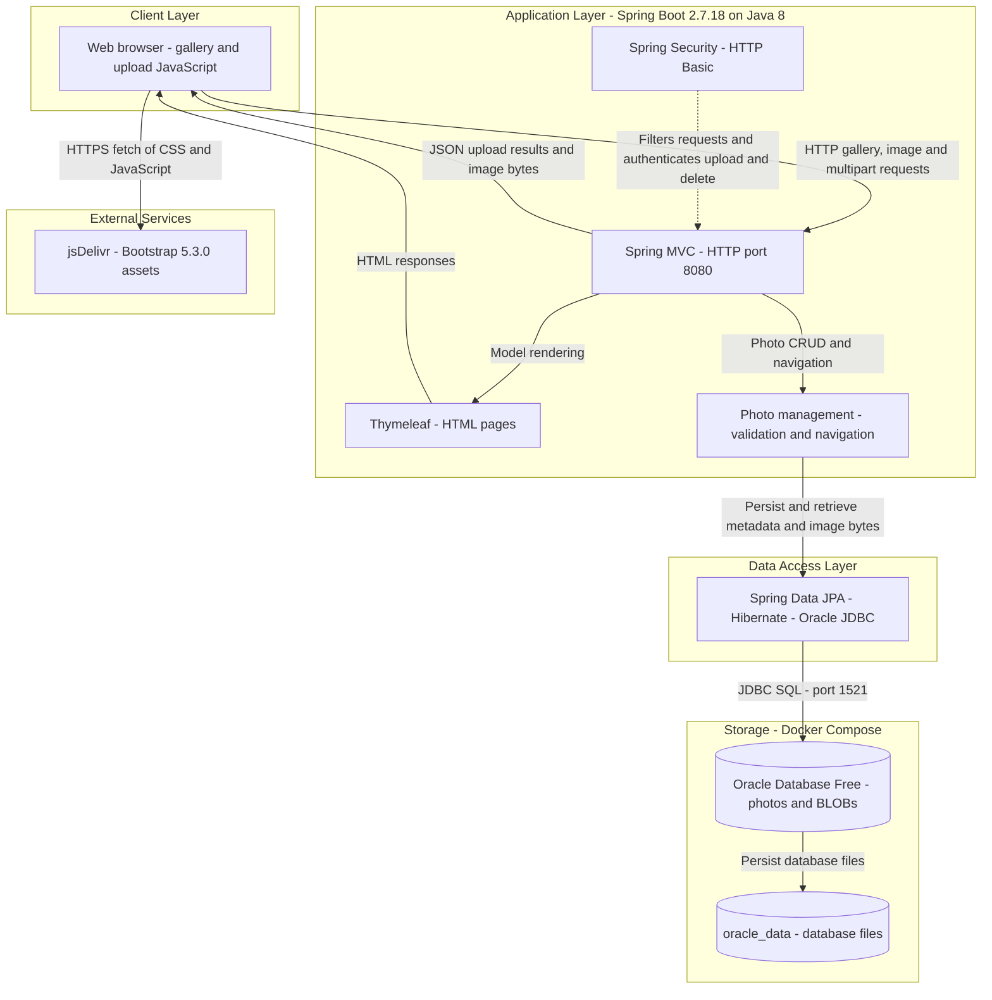
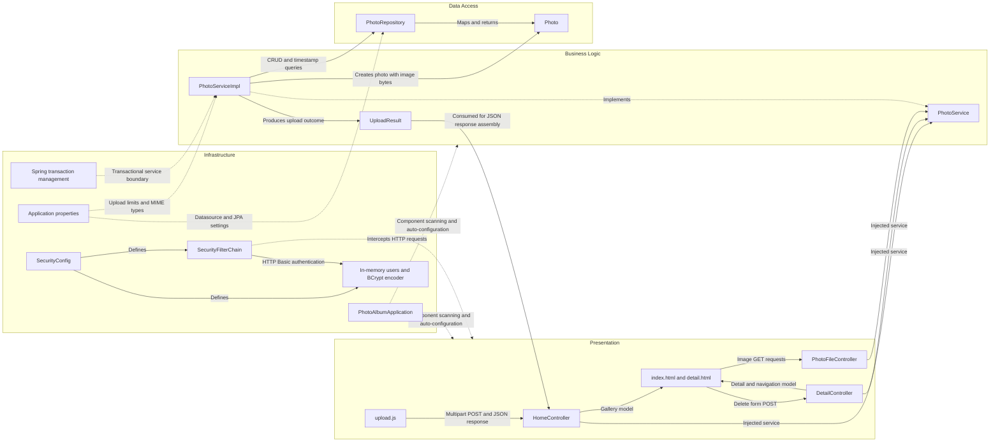

# Architecture Diagram

Photo Album is a single-module Java web application with server-rendered gallery pages and a multipart upload API. The diagrams describe the checked-in implementation and Docker Compose topology, not a verified running deployment; credentials and credential values are omitted.

## Application Architecture

### Technology Stack Summary

| Layer | Technology | Version | Purpose |
|---|---|---|---|
| Runtime and packaging | Java, Maven, executable Spring Boot JAR | Java 8; Maven build image 3.9.6; application 1.0.0 | One deployable application; multi-stage container with Temurin 8 JRE. [Build](../../../../../../pom.xml#L15-L26), [container](../../../../../../Dockerfile#L1-L31). |
| Application | Spring Boot | 2.7.18 | Auto-configuration and application bootstrap. [Parent](../../../../../../pom.xml#L8-L13), [entry point](../../../../../../src/main/java/com/photoalbum/PhotoAlbumApplication.java#L9-L14). |
| Presentation | Spring MVC, Thymeleaf | Managed by Boot 2.7.18; individual versions not pinned | HTTP controllers, gallery and detail page rendering. [Dependencies](../../../../../../pom.xml#L30-L41), [gallery controller](../../../../../../src/main/java/com/photoalbum/controller/HomeController.java#L23-L57). |
| Browser UI | JavaScript Fetch API, Bootstrap | Browser-provided API; Bootstrap 5.3.0 | Multipart uploads with JSON feedback and responsive styling. [Upload client](../../../../../../src/main/resources/static/js/upload.js#L90-L120), [CDN references](../../../../../../src/main/resources/templates/layout.html#L7-L8), [script](../../../../../../src/main/resources/templates/layout.html#L42). |
| Security | Spring Security, BCrypt, in-memory user store | Boot-managed | Stateless HTTP Basic; authenticated POST upload/delete, public reads. [Configuration](../../../../../../src/main/java/com/photoalbum/config/SecurityConfig.java#L28-L61). |
| Business logic | Spring services, transactions, Java ImageIO | Boot-managed Spring; Java 8 API | Upload validation, header-based dimension inspection, CRUD and previous/next navigation. [Service](../../../../../../src/main/java/com/photoalbum/service/impl/PhotoServiceImpl.java#L28-L47), [image inspection](../../../../../../src/main/java/com/photoalbum/service/impl/PhotoServiceImpl.java#L117-L158). |
| Persistence | Spring Data JPA, Hibernate, Oracle ojdbc8 | Boot-managed; individual versions not pinned | Entity CRUD plus Oracle-specific native queries. [Dependencies](../../../../../../pom.xml#L43-L54), [repository](../../../../../../src/main/java/com/photoalbum/repository/PhotoRepository.java#L15-L42). |
| Database | Oracle Database Free | Image tag `latest`; exact runtime version unpinned | Metadata and binary photos in one database. Compose comments describe 23ai, but the floating image tag does not guarantee that version. [Compose](../../../../../../docker-compose.yml#L2-L14), [entity](../../../../../../src/main/java/com/photoalbum/model/Photo.java#L15-L41). |
| Deployment | Docker Compose, bridge network, named volume | Compose version unspecified | App waits for database health; ports 8080 and 1521 published. [Topology](../../../../../../docker-compose.yml#L10-L22), [application and network](../../../../../../docker-compose.yml#L24-L51). |

### Data Storage & External Services

Oracle stores photo metadata and image bytes in the `photos` table; the `photo_data` field is a JPA LOB. Uploaded bytes are written to the database, and `/photo/{id}` returns those bytes through a `ByteArrayResource`; `/uploads/` paths are compatibility metadata, not the current upload storage mechanism ([entity](../../../../../../src/main/java/com/photoalbum/model/Photo.java#L15-L56), [upload persistence](../../../../../../src/main/java/com/photoalbum/service/impl/PhotoServiceImpl.java#L112-L175), [image response](../../../../../../src/main/java/com/photoalbum/controller/PhotoFileController.java#L53-L83)). Compose persists Oracle files in `oracle_data` and mounts `oracle-init` for database initialization ([volume mounts](../../../../../../docker-compose.yml#L12-L14)). Both application profiles set `spring.jpa.hibernate.ddl-auto=create`, so schema recreation on startup is configured despite the persistent database volume ([default configuration](../../../../../../src/main/resources/application.properties#L17-L21), [Docker profile](../../../../../../src/main/resources/application-docker.properties#L13-L17)).

The browser fetches Bootstrap assets from jsDelivr; no application-side cache, message broker, object-storage integration, or external business API was identified in the inspected build, configuration and source. Database and administrator credentials are supplied through external configuration/environment variables; no values are reproduced here ([Compose wiring](../../../../../../docker-compose.yml#L30-L36), [administrator configuration](../../../../../../src/main/java/com/photoalbum/config/SecurityConfig.java#L33-L42)).

### Key Architectural Decisions

- **Layered monolith with constructor injection:** MVC controllers depend on the `PhotoService` interface; its implementation injects `PhotoRepository`. Read methods use read-only transactions within a transactional service ([controller injection](../../../../../../src/main/java/com/photoalbum/controller/HomeController.java#L28-L32), [service injection and transactions](../../../../../../src/main/java/com/photoalbum/service/impl/PhotoServiceImpl.java#L28-L71)).
- **Database-centric photo storage:** JPA entities carry metadata and BLOB content together; native queries use Oracle constructs such as `ROWNUM`, `NVL`, and `TO_CHAR`, coupling persistence to Oracle ([mapping](../../../../../../src/main/java/com/photoalbum/model/Photo.java#L15-L79), [queries](../../../../../../src/main/java/com/photoalbum/repository/PhotoRepository.java#L34-L87)).
- **Public gallery with protected mutations:** an in-memory administrator is configured with BCrypt; HTTP Basic authenticates upload/delete requests, sessions are stateless and CSRF is explicitly disabled. No TLS termination is configured in the inspected application/Compose settings ([security policy](../../../../../../src/main/java/com/photoalbum/config/SecurityConfig.java#L28-L61), [HTTP port](../../../../../../src/main/resources/application.properties#L1-L2), [published port](../../../../../../docker-compose.yml#L37-L38)).

## Component Relationships

### Component Inventory

| Component | Layer | Type | Responsibility |
|---|---|---|---|
| `index.html`, `detail.html`, `layout.html` | Presentation | Thymeleaf templates | Gallery, detail/navigation/delete UI, and shared layout template; controllers explicitly return `index` and `detail`. [Gallery rendering](../../../../../../src/main/java/com/photoalbum/controller/HomeController.java#L37-L49), [detail rendering](../../../../../../src/main/java/com/photoalbum/controller/DetailController.java#L32-L54), [layout](../../../../../../src/main/resources/templates/layout.html#L1-L48). |
| `upload.js` | Presentation | Browser script | Drag/drop selection, client validation, multipart upload, JSON feedback and dynamic gallery cards. [Validation and request](../../../../../../src/main/resources/static/js/upload.js#L60-L132), [gallery update](../../../../../../src/main/resources/static/js/upload.js#L135-L202). |
| `HomeController` | Presentation | MVC controller | GET `/` gallery and POST `/upload`; converts upload outcomes into JSON maps. [Source](../../../../../../src/main/java/com/photoalbum/controller/HomeController.java#L23-L98). |
| `DetailController` | Presentation | MVC controller | GET `/detail/{id}`, previous/next navigation and POST `/detail/{id}/delete` with redirect feedback. [Source](../../../../../../src/main/java/com/photoalbum/controller/DetailController.java#L17-L79). |
| `PhotoFileController` | Presentation | Binary-response controller | GET `/photo/{id}`, database image bytes and MIME-aware HTTP response with no-cache headers. [Source](../../../../../../src/main/java/com/photoalbum/controller/PhotoFileController.java#L22-L86). |
| `PhotoService` | Business logic | Service interface | Contract for listing, lookup, upload, deletion and chronological navigation. [Source](../../../../../../src/main/java/com/photoalbum/service/PhotoService.java#L13-L54). |
| `PhotoServiceImpl` | Business logic | Transactional Spring service | Implements operations, validates MIME/size, inspects image dimensions and delegates database operations. [Injection](../../../../../../src/main/java/com/photoalbum/service/impl/PhotoServiceImpl.java#L28-L47), [upload](../../../../../../src/main/java/com/photoalbum/service/impl/PhotoServiceImpl.java#L82-L193), [deletion and navigation](../../../../../../src/main/java/com/photoalbum/service/impl/PhotoServiceImpl.java#L198-L237). |
| `UploadResult` | Business logic | Result DTO | Carries success flag, original filename, error message and saved photo ID between service and controller. [Source](../../../../../../src/main/java/com/photoalbum/model/UploadResult.java#L3-L29). |
| `PhotoRepository` | Data access | Spring Data repository | `JpaRepository<Photo, String>` CRUD and native Oracle ordering, navigation, filtering, pagination and statistics queries. [Source](../../../../../../src/main/java/com/photoalbum/repository/PhotoRepository.java#L15-L100). |
| `Photo` | Data access | JPA entity | UUID identity, metadata, upload timestamp, dimensions and binary LOB mapped to `photos`. [Fields](../../../../../../src/main/java/com/photoalbum/model/Photo.java#L15-L91), [identity initialization](../../../../../../src/main/java/com/photoalbum/model/Photo.java#L93-L107). |
| `PhotoAlbumApplication` | Infrastructure | Boot entry point | Starts application and enables component discovery/auto-configuration. [Source](../../../../../../src/main/java/com/photoalbum/PhotoAlbumApplication.java#L9-L14). |
| `SecurityConfig`, `SecurityFilterChain`, in-memory user manager and password encoder | Infrastructure | Configuration and security beans | Builds stateless Basic authentication and configured administrator identity; filters requests before controllers. [Source](../../../../../../src/main/java/com/photoalbum/config/SecurityConfig.java#L25-L62). |
| Application properties | Infrastructure | Externalized settings | Datasource/JPA settings, port, multipart limits and allowed image MIME types; Docker profile changes logging. [Default](../../../../../../src/main/resources/application.properties#L1-L34), [Docker profile](../../../../../../src/main/resources/application-docker.properties#L13-L35). |
| Spring transaction management | Infrastructure | Annotation-driven cross-cutting concern | Transactional service boundary, with read-only annotations on lookup/navigation. [Source](../../../../../../src/main/java/com/photoalbum/service/impl/PhotoServiceImpl.java#L28-L29), [read-only lookup](../../../../../../src/main/java/com/photoalbum/service/impl/PhotoServiceImpl.java#L53-L71), [navigation](../../../../../../src/main/java/com/photoalbum/service/impl/PhotoServiceImpl.java#L223-L237). |

Relationships represent in-process Java calls, server-rendered models and browser HTTP requests, not messaging or separate backend services. External libraries and storage services appear only in the application-level diagram.
