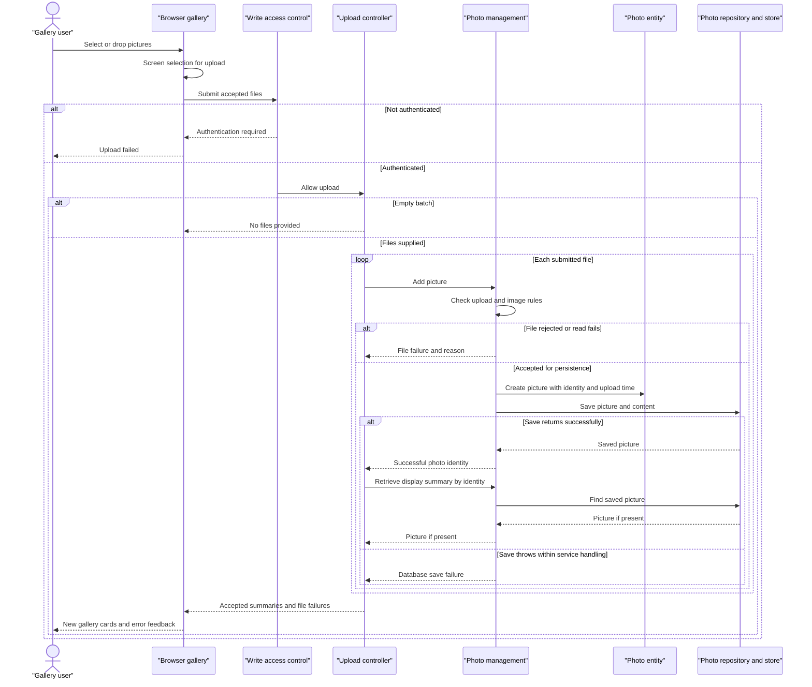

# Core Business Workflows

Photo Album lets visitors browse a shared photo gallery and inspect individual pictures with chronological navigation. Authenticated users can add pictures in batches and permanently remove pictures from the gallery.

## Domain Entities

| Entity | Service / Bounded Context | Description | Key Relationships |
|---|---|---|---|
| Photo | PhotoService / Photo management | An uploaded picture, including its display information and image content; the only persisted business entity identified. | Each photo stands alone in the shared gallery. Older/newer neighbors are derived from upload time, not explicit relationships. No album, user ownership, or tagging entity is modeled. |
| UploadResult | PhotoService / Upload processing | A transient operation outcome, not a persisted entity or aggregate. Communicates acceptance or rejection of one uploaded file. | A successful result references the saved Photo; a failed result carries the submitted filename and an error. |

Evidence: [Photo.java:12–108](../../../../../../src/main/java/com/photoalbum/model/Photo.java#L12-L108), [UploadResult.java:3–29](../../../../../../src/main/java/com/photoalbum/model/UploadResult.java#L3-L29), [PhotoServiceImpl.java:220–237](../../../../../../src/main/java/com/photoalbum/service/impl/PhotoServiceImpl.java#L220-L237).

## Service-to-Domain Mapping

This is one application with internal layers, not independently deployed business services. The following rows describe responsibilities within that application.

| Service | Domain Context | Owned Entities | External Dependencies |
|---|---|---|---|
| HomeController and browser upload UI | Shared gallery and batch-upload presentation | No independent entity ownership; composes Photo summaries and UploadResult outcomes | PhotoService; visitor's browser |
| DetailController | Individual-photo viewing and removal | No independent entity ownership; reads/deletes Photo through PhotoService | PhotoService |
| PhotoFileController | Delivery of picture content | No independent entity ownership; reads Photo content | PhotoService |
| PhotoServiceImpl with PhotoRepository | Photo management, authoritative business operations and persistence | Photo; transient UploadResult | Photo database; image-header readers |
| SecurityConfig | Write-access control | No business entity; configured authentication account | Externally supplied credentials, omitted from this document |

PhotoService owns the business operations; the repository-backed photo database is the source of truth for both metadata and image bytes. Controllers do not maintain separate stores or exchange events. Evidence: [HomeController.java:24–97](../../../../../../src/main/java/com/photoalbum/controller/HomeController.java#L24-L97), [DetailController.java:18–78](../../../../../../src/main/java/com/photoalbum/controller/DetailController.java#L18-L78), [PhotoFileController.java:23–83](../../../../../../src/main/java/com/photoalbum/controller/PhotoFileController.java#L23-L83), [PhotoServiceImpl.java:28–47](../../../../../../src/main/java/com/photoalbum/service/impl/PhotoServiceImpl.java#L28-L47), [SecurityConfig.java:33–60](../../../../../../src/main/java/com/photoalbum/config/SecurityConfig.java#L33-L60).

## Primary Workflows

### Workflow 1: Upload pictures and refresh the gallery

1. A user selects or drops files. The browser applies **Client upload screening**, reports rejected selections, and sends accepted files to `POST /upload`.
2. The security filter requires **Authenticated writes** before the controller runs. The controller applies **Nonempty batch** and processes each supplied file sequentially.
3. PhotoService applies **Server upload acceptance** and **Image-dimension safety**. It reads the content, extracts dimensions when supported, and generates a compatibility filename/path.
4. The service constructs a Photo, assigning its identity and upload time, and saves metadata and image bytes together through PhotoRepository. No separate filesystem upload is performed.
5. For each successful UploadResult, HomeController reloads the Photo and builds a display summary. Failed outcomes are collected separately; one rejection does not deliberately stop subsequent files.
6. The controller returns accepted summaries and per-file failures. The browser prepends cards for accepted photos and displays returned errors without a page reload. Cards subsequently retrieve image content separately.

There is no batch-wide all-or-nothing transaction. Normal processing can produce mixed success. A success whose follow-up lookup returns no photo is omitted from both result lists; a follow-up lookup exception is not caught by the controller and can interrupt the response after earlier saves.

Evidence: [upload.js:48–132](../../../../../../src/main/resources/static/js/upload.js#L48-L132), [upload.js:135–179](../../../../../../src/main/resources/static/js/upload.js#L135-L179), [HomeController.java:55–97](../../../../../../src/main/java/com/photoalbum/controller/HomeController.java#L55-L97), [PhotoServiceImpl.java:81–192](../../../../../../src/main/java/com/photoalbum/service/impl/PhotoServiceImpl.java#L81-L192), [Photo.java:93–107](../../../../../../src/main/java/com/photoalbum/model/Photo.java#L93-L107).

### Workflow 2: Browse the gallery and inspect adjacent pictures

1. A visitor opens `GET /`. HomeController requests all photos, ordered newest first, and renders the shared gallery. If retrieval throws, it logs the failure and renders an empty list rather than an explicit unavailable-gallery response.
2. Selecting a picture enters `GET /detail/{id}`. The controller looks up the current Photo and requests older/newer neighbors under **Chronological navigation**.
3. The detail page combines the current photo with optional previous/next identifiers. A missing or blank identifier, missing photo, or detail-loading exception redirects to the gallery.
4. Gallery/detail image elements independently request `GET /photo/{id}`. PhotoFileController reads stored bytes and serves them using the recorded MIME type. Missing records or empty image data return not found; other serving exceptions return a server error.

Evidence: [HomeController.java:37–49](../../../../../../src/main/java/com/photoalbum/controller/HomeController.java#L37-L49), [DetailController.java:32–58](../../../../../../src/main/java/com/photoalbum/controller/DetailController.java#L32-L58), [PhotoServiceImpl.java:53–75](../../../../../../src/main/java/com/photoalbum/service/impl/PhotoServiceImpl.java#L53-L75), [PhotoServiceImpl.java:223–237](../../../../../../src/main/java/com/photoalbum/service/impl/PhotoServiceImpl.java#L223-L237), [detail.html:67–87](../../../../../../src/main/resources/templates/detail.html#L67-L87), [PhotoFileController.java:37–86](../../../../../../src/main/java/com/photoalbum/controller/PhotoFileController.java#L37-L86).

### Workflow 3: Confirm and permanently remove a picture

1. The detail-page delete form requests browser confirmation before submitting `POST /detail/{id}/delete`. This confirmation is a UI affordance, not a server-side approval step.
2. The security filter applies **Authenticated writes**. PhotoService looks up the Photo; absence returns `false`, while presence causes repository deletion of the record and its stored image content.
3. DetailController sets a success message, a not-found message, or a retry-oriented error message following an exception, then redirects to the gallery. No soft-delete, restore, or compensating business operation is implemented.

Evidence: [detail.html:50–51](../../../../../../src/main/resources/templates/detail.html#L50-L51), [DetailController.java:64–78](../../../../../../src/main/java/com/photoalbum/controller/DetailController.java#L64-L78), [PhotoServiceImpl.java:198–217](../../../../../../src/main/java/com/photoalbum/service/impl/PhotoServiceImpl.java#L198-L217), [SecurityConfig.java:45–60](../../../../../../src/main/java/com/photoalbum/config/SecurityConfig.java#L45-L60).

The application entry point only starts the application. No scheduled jobs, message listeners, batch commands, or startup business-state initialization were identified in the application source. Repository methods for monthly filtering, pagination, and statistics are not connected to the traced controller workflows and are not documented as user-facing processes. Evidence: [PhotoAlbumApplication.java:9–14](../../../../../../src/main/java/com/photoalbum/PhotoAlbumApplication.java#L9-L14), [PhotoRepository.java:58–100](../../../../../../src/main/java/com/photoalbum/repository/PhotoRepository.java#L58-L100).

## Cross-Service Data Flows

- **No remote business-service aggregation:** controllers call one in-process PhotoService, which reads/writes the same authoritative photo store. There is no gateway, message choreography, circuit breaker, or cross-context identifier reconciliation in the traced code.
- **Batch result composition:** the upload service returns one outcome per processed file; the controller joins successful outcomes back to Photo by returned photo ID, then composes accepted summaries and failure messages. Image bytes are not included in that response.
- **Detail composition:** the controller combines a current Photo with neighbors selected by upload time. The browser loads the image by the same photo ID, rather than using the compatibility upload path.
- **Degradation:** gallery lookup failures appear as an empty gallery; detail failures redirect home; absent image data returns not found. Upload failures normally remain per-file outcomes, while image-serving exceptions return a server error. There is no alternate image store or remote-service fallback.

Evidence: [HomeController.java:37–97](../../../../../../src/main/java/com/photoalbum/controller/HomeController.java#L37-L97), [DetailController.java:38–58](../../../../../../src/main/java/com/photoalbum/controller/DetailController.java#L38-L58), [PhotoServiceImpl.java:112–185](../../../../../../src/main/java/com/photoalbum/service/impl/PhotoServiceImpl.java#L112-L185), [PhotoFileController.java:44–86](../../../../../../src/main/java/com/photoalbum/controller/PhotoFileController.java#L44-L86), [upload.js:176–185](../../../../../../src/main/resources/static/js/upload.js#L176-L185).

## Business Workflow Sequence

The primary upload flow below shows normal per-file outcomes; transaction-completion failures and unexpected controller lookup failures can escape that response handling. There is no circuit breaker; alternatives show actual rejection and error behavior.

Evidence: [HomeController.java:55–97](../../../../../../src/main/java/com/photoalbum/controller/HomeController.java#L55-L97), [PhotoServiceImpl.java:81–192](../../../../../../src/main/java/com/photoalbum/service/impl/PhotoServiceImpl.java#L81-L192), [SecurityConfig.java:54–60](../../../../../../src/main/java/com/photoalbum/config/SecurityConfig.java#L54-L60), [upload.js:60–132](../../../../../../src/main/resources/static/js/upload.js#L60-L132).

## Business Rules & Decision Logic

### Validation and acceptance

- **Client upload screening:** accept JPEG, PNG, GIF, or WebP MIME types and files no larger than 10 MiB. Empty selections do nothing; the client does not reject zero-length files here. Client checks are advisory. [upload.js:60–87](../../../../../../src/main/resources/static/js/upload.js#L60-L87)
- **Nonempty batch:** a null/empty file list returns a bad-request result. Otherwise the response is normally successful at the HTTP level even if every file is rejected; its business `success` flag is true only when at least one display summary was collected. [HomeController.java:62–97](../../../../../../src/main/java/com/photoalbum/controller/HomeController.java#L62-L97)
- **Server upload acceptance:** lowercase the submitted MIME type and compare it with the configured allowlist; require a positive file length not exceeding the configured byte limit. Default configuration matches the client types and 10 MiB limit. A missing MIME type reaches the generic upload-error catch rather than a dedicated validation message. [PhotoServiceImpl.java:86–110](../../../../../../src/main/java/com/photoalbum/service/impl/PhotoServiceImpl.java#L86-L110), [PhotoServiceImpl.java:186–190](../../../../../../src/main/java/com/photoalbum/service/impl/PhotoServiceImpl.java#L186-L190), [application.properties:28–30](../../../../../../src/main/resources/application.properties#L28-L30)
- **Image-dimension safety:** when a header reader is available, reject images exceeding 40,000,000 pixels. An I/O exception rejects the upload; other dimension-extraction exceptions permit continuation without dimensions. If no reader recognizes the content, dimensions remain absent and upload can continue: the MIME allowlist is not a guarantee of decodable image content. [PhotoServiceImpl.java:34–35](../../../../../../src/main/java/com/photoalbum/service/impl/PhotoServiceImpl.java#L34-L35), [PhotoServiceImpl.java:117–158](../../../../../../src/main/java/com/photoalbum/service/impl/PhotoServiceImpl.java#L117-L158)
- **Declared entity constraints:** original/stored filenames must be nonblank and at most 255 characters; compatibility path is at most 500 characters; file size must be present and positive; MIME type must be nonblank and at most 50 characters; upload time must be present. These are entity annotations, not an explicit controller validation pass. Image content is nullable in the entity, but delivery treats absent content as not found. [Photo.java:28–91](../../../../../../src/main/java/com/photoalbum/model/Photo.java#L28-L91), [PhotoFileController.java:57–62](../../../../../../src/main/java/com/photoalbum/controller/PhotoFileController.java#L57-L62)
- **Request limits versus batch policy:** multipart configuration limits each file to 10 MB and each request to 50 MB before business processing. A ten-files-per-upload property is declared but is not consumed by the traced controller/service/browser flow; it must not be presented as enforced behavior. [application.properties:24–30](../../../../../../src/main/resources/application.properties#L24-L30), [HomeController.java:57–91](../../../../../../src/main/java/com/photoalbum/controller/HomeController.java#L57-L91), [PhotoServiceImpl.java:37–47](../../../../../../src/main/java/com/photoalbum/service/impl/PhotoServiceImpl.java#L37-L47), [upload.js:60–100](../../../../../../src/main/resources/static/js/upload.js#L60-L100)

### Lifecycle, decisions, and computed presentation

- **Lifecycle:** submitted file → rejected outcome or saved Photo → optional permanent deletion. There is no explicit status machine, approval state, deduplication check, or user-to-photo ownership relationship. Photo identity and upload time are generated on construction; the compatibility filename is separately randomized. [Photo.java:93–107](../../../../../../src/main/java/com/photoalbum/model/Photo.java#L93-L107), [PhotoServiceImpl.java:112–115](../../../../../../src/main/java/com/photoalbum/service/impl/PhotoServiceImpl.java#L112-L115), [PhotoServiceImpl.java:160–177](../../../../../../src/main/java/com/photoalbum/service/impl/PhotoServiceImpl.java#L160-L177), [PhotoServiceImpl.java:198–217](../../../../../../src/main/java/com/photoalbum/service/impl/PhotoServiceImpl.java#L198-L217)
- **Chronological navigation:** gallery ordering is descending upload time. Previous selects the first older result ordered newest first; next selects the first newer result ordered oldest first. Comparisons are strict, so equal upload timestamps do not become neighbors through these queries; no tie-breaker is specified. [PhotoRepository.java:22–56](../../../../../../src/main/java/com/photoalbum/repository/PhotoRepository.java#L22-L56), [PhotoServiceImpl.java:223–237](../../../../../../src/main/java/com/photoalbum/service/impl/PhotoServiceImpl.java#L223-L237)
- **Computed display:** browser cards format the upload timestamp, round bytes to displayed kilobytes, and include dimensions only when both values are present. New cards are prepended; a complete gallery reload obtains authoritative timestamp ordering. [upload.js:154–198](../../../../../../src/main/resources/static/js/upload.js#L154-L198), [HomeController.java:37–41](../../../../../../src/main/java/com/photoalbum/controller/HomeController.java#L37-L41)

### Cross-cutting business behavior

- **Transactions:** PhotoServiceImpl has class-level transactional behavior; reads and navigation explicitly use read-only transactions. Each externally invoked upload/delete service operation has its own boundary, not one transaction spanning the controller's batch loop. Save exceptions caught inside the service become failed outcomes where possible, but transaction commit/rollback exceptions may surface at the proxy boundary after the method returns. No distributed transaction or saga is present. [PhotoServiceImpl.java:28–30](../../../../../../src/main/java/com/photoalbum/service/impl/PhotoServiceImpl.java#L28-L30), [PhotoServiceImpl.java:53–75](../../../../../../src/main/java/com/photoalbum/service/impl/PhotoServiceImpl.java#L53-L75), [PhotoServiceImpl.java:172–190](../../../../../../src/main/java/com/photoalbum/service/impl/PhotoServiceImpl.java#L172-L190), [HomeController.java:68–91](../../../../../../src/main/java/com/photoalbum/controller/HomeController.java#L68-L91)
- **Errors and recovery:** validation/read/save failures normally become per-file messages; retrieval/deletion failures are wrapped as runtime exceptions. Controllers provide the workflow-specific empty-gallery, redirect, flash-message, or file-response outcomes described above. No automatic retry, dead-letter queue, or compensation is implemented. [PhotoServiceImpl.java:55–75](../../../../../../src/main/java/com/photoalbum/service/impl/PhotoServiceImpl.java#L55-L75), [PhotoServiceImpl.java:150–190](../../../../../../src/main/java/com/photoalbum/service/impl/PhotoServiceImpl.java#L150-L190), [PhotoServiceImpl.java:214–217](../../../../../../src/main/java/com/photoalbum/service/impl/PhotoServiceImpl.java#L214-L217)
- **Audit/logging:** upload rejection/success, deletion, retrieval failures, and content serving are logged with filenames and/or identifiers. Content serving also logs a short byte prefix. These are operational logs; no durable business audit entity or change-history workflow is defined. [PhotoServiceImpl.java:86–102](../../../../../../src/main/java/com/photoalbum/service/impl/PhotoServiceImpl.java#L86-L102), [PhotoServiceImpl.java:179–189](../../../../../../src/main/java/com/photoalbum/service/impl/PhotoServiceImpl.java#L179-L189), [PhotoServiceImpl.java:203–216](../../../../../../src/main/java/com/photoalbum/service/impl/PhotoServiceImpl.java#L203-L216), [PhotoFileController.java:45–72](../../../../../../src/main/java/com/photoalbum/controller/PhotoFileController.java#L45-L72)
- **Authenticated writes:** upload and deletion require authentication; gallery, detail, and content reads are public. The configured account is assigned an administrator role, but the write rules check authentication rather than a specific role or photo ownership. Authentication is stateless HTTP Basic, and CSRF protection is disabled. Credentials and credential values are intentionally omitted. [SecurityConfig.java:33–60](../../../../../../src/main/java/com/photoalbum/config/SecurityConfig.java#L33-L60)
