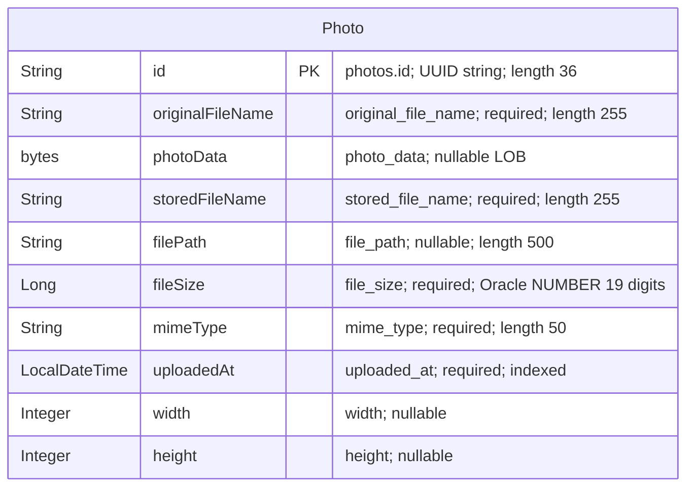

# Data Architecture & Persistence Layer

The persistence layer has one JPA entity, `Photo`, containing both image metadata and binary content in one relational table. Spring Data JPA/Hibernate accesses Oracle in the default and Docker configurations; tests use an isolated in-memory H2 database. Sources: `src/main/java/com/photoalbum/model/Photo.java:15-91`, `pom.xml:43-54,88-93`, and the configuration files cited below.

## Database Configuration

| Service/Module | DB Type | Profile | Driver | Connection | Migration Tool |
|---|---|---|---|---|---|
| Photo Album | Oracle | Default/base configuration | `oracle.jdbc.OracleDriver`; runtime `com.oracle.database.jdbc:ojdbc8` | Environment-overridable thin JDBC connection to an Oracle listener/PDB. Database credentials are environment-supplied; values omitted. No explicit pool sizing or tuning found. | No Flyway/Liquibase dependency or versioned migration framework found; Hibernate recreates the mapped schema at startup. |
| Photo Album | Oracle | `docker` | Same Oracle driver | Same environment-overridable Oracle connection model; credentials omitted. No explicit pool tuning found. | Hibernate recreates the mapped schema at startup, as in the base configuration. |
| Photo Album tests | H2 | `test` | `org.h2.Driver`; test-scoped `com.h2database:h2` | In-memory JDBC database; credentials omitted. | Hibernate creates the schema and drops it when the persistence context closes. |

Sources: `src/main/resources/application.properties:9-21`; `src/main/resources/application-docker.properties:1-17`; `src/test/resources/application-test.properties:1-10`; `pom.xml:43-54,88-93`. The existing test class activates the test profile (`src/test/java/com/photoalbum/PhotoAlbumApplicationTests.java:7-8`).

Schema generation is destructive on application restart in the Oracle configurations; these are not schema-validation-only settings. The Oracle initialization scripts provision schema privileges, inspect the schema user, and check connectivity; they do not define the `photos` table or insert photo seed rows (`oracle-init/01-create-user.sql:1-30`, `oracle-init/02-verify-user.sql:1-12`, `oracle-init/healthcheck.sql:1-3`). No application schema/data seed scripts or programmatic photo seeding were found in the inspected source/resources. Connection-pool implementation and limits are not explicitly declared; any pool defaults are framework-managed, not verified runtime settings. See `configuration-inventory.md` for the full property inventory.

## Data Ownership per Service

| Service | Tables Owned | ORM Framework | Caching | Notes |
|---|---|---|---|---|
| Photo Album / `PhotoServiceImpl` | `photos` | JPA/Hibernate through Spring Data `JpaRepository<Photo, String>` | No explicit application cache or Hibernate second-level/query-cache configuration found | One schema-owned entity; image bytes and metadata share the same row. The schema account can create its own objects. |

Sources: `src/main/java/com/photoalbum/model/Photo.java:15-91`; `src/main/java/com/photoalbum/repository/PhotoRepository.java:15-16`; `src/main/java/com/photoalbum/service/impl/PhotoServiceImpl.java:28-45,160-174`; `oracle-init/01-create-user.sql:14-30`.

## Entity Model

`Photo` maps to `photos`, with a nonunique index on `uploaded_at`. Its constructor assigns a UUID string and local upload timestamp; the timestamp column also declares an Oracle database-time default. The binary field uses `@Lob` without a lazy-fetch override. There are no foreign keys, relationship annotations, association cascades, or bidirectional links; no relationship edges are therefore invented in the diagram. Sources: `src/main/java/com/photoalbum/model/Photo.java:15-97`.

`storedFileName` and `filePath` are compatibility metadata, not an external blob-store reference used by the current persistence implementation. Image content is saved with the entity and served from its byte array (`src/main/java/com/photoalbum/service/impl/PhotoServiceImpl.java:112-124,160-174`; `src/main/java/com/photoalbum/controller/PhotoFileController.java:53-69`). `UploadResult` is a nonpersistent result object, not another entity (`src/main/java/com/photoalbum/model/UploadResult.java:3-10`).

Transactions are declared at service-class level. Listing, ID lookup, and previous/next reads override this with read-only transactions; upload and deletion retain the class-level transaction semantics (`src/main/java/com/photoalbum/service/impl/PhotoServiceImpl.java:28-30,53-71,81-82,172-185,198-210,223-236`).

## Key Repository Methods

All methods belong to `PhotoRepository extends JpaRepository<Photo, String>` in `src/main/java/com/photoalbum/repository/PhotoRepository.java:15-100`. Standard inherited CRUD methods are omitted below; custom queries are all native SQL.

| Service | Repository | Notable Methods | Purpose |
|---|---|---|---|
| Photo Album | `PhotoRepository` | `List<Photo> findAllOrderByUploadedAtDesc()` | Returns all photo rows newest-first, including the BLOB column. Source: lines 18-27. |
| Photo Album | `PhotoRepository` | `List<Photo> findPhotosUploadedBefore(LocalDateTime uploadedAt)` | Returns up to ten rows strictly older than the timestamp, descending, using Oracle `ROWNUM`. Source: lines 29-42. |
| Photo Album | `PhotoRepository` | `List<Photo> findPhotosUploadedAfter(LocalDateTime uploadedAt)` | Returns newer rows in ascending order, without a SQL row limit; substitutes a default for null compatibility paths using Oracle `NVL`. Source: lines 44-56. |
| Photo Album | `PhotoRepository` | `List<Photo> findPhotosByUploadMonth(String year, String month)` | Filters timestamps using Oracle `TO_CHAR`, then orders newest-first. Source: lines 58-71. |
| Photo Album | `PhotoRepository` | `List<Photo> findPhotosWithPagination(int startRow, int endRow)` | Selects an inclusive, one-based row range with nested Oracle `ROWNUM` queries. Source: lines 73-87. |
| Photo Album | `PhotoRepository` | `List<Object[]> findPhotosWithStatistics()` | Returns photo columns plus file-size rank and running size totals via SQL analytical functions. Source: lines 89-100. |

These queries couple persistence to Oracle syntax; configuring H2 alone does not establish equivalent behavior for them. The service uses ordered listing and timestamp navigation queries, taking the first navigation result; no cross-service bulk aggregation interface or stored-procedure invocation was found (`src/main/java/com/photoalbum/service/impl/PhotoServiceImpl.java:53-57,223-237`).

## Caching Strategy

| Layer | Observed strategy | Evidence |
|---|---|---|
| Application/repository | No explicit Spring Cache annotations, Redis, Caffeine, Ehcache, JCache provider, cache regions, TTL, or eviction policy found. Reads call the repository directly; no cache-aside/read-through/write-through implementation identified. | `pom.xml:30-101`; `src/main/java/com/photoalbum/repository/PhotoRepository.java:15-100`; `src/main/java/com/photoalbum/service/impl/PhotoServiceImpl.java:53-75,223-237`. |
| ORM | Normal persistence-context identity management may apply within JPA transactions; no explicit second-level or query-result cache configuration found. This is not a shared application cache. | `src/main/java/com/photoalbum/service/impl/PhotoServiceImpl.java:28-30`; `src/main/resources/application.properties:17-21`; `src/main/resources/application-docker.properties:13-17`. |
| Binary responses | Photo responses explicitly prohibit browser/proxy storage and require revalidation; no image-response cache TTL is configured. The source does not establish a broader cache-design rationale. | `src/main/java/com/photoalbum/controller/PhotoFileController.java:74-79`. |
| Sessions | Authentication is stateless; no application session cache is configured here. | `src/main/java/com/photoalbum/config/SecurityConfig.java:46-60`. |

## Data Ownership Boundaries

One application persistence boundary owns the `photos` table. Metadata and image BLOBs are colocated in its Oracle schema rather than split across a database and an object-storage service. The test profile replaces that store with an in-memory H2 database; it is not a second production datastore (`src/main/java/com/photoalbum/model/Photo.java:15-91`; `src/main/resources/application.properties:9-21`; `src/test/resources/application-test.properties:1-10`).

`PhotoServiceImpl` directly accesses its injected repository for both reads and writes. No separate read model, event-sourced store, outbox, other service's tables, inter-service data calls, or gateway aggregation methods were identified in this persistence layer. Read-only transaction annotations separate transaction intent, not CQRS storage ownership (`src/main/java/com/photoalbum/service/impl/PhotoServiceImpl.java:37-45,53-75,172-174,198-210,223-237`).

### Data Classification & Sensitivity

| Entity | Sensitive Fields | Classification (PII/PHI/PCI/None) | Controls in Place |
|---|---|---|---|
| `Photo` | `photoData`, `originalFileName` | Potential PII: uploaded images may identify people and filenames may contain personal information. No explicit PHI or PCI fields are modeled; arbitrary image content cannot be classified conclusively from the schema. | No field encryption, masking, per-photo owner field, or field-level authorization is implemented in the inspected model. Gallery reads are public; configured mutation operations require authentication. No encryption-at-rest configuration is evidenced in inspected persistence files; actual database/storage encryption is unverified. |
| `Photo` | ID, compatibility filename/path, file size, MIME type, upload timestamp, dimensions | No explicit PII/PHI/PCI fields; metadata may be linkable to sensitive image content. | Same public-read/authenticated-mutation boundary; no field-specific masking. |

Sources: `src/main/java/com/photoalbum/model/Photo.java:24-91`; `src/main/java/com/photoalbum/config/SecurityConfig.java:19-23,46-60`; `src/main/resources/application.properties:9-21`; `src/main/resources/application-docker.properties:1-17`.

Filenames, photo identifiers, and a short prefix of binary content are logged without masking (`src/main/java/com/photoalbum/controller/PhotoFileController.java:53-66`; `src/main/java/com/photoalbum/service/impl/PhotoServiceImpl.java:179-182`). Authentication credentials are maintained outside the photo entity in an in-memory user manager with BCrypt encoding; credential values are intentionally omitted from this assessment (`src/main/java/com/photoalbum/config/SecurityConfig.java:28-42`).
