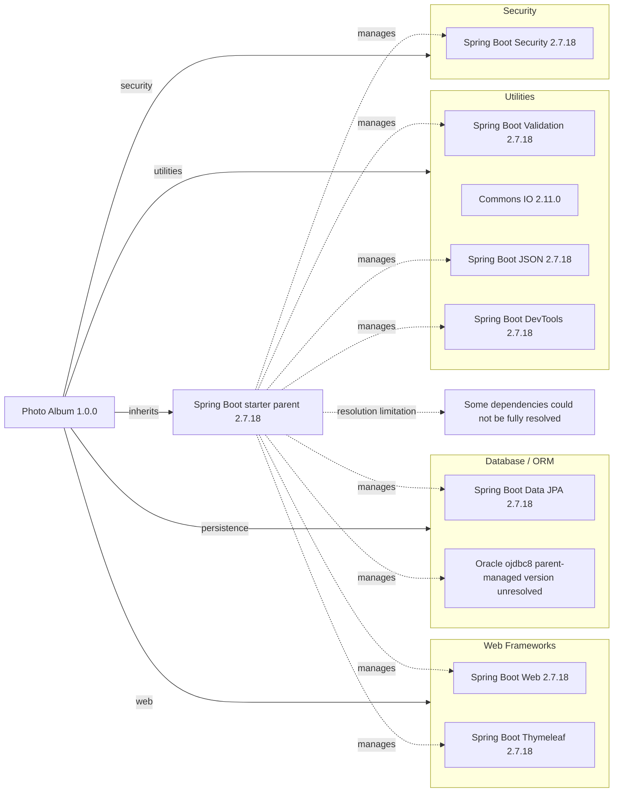

# Dependency Map

Photo Album (`com.photoalbum:photo-album:1.0.0`) declares **11 external dependencies: 9 non-test and 2 test-scoped**, plus one parent POM and one build plugin. Analysis is limited to the repository's sole recognized build manifest, `pom.xml`; no source code or credentials were inspected. Project identity: `pom.xml:15–21`.

## Dependencies

### Dependency Summary

| Category | Count | Key Libraries | Notes |
|----------|------:|---------------|-------|
| Web Frameworks | 2 | Spring Boot Web 2.7.18; Thymeleaf starter 2.7.18 | Compile scope; `pom.xml:31–41` |
| Database / ORM | 2 | Spring Boot Data JPA 2.7.18; Oracle ojdbc8, managed version unresolved | JPA is compile-scoped; JDBC driver is runtime-scoped; `pom.xml:43–54` |
| Security | 1 | Spring Boot Security 2.7.18 | Compile scope; `pom.xml:62–66` |
| Utilities | 4 | Spring Boot Validation 2.7.18; Commons IO 2.11.0; Spring Boot JSON 2.7.18; DevTools 2.7.18 | Compile scope; DevTools is optional; `pom.xml:56–60,68–79,95–100` |
| **Total non-test** | **9** | | Parent POM, build plugin and test dependencies excluded |

#### Declared coordinates, versions and scopes

An omitted Maven scope defaults to `compile`. Spring Boot artifact versions below are inherited through the 2.7.18 parent, not explicitly pinned on each dependency. The parent/BOM contents and a resolved dependency tree are not present in the inspected repository, so third-party managed versions and transitive trees are not asserted.

| Declared dependency | Declared / inherited version | Scope | Evidence |
|---------------------|------------------------------|-------|----------|
| `org.springframework.boot:spring-boot-starter-web` | Omitted; parent-managed 2.7.18 | compile | `pom.xml:32–35` |
| `org.springframework.boot:spring-boot-starter-thymeleaf` | Omitted; parent-managed 2.7.18 | compile | `pom.xml:38–41` |
| `org.springframework.boot:spring-boot-starter-data-jpa` | Omitted; parent-managed 2.7.18 | compile | `pom.xml:44–47` |
| `com.oracle.database.jdbc:ojdbc8` | Omitted; parent-managed, exact version unresolved | runtime | `pom.xml:50–54` |
| `org.springframework.boot:spring-boot-starter-validation` | Omitted; parent-managed 2.7.18 | compile | `pom.xml:57–60` |
| `org.springframework.boot:spring-boot-starter-security` | Omitted; parent-managed 2.7.18 | compile | `pom.xml:63–66` |
| `commons-io:commons-io` | Explicit 2.11.0 | compile | `pom.xml:69–73` |
| `org.springframework.boot:spring-boot-starter-json` | Omitted; parent-managed 2.7.18 | compile | `pom.xml:76–79` |
| `org.springframework.boot:spring-boot-devtools` | Omitted; parent-managed 2.7.18 | compile, optional | `pom.xml:96–100` |

**Dependency management:** `org.springframework.boot:spring-boot-starter-parent:2.7.18` is the sole declared parent (`pom.xml:8–13`). No explicit BOM import, additional module or dependency-management override is declared. Its upstream dependency management is inherited rather than reproduced locally.

**Build tooling:** `org.springframework.boot:spring-boot-maven-plugin` is declared without a version, managed through the parent (`pom.xml:103–109`); it is build tooling, not an application dependency.

### Version & Compatibility Risks

Spring Boot 2.7.18 is a legacy line outside community support; upgrading to Spring Boot 3 requires Java 17 or newer and migration from Java EE `javax` APIs to Jakarta APIs. The manifest currently targets Java 8 (`pom.xml:8–11,23–26`). Commons IO is explicitly pinned to the older 2.11.0 release (`pom.xml:68–73`) and warrants a current compatibility and advisory review. Exact Oracle JDBC and H2 versions cannot be verified from this manifest alone; no vulnerability scan or resolved compatibility assessment was performed.

### Notable Observations

- Most version selection is centralized in the Spring Boot parent; the explicit Commons IO pin is outside that alignment (`pom.xml:8–13,30–101`).
- The JSON starter is categorized as a utility: its nearby “Image processing” comment does not itself declare a dedicated image-processing library (`pom.xml:75–79`).
- DevTools is optional but has no explicit runtime scope or profile restriction. Optional controls downstream propagation; it does not by itself establish production packaging behavior (`pom.xml:95–100`).
- No direct messaging, caching, logging or observability dependencies are declared. Starter transitives may supply additional libraries, but no lockfile or local BOM content establishes their exact graph (`pom.xml:30–101`).

## Test Dependencies

| Framework | Version | Notes |
|-----------|---------|-------|
| `org.springframework.boot:spring-boot-starter-test` | Omitted; parent-managed 2.7.18 | Test support starter; constituent framework versions are not declared locally. `pom.xml:81–86` |
| `com.h2database:h2` | Omitted; parent-managed, exact version unresolved | Test-scoped in-memory database support. `pom.xml:88–93` |

Total test-scope dependencies: 2

The manifest declares a test starter and H2 but no explicit Testcontainers or contract-testing library. H2 differs from the runtime Oracle driver, so database-specific behavior is not established by this dependency inventory (`pom.xml:49–54,81–93`); tests were not run.
