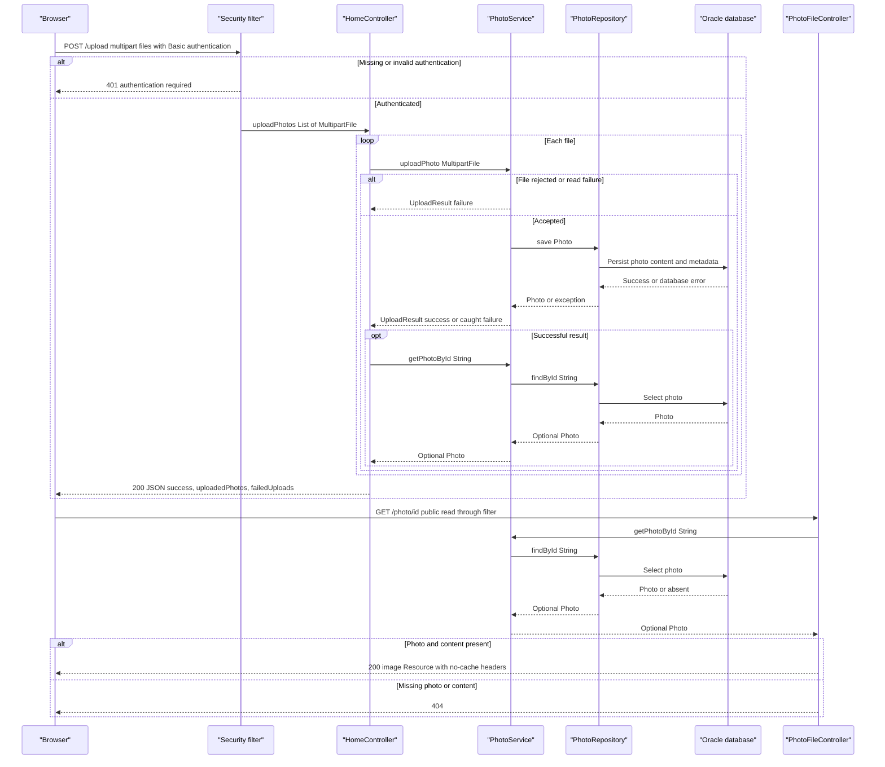

# API & Service Communication Contracts

The application exposes five explicit controller endpoints: two HTML reads, one binary photo read, one multipart JSON upload, and one form-based deletion. Browser requests and database operations are synchronous; no service-to-service HTTP API or asynchronous messaging implementation was found.

Evidence references below use repository-relative paths and line numbers. Credential values are intentionally omitted.

## Service Catalog

| Service | Port | Category | Purpose |
|---|---|---|---|
| `photoalbum-java-app` / Maven `com.photoalbum:photo-album` | HTTP 8080, published as 8080 | API Layer + Business | Single source-built application serving the gallery, upload, deletion, and photo bytes. Spring Boot 2.7.18 Web/MVC, Thymeleaf, Data JPA, Security, Validation, JSON, and Oracle JDBC dependencies. |
| `oracle-db` | TCP 1521, published as 1521 | Infrastructure | Third-party `gvenzl/oracle-free:latest` database container; stores photo metadata and content through JDBC. Not a source module or HTTP API. |

Sources: `pom.xml:8-21,30-79`; `docker-compose.yml:1-14,24-43`; `src/main/java/com/photoalbum/service/impl/PhotoServiceImpl.java:160-184`.

The Maven build contains one application artifact and no child modules (`pom.xml:15-18,103-110`). Azure provisioning automation additionally defines ACR, AKS, and a PostgreSQL flexible server/database (`azure-setup.ps1:69,85,117,139,267`). These are infrastructure intentions, not additional implemented application services: the checked-in application still uses Oracle JDBC and Oracle-specific repository queries (`pom.xml:49-54`; `src/main/java/com/photoalbum/repository/PhotoRepository.java:34-56,64-100`). PostgreSQL's intended connection port is 5432 (`azure-setup.ps1:267`); registry/cluster API ports are not established by the application contract.

## API Endpoints Inventory

| Service / Controller | Method | Path | Request Type | Response Type |
|---|---|---|---|---|
| Photo Album / `HomeController` | GET | `/` | No application parameters | Normally 200 HTML, `index` view with `List<Photo>` and a timestamp; retrieval exceptions render an empty gallery instead of an explicit error. |
| Photo Album / `HomeController` | POST | `/upload` | Authenticated multipart form, required repeated `files` parts bound to `List<MultipartFile>` | 200 JSON `Map<String,Object>` containing upload successes/failures; explicit 400 JSON for an empty list; missing required part normally fails framework binding with 400; absent/invalid Basic authentication normally yields 401. |
| Photo Album / `DetailController` | GET | `/detail/{id}` | String path identifier | Normally 200 HTML `detail` view, with `Photo` and previous/next identifiers; missing photo or caught exception returns `redirect:/` (normally 302). |
| Photo Album / `DetailController` | POST | `/detail/{id}/delete` | Authenticated request with String path identifier; no application body DTO | `redirect:/` (normally 302) with success/error flash attribute for successful deletion, missing photo, or caught exception; absent/invalid Basic authentication normally yields 401. |
| Photo Album / `PhotoFileController` | GET | `/photo/{id}` | String path identifier | 200 `ResponseEntity<Resource>` backed by `ByteArrayResource`; photo MIME content type; 404 for absent photo/empty bytes; 500 on caught exception. |

Route and response evidence: `src/main/java/com/photoalbum/controller/HomeController.java:37-98`; `src/main/java/com/photoalbum/controller/DetailController.java:18-78`; `src/main/java/com/photoalbum/controller/PhotoFileController.java:23-86`. Authentication evidence: `src/main/java/com/photoalbum/config/SecurityConfig.java:45-61`. Framework-default status behavior above is inferred, not asserted by integration tests.

**Contract details**

- Upload processing is sequential and returns HTTP 200 even when every processed file fails; clients must inspect `success`, `uploadedPhotos`, and `failedUploads`. A successful service result is re-read by ID before being included in the response (`HomeController.java:68-97`). Service-level rejections are represented as per-file errors, not automatically HTTP 400 (`src/main/java/com/photoalbum/service/impl/PhotoServiceImpl.java:82-109,138-154,172-192`).
- Upload transport limits are 10 MB per file and 50 MB per request; oversized multipart requests can be rejected before the controller. No custom exception-to-status mapping for that case was found, so no exact status is promised here (`src/main/resources/application.properties:23-25`). Detailed validation rules belong in `business-workflows.md`.
- The binary response adds `Cache-Control: no-cache, no-store, must-revalidate, private`, `Pragma: no-cache`, `Expires: 0`, and `X-Photo-ID`, `X-Photo-Name`, `X-Photo-Size` headers (`PhotoFileController.java:74-83`).
- No URL/header/query API versioning is implemented in the controller mappings. The browser's `_t` query argument is cache busting, not versioning, and is not bound by the photo controller (`src/main/resources/static/js/upload.js:176-179`; `PhotoFileController.java:37-38`).
- Static CSS, JavaScript, and a bundled upload image also exist under `src/main/resources/static`; these are framework-served assets rather than additional declared business controller endpoints. No JSON resource-list/read/delete REST endpoints are declared.

## Management & Observability Endpoints

| Service | Endpoint | Custom Metrics (if any) |
|---|---|---|
| Photo Album | No declared Actuator, dedicated health, metrics, Prometheus, Swagger UI, or OpenAPI endpoint found | No `@Timed` or custom meter registration found |
| Oracle container | No HTTP management endpoint declared; container-local health command only | No application metrics export declared |

The dependency list has no Actuator, metrics exporter, or OpenAPI library (`pom.xml:30-101`); the controller surface is limited to the five routes above. Oracle's Compose health command is not an application API (`docker-compose.yml:17-22`). Application logging is present but is not a metrics endpoint (`HomeController.java:26,44-45`; `PhotoFileController.java:26,84-86`).

## DTOs & Contracts

| Type | API role | Mutability / exposure |
|---|---|---|
| `Photo` | Service-owned domain entity supplied to HTML views and used to construct upload response entries and binary responses | Mutable POJO with setters; not returned directly as a JSON entity. |
| `UploadResult` | Internal service-to-controller outcome for each upload | Mutable POJO; converted into response maps, not exposed directly as the HTTP response DTO. |
| `MultipartFile` / `List<MultipartFile>` | Framework request contract for upload parts | Framework interface, not a custom immutable request model. |
| `Map<String,Object>` / `List<Map<String,Object>>` | Ad hoc upload JSON envelope and per-file projections | Mutable collections; no typed response DTO or gateway aggregation model. |
| `Resource` / `ByteArrayResource` | Binary photo response contract | Framework response wrapper; not a JSON DTO. |

Sources: `src/main/java/com/photoalbum/model/Photo.java:19,93-108,120-199`; `src/main/java/com/photoalbum/model/UploadResult.java:6-62`; `HomeController.java:55-97`; `PhotoFileController.java:68-83`.

There are no gateway-level DTOs, Java records, protobuf schemas, GraphQL schemas, or checked-in OpenAPI specifications in the inspected application sources. JSON serialization relies on Spring MVC/Jackson defaults through the web/JSON starters; no custom mapper, serializer, or explicit date format was found (`pom.xml:31-35,75-79`; `HomeController.java:56-58,79`). HTML rendering uses Thymeleaf rather than serializing the entire `Photo` model (`pom.xml:37-41`; `DetailController.java:44-54`). Entity fields and persistence details belong in `data-architecture.md`, not this inventory.

The upload response's compatibility `filePath` is not the implemented binary endpoint: the service constructs a legacy `/uploads/` path, while the browser builds `/photo/{id}` from the returned ID (`src/main/java/com/photoalbum/service/impl/PhotoServiceImpl.java:112-115,160-167`; `src/main/resources/static/js/upload.js:176-179`).

## Communication Patterns

- **Browser-to-application:** Same-origin HTTP requests; upload uses `fetch('/upload')` with `FormData`, parses JSON, and updates the gallery. Delete uses an HTML POST form; images use `/photo/{id}` (`src/main/resources/static/js/upload.js:97-126,176-185`; `src/main/resources/templates/detail.html:50,67`).
- **Within the application:** Controllers invoke injected `PhotoService`; `PhotoServiceImpl` invokes `PhotoRepository` synchronously under transactions. Upload saves a photo, then the controller performs another lookup for the response projection. These are in-process layers, not independently deployed microservices (`HomeController.java:28-31,68-83`; `src/main/java/com/photoalbum/service/impl/PhotoServiceImpl.java:28-47,69-75,172-184`; `src/main/java/com/photoalbum/repository/PhotoRepository.java:15-16`).
- **External data communication:** JDBC to Oracle using the Compose DNS hostname `oracle-db` and port 1521; this is database protocol traffic, not REST (`docker-compose.yml:30-34`; `src/main/resources/application.properties:9-15`).
- **External browser dependencies:** Templates load Bootstrap CSS/JavaScript from jsDelivr over HTTPS. This is browser asset retrieval, not a server-side business service API (`src/main/resources/templates/index.html:7,124`).
- **Async:** No message broker, event bus, queue producer/consumer, or application background messaging implementation found. JavaScript `async`/`await` is client request handling, not an asynchronous service communication contract (`src/main/resources/static/js/upload.js:90-132`; `pom.xml:30-101`).
- **Resilience and timeouts:** No explicit HTTP-client/JDBC request timeout, retry policy, circuit breaker, bulkhead, or downstream fallback library/configuration was found in the application. Browser upload has one `fetch` attempt and no explicit timeout or abort handling; failures show feedback without retry (`upload.js:102-132`). Gallery reads fall back to an empty list; detail failures redirect; photo-serving failures return 500; upload failures become per-file results (`HomeController.java:38-49,85-97`; `DetailController.java:38-58`; `PhotoFileController.java:84-86`). A transaction completion failure can still escape the upload method/controller; the per-file envelope is not a universal error handler (`PhotoServiceImpl.java:28-29,81-82,172-192`).
- **Discovery, gateway, balancing:** No Eureka/Consul registration, API gateway, response composition across backend services, or client-side load balancing found. Compose supplies ordinary container-name DNS; there is one application service (`docker-compose.yml:1-44`; `pom.xml:30-101`).
- **Availability:** Compose starts the application after the database is healthy and restarts the application on failure; this is process orchestration, not per-request retry. See `configuration-inventory.md` for startup configuration (`docker-compose.yml:39-44`).
- **Security posture:** Public reads; POST `/upload` and `/detail/*/delete` require HTTP Basic authentication. A single in-memory administrative user is created with BCrypt password encoding and an ADMIN role, but endpoint rules check only authentication, not that role. Authentication is stateless and CSRF is explicitly disabled. No JWT/OAuth2 or method-level role checks were found (`src/main/java/com/photoalbum/config/SecurityConfig.java:28-61`). The application publishes HTTP 8080, with no checked-in HTTPS listener or TLS enforcement; external ingress TLS cannot be inferred. No JDBC TLS requirement is expressed by the configured connection URL (`docker-compose.yml:32,37-38`; `src/main/resources/application.properties:1-15`). Credential values are not reproduced here.

## Service Technology Matrix

| Service | Web | Data Access | Discovery | Gateway | Actuator / Health | Cache | Metrics |
|---|---|---|---|---|---|---|---|
| Photo Album | Spring MVC + Thymeleaf; JSON upload | Spring Data JPA / Hibernate + Oracle JDBC | Compose DNS only | None | No dedicated application endpoint | No application cache declared; binary responses prohibit caching | Logging only; no exporter found |
| Oracle container | Not an HTTP app | Oracle server | Compose service name | None | Container-local check | Not assessed as an application cache | No configured exporter found |

Evidence: `pom.xml:30-101`; `docker-compose.yml:1-22,24-44`; `PhotoFileController.java:74-83`. Cache implementation and persistence details are deferred to `data-architecture.md`.

## Service Communication Sequence

Primary flow: authenticated multipart upload, per-file success/failure composition, and subsequent public binary read. Response arrows represent synchronous returns; no broker or asynchronous service message is implied.

Sequence evidence: `SecurityConfig.java:45-61`; `HomeController.java:55-97`; `PhotoServiceImpl.java:69-75,82-192`; `PhotoFileController.java:37-86` (all under `src/main/java/com/photoalbum/` in their respective package directories). The upload diagram shows caught service failures; uncaught transactional/readback exceptions can bypass the 200 envelope. Binary-read exceptions return 500 as documented above.
