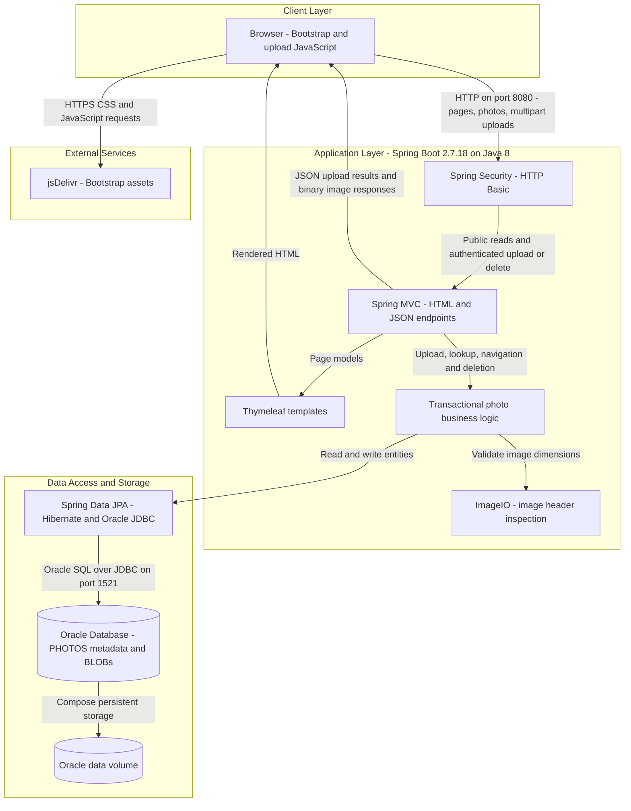
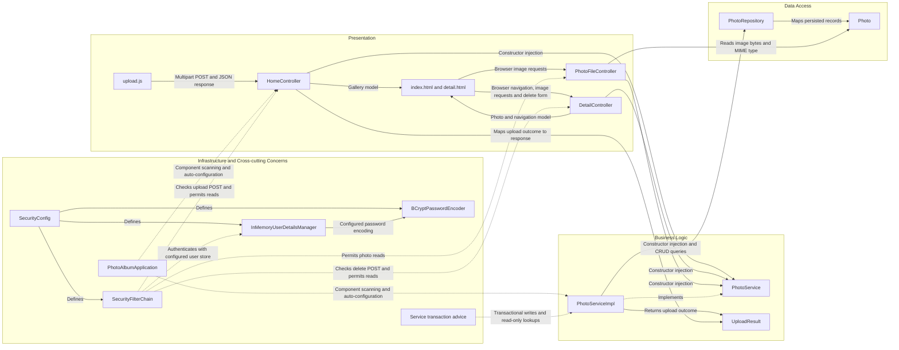

# Architecture Diagram

Photo Album is a single-module, server-rendered Spring Boot application for uploading, browsing, viewing, and deleting photos. This assessment describes checked-in code and container configuration, not a verified running deployment; citations use repository-relative paths and line numbers. Credential values are omitted.

## Application Architecture

### Technology Stack Summary

| Layer | Technology | Version | Purpose |
|---|---|---|---|
| Runtime and packaging | Java, Maven, executable Spring Boot JAR | Java 8; Boot 2.7.18; application 1.0.0 | One application process, bootstrapped by `PhotoAlbumApplication` (`pom.xml:8-26,103-108`; `src/main/java/com/photoalbum/PhotoAlbumApplication.java:9-14`). |
| Presentation | Spring MVC, Thymeleaf | Boot-managed; no independent versions declared | Gallery/detail HTML, JSON upload response, binary photo delivery (`pom.xml:30-41`; `src/main/java/com/photoalbum/controller/HomeController.java:37-57`; `src/main/java/com/photoalbum/controller/PhotoFileController.java:37-83`). |
| Browser | Bootstrap and plain JavaScript Fetch API | Bootstrap 5.3.0 | CDN-hosted styling/widgets; multipart uploads and dynamic gallery updates (`src/main/resources/templates/index.html:7,124-125`; `src/main/resources/static/js/upload.js:97-111,178-185`). |
| Security | Spring Security, BCrypt, in-memory user store | Boot-managed; no independent version declared | Stateless HTTP Basic; authenticated POST upload/delete, public remaining requests, CSRF disabled (`src/main/java/com/photoalbum/config/SecurityConfig.java:28-61`). |
| Business logic | Spring services, transaction management, JDK ImageIO | Boot-managed Spring; JDK 8 API | Upload validation, header-based dimension inspection, navigation, persistence orchestration (`src/main/java/com/photoalbum/service/impl/PhotoServiceImpl.java:28-47,81-174,221-237`). |
| Persistence | Spring Data JPA, Hibernate, Oracle `ojdbc8` | Boot-managed; no independent versions declared | Entity CRUD plus Oracle-specific native queries (`pom.xml:43-54`; `src/main/java/com/photoalbum/repository/PhotoRepository.java:15-56`). |
| Production-configured storage | Oracle Database Free container | `gvenzl/oracle-free:latest`; exact database version unpinned | Metadata and image BLOBs; named volume persists database files (`docker-compose.yml:3-14,46-47`; `src/main/java/com/photoalbum/model/Photo.java:15-41`). |
| Container execution | Multi-stage Docker build, Eclipse Temurin JRE | Maven 3.9.6 build image; Java 8 runtime image | Builds JAR and launches application on port 8080 (`Dockerfile:1-31`). |
| Test-only storage | H2 in-memory database | Boot-managed; no independent version declared | Test profile, not production storage (`pom.xml:88-93`; `src/test/resources/application-test.properties:1-9`). |

### Data Storage & External Services

Oracle is the application datastore: `Photo` maps to `photos`, combining UUID identifiers, file metadata, timestamps, dimensions, and a `@Lob` byte array (`src/main/java/com/photoalbum/model/Photo.java:15-97`). Uploads save image bytes through the repository; image responses read those bytes directly, rather than retrieving uploaded files from disk (`src/main/java/com/photoalbum/service/impl/PhotoServiceImpl.java:112-174`; `src/main/java/com/photoalbum/controller/PhotoFileController.java:57-83`). The `/uploads/` path is compatibility metadata, not the current image-serving path. Compose connects the application and Oracle over a bridge network, waits for database health, and mounts `oracle_data`; both application profiles configure Hibernate schema creation at startup, so a persistent volume alone does not ensure retention across application restarts (`docker-compose.yml:12-22,30-51`; `src/main/resources/application.properties:17-20`; `src/main/resources/application-docker.properties:13-16`).

The browser fetches Bootstrap assets from jsDelivr (`src/main/resources/templates/index.html:7,124`; `src/main/resources/templates/detail.html:7,147`). No cache, message broker, object-storage service, or outbound business API integration was identified in the inspected application sources and configuration. Database and administrator credential values are not reproduced.

### Key Architectural Decisions

- **Layered monolith with constructor injection:** all three controllers depend on the `PhotoService` interface; its single implementation depends on `PhotoRepository`. Transaction boundaries live in the service, with read-only lookup/navigation operations (`src/main/java/com/photoalbum/controller/HomeController.java:28-32`; `src/main/java/com/photoalbum/controller/DetailController.java:23-27`; `src/main/java/com/photoalbum/controller/PhotoFileController.java:28-32`; `src/main/java/com/photoalbum/service/impl/PhotoServiceImpl.java:28-71,223-237`).
- **Database-backed image storage with Oracle coupling:** metadata and BLOB bytes share one entity, and native queries use Oracle constructs including `ROWNUM`, `NVL`, and `TO_CHAR` (`src/main/java/com/photoalbum/model/Photo.java:15-91`; `src/main/java/com/photoalbum/repository/PhotoRepository.java:34-87`).
- **Public gallery with protected mutations:** Spring Security authenticates upload/delete POST routes using HTTP Basic and an injected administrator configuration; it uses an in-memory user store and stateless sessions, with CSRF explicitly disabled (`src/main/java/com/photoalbum/config/SecurityConfig.java:28-61`).

## Component Relationships

Arrows from templates describe requests made by the rendered browser page, not server-side template calls. The service interface is injected through constructors; Spring supplies `PhotoServiceImpl`, whose repository is also constructor-injected (`src/main/java/com/photoalbum/controller/HomeController.java:28-32`; `src/main/java/com/photoalbum/service/impl/PhotoServiceImpl.java:28-47`). Infrastructure nodes include framework objects explicitly configured or activated by application code, rather than additional application-owned classes.

### Component Inventory

| Component | Layer | Type | Responsibility |
|---|---|---|---|
| `index.html`, `detail.html` | Presentation | Thymeleaf templates | Render gallery cards, original-image links, detail navigation and deletion form (`src/main/resources/templates/index.html:90-106`; `src/main/resources/templates/detail.html:50-90`). |
| `upload.js` | Presentation | Browser script | Build multipart `files` payload, call `/upload`, interpret JSON, add cards using `/photo/{id}` (`src/main/resources/static/js/upload.js:97-111,178-185`). |
| `HomeController` | Presentation | MVC controller | Serve `GET /`; process `POST /upload` and construct success/failure JSON maps (`src/main/java/com/photoalbum/controller/HomeController.java:37-97`). |
| `DetailController` | Presentation | MVC controller | Serve `GET /detail/{id}`, look up older/newer photos, process `POST /detail/{id}/delete` and redirect (`src/main/java/com/photoalbum/controller/DetailController.java:18-78`). |
| `PhotoFileController` | Presentation | Binary response controller | Serve `GET /photo/{id}` from entity BLOB bytes, set MIME and no-cache headers (`src/main/java/com/photoalbum/controller/PhotoFileController.java:23-86`). |
| `PhotoService` | Business logic | Service interface | Define listing, lookup, upload, deletion and previous/next navigation contracts (`src/main/java/com/photoalbum/service/PhotoService.java:13-54`). |
| `PhotoServiceImpl` | Business logic | Transactional Spring service | Validate MIME, size and image dimensions; save/read/delete photos; navigate by upload time (`src/main/java/com/photoalbum/service/impl/PhotoServiceImpl.java:28-47,81-174,198-237`). |
| `UploadResult` | Business logic | Result DTO | Carry upload success, original filename, error message and photo ID; controller maps it into JSON response data (`src/main/java/com/photoalbum/model/UploadResult.java:6-29`; `src/main/java/com/photoalbum/controller/HomeController.java:68-95`). |
| `PhotoRepository` | Data access | Spring Data JPA repository | `JpaRepository<Photo, String>` CRUD and native Oracle queries; month/pagination/statistics queries are declared but not called by the inspected service (`src/main/java/com/photoalbum/repository/PhotoRepository.java:15-100`; `src/main/java/com/photoalbum/service/impl/PhotoServiceImpl.java:53-75,198-237`). |
| `Photo` | Data access | JPA entity | UUID identity, BLOB image, compatibility paths, metadata and upload-time index (`src/main/java/com/photoalbum/model/Photo.java:15-97`). |
| `PhotoAlbumApplication` | Infrastructure | Boot entry point | Launch Spring Boot and enable application auto-configuration/component scanning (`src/main/java/com/photoalbum/PhotoAlbumApplication.java:9-14`). |
| `SecurityConfig` and configured security beans | Infrastructure | Configuration, request filter chain, user store and password encoder | Define in-memory administrator, BCrypt encoding, HTTP Basic and route-specific authentication; credential values omitted (`src/main/java/com/photoalbum/config/SecurityConfig.java:25-61`). |
| Service transaction advice | Infrastructure | Spring transaction interception | Apply class-level write transactions and method-level read-only transactions around service operations (`src/main/java/com/photoalbum/service/impl/PhotoServiceImpl.java:28-29,53-69,223-237`). |
