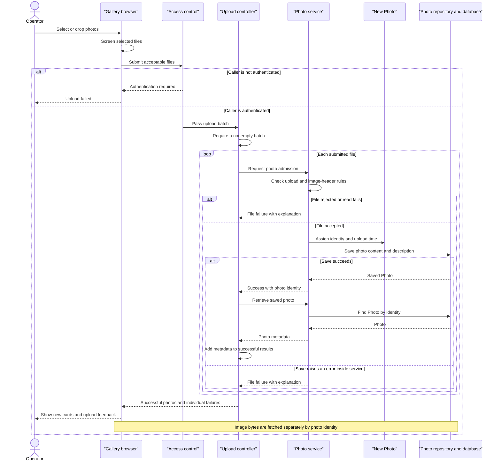

# Core Business Workflows

Photo Album lets visitors browse uploaded photos, inspect individual images, and move through the collection chronologically. Authenticated operators can add multiple photos and permanently remove photos from the shared gallery.

Evidence references below use repository-relative paths and source line numbers. No credential values are reproduced.

## Domain Entities

| Entity | Service / Bounded Context | Description | Key Relationships |
|---|---|---|---|
| Photo | Photo management | An uploaded image together with information needed to display, identify, and navigate it. This is the only persisted business entity identified; there are no separate album, owner, or tag entities. | Image content and descriptive information belong to the same photo. Older/newer neighbors are calculated from upload time, not stored relationships. |
| UploadResult | Photo intake | A transient operation outcome, not a persisted entity: communicates whether an individual photo was accepted and associates success with the resulting photo or failure with an explanation. | Links a submitted filename to a saved Photo identifier or an error. |

Evidence: `src/main/java/com/photoalbum/model/Photo.java:12-19,28-108`; `src/main/java/com/photoalbum/model/UploadResult.java:3-29`; `src/main/java/com/photoalbum/service/impl/PhotoServiceImpl.java:220-238`.

## Service-to-Domain Mapping

This is one application with internal components, not separately deployed domain services. The bounded contexts below are descriptive responsibility groupings, not explicit DDD modules.

| Service | Domain Context | Owned Entities | External Dependencies |
|---|---|---|---|
| HomeController | Gallery presentation and batch intake | No independent ownership; composes Photo information and per-file outcomes | Internal PhotoService |
| DetailController | Individual viewing and removal | No independent ownership; reads/deletes Photo through the service | Internal PhotoService |
| PhotoFileController | Image delivery | No independent ownership; serves Photo content | Internal PhotoService |
| PhotoServiceImpl | Photo lifecycle and admission policy | Photo lifecycle; transient UploadResult | PhotoRepository and image-header readers |
| PhotoRepository | Photo persistence | Authoritative persisted Photo collection, including image content | Database; queries use Oracle-specific SQL |

All controllers share the same service and repository; no inter-domain identifier exchange, independent service-owned databases, gateway, or event bus appears in the traced workflows. Evidence: `src/main/java/com/photoalbum/controller/HomeController.java:28-32,68-83`; `src/main/java/com/photoalbum/controller/DetailController.java:23-27,38-52,64-78`; `src/main/java/com/photoalbum/controller/PhotoFileController.java:28-32,44-83`; `src/main/java/com/photoalbum/service/impl/PhotoServiceImpl.java:37-48,160-174`; `src/main/java/com/photoalbum/repository/PhotoRepository.java:15-27,34-56`.

## Primary Workflows

### Workflow 1: Add multiple photos with independent outcomes

1. An operator selects or drops files into the gallery. The browser applies **Client upload screening**, then submits the remaining files together through `POST /upload` and displays progress. Authentication is required by **Mutation authorization**.
2. HomeController applies **Nonempty batch** and processes each file sequentially through PhotoService rather than opening one batch-wide transaction.
3. PhotoService applies **Server upload admission** and **Image-header inspection**. A rejected file normally produces an UploadResult failure and does not prevent later files from being considered.
4. For an accepted file, the service generates a compatibility filename/path, reads content, captures available dimensions, constructs Photo, and saves it. The generated compatibility path is not a filesystem write.
5. On service success, the controller re-fetches the photo by its returned identifier and adds presentation metadata to the successful-results list. Failures are collected separately. **Batch outcome calculation** determines the overall success flag.
6. The browser prepends successful cards to the gallery and displays individual failure messages. It requests image bytes separately by photo identifier; it does not display images from the compatibility upload path.

Evidence: `src/main/resources/static/js/upload.js:48-131,135-179`; `src/main/java/com/photoalbum/config/SecurityConfig.java:45-60`; `src/main/java/com/photoalbum/controller/HomeController.java:55-97`; `src/main/java/com/photoalbum/service/impl/PhotoServiceImpl.java:81-192`.

Failure boundaries matter: upload failures caught inside the service become per-file results, but the controller does not catch exceptions from the successful-upload re-fetch or from a transactional proxy at commit. Those exceptions can terminate the request after earlier files have already been committed. A successful save whose re-fetch returns empty is included in neither result list. Evidence: `src/main/java/com/photoalbum/controller/HomeController.java:68-97`; `src/main/java/com/photoalbum/service/impl/PhotoServiceImpl.java:28-30,172-192`.

### Workflow 2: Browse the collection and navigate individual photos

1. A visitor opens `GET /`. HomeController loads the complete collection using **Gallery ordering** and renders photo cards.
2. If collection retrieval fails, the controller renders an empty collection instead. The template's empty-gallery message therefore cannot distinguish a genuinely empty album from a loading failure.
3. Selecting a card opens `GET /detail/{id}`. DetailController finds the requested photo, then asks the service for older and newer neighbors using **Chronological navigation**.
4. The detail view shows metadata, conditionally available dimensions, and only the neighbor links that have a target. Blank identifiers, absent photos, or lookup/navigation exceptions redirect to the gallery.
5. Gallery/detail image elements independently request `GET /photo/{id}`. PhotoFileController applies **Image delivery availability**, returning stored bytes and the recorded media type when present. Its no-cache response makes subsequent views request content again.

Evidence: `src/main/java/com/photoalbum/controller/HomeController.java:37-49`; `src/main/java/com/photoalbum/repository/PhotoRepository.java:18-56`; `src/main/java/com/photoalbum/controller/DetailController.java:32-58`; `src/main/java/com/photoalbum/controller/PhotoFileController.java:37-86`; `src/main/resources/templates/index.html:81-108`; `src/main/resources/templates/detail.html:62-94,103-130`.

### Workflow 3: Permanently remove a photo

1. The detail view offers a delete form with a browser confirmation prompt. This is a user-interface safeguard, not a server-side approval step.
2. An authenticated operator submits `POST /detail/{id}/delete`; **Mutation authorization** applies.
3. PhotoService looks up the photo and applies **Delete existence**. An existing photo is deleted from the repository, including its stored content; an absent photo returns a negative outcome.
4. DetailController sets a success, not-found, or failure flash message and redirects to the gallery, which displays that message.

Evidence: `src/main/resources/templates/detail.html:50-59`; `src/main/java/com/photoalbum/config/SecurityConfig.java:54-60`; `src/main/java/com/photoalbum/service/impl/PhotoServiceImpl.java:195-217`; `src/main/java/com/photoalbum/controller/DetailController.java:64-78`; `src/main/resources/templates/index.html:37-46`.

### Other entry points

The application entry point only starts the application; no business-state seeding is present there. No scheduled tasks, business event listeners, or batch runners were identified in the inspected Java sources. Repository methods for monthly selection, pagination, and statistics exist, but the traced service/controllers do not expose business workflows using them; they are not documented as active user features. Evidence: `src/main/java/com/photoalbum/PhotoAlbumApplication.java:9-14`; `src/main/java/com/photoalbum/repository/PhotoRepository.java:58-100`; `src/main/java/com/photoalbum/service/impl/PhotoServiceImpl.java:50-238`.

## Cross-Service Data Flows

There are no backend-to-backend service calls or gateway aggregation in the inspected application. Browser requests flow through local controllers and PhotoService to the shared PhotoRepository. The database is the source of truth for both photo descriptions and bytes; there is no separate object-storage lookup in the actual serving path. Evidence: `src/main/java/com/photoalbum/service/impl/PhotoServiceImpl.java:160-174`; `src/main/java/com/photoalbum/controller/PhotoFileController.java:44-83`.

Composition occurs locally in two places:

- **Upload response:** HomeController joins each successful UploadResult to a newly fetched Photo by identifier and emits a metadata collection alongside a separate failures collection. The browser joins metadata to image content through identifier-based image requests, not through the returned compatibility path. Evidence: `src/main/java/com/photoalbum/controller/HomeController.java:68-95`; `src/main/resources/static/js/upload.js:113-120,176-185`.
- **Detail page:** DetailController combines the selected Photo with two optional neighbor identifiers from separate service reads. There is no common read transaction spanning all three calls, so navigation is not guaranteed to reflect a single snapshot during concurrent changes. Evidence: `src/main/java/com/photoalbum/controller/DetailController.java:38-52`; `src/main/java/com/photoalbum/service/impl/PhotoServiceImpl.java:67-76,223-238`.

No circuit breaker, retry, event-driven reconciliation, or external-service fallback appears in these paths. Actual degradation is local: collection failure becomes an empty gallery; detail failure redirects home; missing bytes become not-found; other image-serving exceptions become a server error. Evidence: `src/main/java/com/photoalbum/controller/HomeController.java:39-48`; `src/main/java/com/photoalbum/controller/DetailController.java:38-58`; `src/main/java/com/photoalbum/controller/PhotoFileController.java:48-86`.

## Business Workflow Sequence

Primary process: upload a collection of photos and make accepted images visible. Participants represent local components, not microservices. Rules and failure boundaries are supported by the Workflow 1 citations above.

The diagram shows handled per-file failures, not a guarantee of continued execution after a commit-time or re-fetch exception. Those unhandled request-level boundaries are described in Workflow 1.

## Business Rules & Decision Logic

### Admission and validation

- **Nonempty batch:** A null or empty bound list returns a bad-request response with overall failure. Multipart binding/transport rejection may occur before the controller executes. Evidence: `src/main/java/com/photoalbum/controller/HomeController.java:55-66`.
- **Client upload screening:** The browser allows JPEG, PNG, GIF, and WebP MIME types, rejecting files larger than 10 MiB. It does not reject zero-length files here. Evidence: `src/main/resources/static/js/upload.js:60-88`.
- **Server upload admission:** Declared MIME type, lowercased, must be in the configured allowlist; size must be positive and no greater than the configured maximum. Current configuration specifies the same four MIME types and 10,485,760-byte limit; multipart transport limits are 10 MB per file and 50 MB per request. A missing MIME type reaches the generic upload-error catch, rather than a dedicated validation result. Evidence: `src/main/java/com/photoalbum/service/impl/PhotoServiceImpl.java:41-47,86-110,186-190`; `src/main/resources/application.properties:24-30`.
- **Image-header inspection:** When an ImageIO reader recognizes the content, width multiplied by height above 40,000,000 pixels rejects the upload. An I/O exception rejects the file; other inspection exceptions log a warning and permit continuation without dimensions. If no reader recognizes the content, acceptance can continue with absent dimensions, so MIME admission is not proof of valid image content. Evidence: `src/main/java/com/photoalbum/service/impl/PhotoServiceImpl.java:34-35,117-158`.
- **Photo metadata constraints:** Entity annotations require nonblank original/stored filenames of at most 255 characters, positive nonnull file size, nonblank MIME type of at most 50 characters, nonnull upload time, and a compatibility path of at most 500 characters. These are declared entity constraints, not explicit controller validation steps. Evidence: `src/main/java/com/photoalbum/model/Photo.java:28-79`.
- **Configured versus enforced count:** Configuration declares a maximum of ten files per upload, but the controller loops over the entire supplied list and PhotoService does not consult that property. Do not treat ten files as an enforced business constraint. Evidence: `src/main/resources/application.properties:30`; `src/main/java/com/photoalbum/controller/HomeController.java:57-97`; `src/main/java/com/photoalbum/service/impl/PhotoServiceImpl.java:37-48`.

### Decisions, derived values, and lifecycle

- **Batch outcome calculation:** Overall success means at least one photo appears in the successful-results list, not that every file succeeded. A nonempty processed batch normally returns HTTP success even when every individual file failed. Evidence: `src/main/java/com/photoalbum/controller/HomeController.java:68-97`.
- **Identity and lifecycle:** New Photo instances receive a UUID and current local upload time. A separate UUID-based stored filename retains the submitted extension, and a compatibility path is derived from it. The observable lifecycle is submitted → rejected or persisted → deleted; no approval, soft deletion, recovery, deduplication, or ownership relationship is implemented in the traced model/service. Evidence: `src/main/java/com/photoalbum/model/Photo.java:93-108`; `src/main/java/com/photoalbum/service/impl/PhotoServiceImpl.java:112-115,160-185,195-217,243-248`.
- **Gallery ordering / Chronological navigation:** Gallery entries are newest first. Previous means the closest strictly older upload; next means the closest strictly newer upload, chosen as the first query result. Equal timestamps are excluded from both directions; no secondary ordering is specified. Missing neighbors suppress navigation links. Evidence: `src/main/java/com/photoalbum/repository/PhotoRepository.java:18-56`; `src/main/java/com/photoalbum/service/impl/PhotoServiceImpl.java:220-238`; `src/main/resources/templates/detail.html:74-94`.
- **Image delivery availability:** Blank/missing identifiers and absent or empty content produce not-found; serving exceptions produce a server error. The recorded MIME type controls the response content type. Evidence: `src/main/java/com/photoalbum/controller/PhotoFileController.java:37-86`.
- **Delete existence:** Only an existing photo can be removed; a nonexistent identifier yields false rather than a successful deletion. There is no downstream file-deletion or compensation step because content belongs to the persisted photo. Evidence: `src/main/java/com/photoalbum/service/impl/PhotoServiceImpl.java:199-217`.
- **Presentation-derived values:** Gallery/detail views format upload dates and file sizes and show dimensions only when available; these are display calculations, not additional persisted lifecycle states. Evidence: `src/main/resources/static/js/upload.js:161-197`; `src/main/resources/templates/detail.html:108-130`.

### Cross-cutting business behavior

- **Mutation authorization:** Upload and delete require authentication; gallery, details, and content are public. The configured account is assigned an administrative role, but endpoint rules check authentication rather than that role. There are no resource-owner checks in the traced controllers. Authentication is stateless HTTP Basic; CSRF checking is disabled. Credential values are intentionally omitted. Evidence: `src/main/java/com/photoalbum/config/SecurityConfig.java:33-60`.
- **Transactions and consistency:** PhotoServiceImpl has class-level transaction scope; retrieval and neighbor methods are read-only. Each controller-invoked upload is a separate service transaction, not an atomic batch. Local database exceptions are sometimes converted into failure results, but commit errors can arise after the service method returns; a result flag alone does not establish a successful commit. There is no saga or cross-service compensation in these flows. Evidence: `src/main/java/com/photoalbum/service/impl/PhotoServiceImpl.java:28-30,53-75,172-192,198-217,223-238`; `src/main/java/com/photoalbum/controller/HomeController.java:68-97`.
- **Errors and observability:** Read/delete service failures are wrapped as runtime exceptions; upload generally reports a per-file explanation. Upload and deletion successes and failures are logged, and file delivery logs include metadata and a prefix of image bytes. These operational logs are not an identified durable business audit trail; no dedicated audit entity or business exception hierarchy appears in the inspected workflows. Evidence: `src/main/java/com/photoalbum/service/impl/PhotoServiceImpl.java:55-75,179-190,201-217`; `src/main/java/com/photoalbum/controller/PhotoFileController.java:54-72`.
